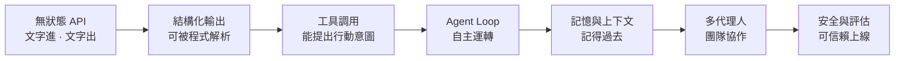

# 序言：從文字接龍到自主代理人

## 一個讓人失眠的週五

半年前的某個週五深夜，我盯著螢幕上一個「看起來很聰明」的客服機器人。它能回答產品問題、能查訂單、甚至會用很有禮貌的語氣道歉。直到一位用戶問它：「如果我現在取消訂單，之前累積的點數怎麼辦？」

它回了一段非常流暢、非常合理、而且完全錯誤的退款規則。

我當下意識到：問題不在模型不夠聰明，而在我們把「文字接龍機」直接推上了生產環境，卻沒有給它大腦、雙手、記憶與剎車。

這本書就是在回答：中間那段路到底該怎麼走。

## 這本書的路線圖

我們從最原始的 LLM API 開始。你會親眼看到它其實只是「給一段文字，回一段文字」——沒有記憶、沒有工具、沒有目標。接著我們一步步加上：

1. **結構化輸出**：讓模型的話能被程式讀懂（第 2 章）。
2. **工具調用**：讓模型能提出「我要查資料」的意圖（第 3 章）。
3. **標準協定**：用 MCP 把工具的世界標準化（第 4 章）。
4. **Agent Loop**：一個 `while` 迴圈，讓模型自己決定下一步（第 5 章）。
5. **設計模式**：ReAct、Planning、Reflection、Human-in-the-Loop（第 6 章）。
6. **記憶與上下文**：在有限的視窗裡塞進正確的資訊（第 7–8 章）。
7. **多代理人與工程落地**：組團隊、上護欄、做評估（第 9–12 章）。

## 為什麼「無框架優先」

我見過太多團隊直接從 LangGraph 或 Agents SDK 起步。三週後 Demo 很漂亮，但沒有人說得清楚：為什麼 Agent 會卡在同一個工具呼叫三次？為什麼成本突然是昨天的五倍？框架把這些細節封裝得太好，好到你出事時找不到縫隙下手。

所以前 6 章我們刻意不用框架。你會自己寫終止條件、自己處理工具錯誤、自己算 token。等你真的被這些髒活磨過，第 10 章再看框架，你會有一種「原來它幫我做的是這件事」的通透感——而不是只會照著文件抄程式。

## 這本書不談什麼

- 不談如何訓練或微調模型。 we use models, we don't build them.
- 不談 Prompt Engineering 的玄學話術。我們談的是可測試、可版本的資料契約。
- 不保證任何模型名稱或定價永遠有效。技術文件會過時，原理不會。

## 寫給誰

寫給那個在週五深夜盯著螢幕、心裡想著「它為什麼會這樣回答」的你。希望你讀完之後，不再把 Agent 當成黑盒子，而是能拆開它、理解它、重新組裝它。

讓我們從第一行 API 呼叫開始。

---

*（本章導讀結束。接續請閱讀 [第 1 章](第01章-解構LLM-API的本質與邊界.md)。）*
