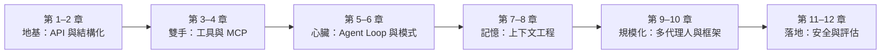

# 從 LLM API 到自主 Agent：現代 AI 系統架構與工程實戰

> 一本「先把底層手刻出來，再談框架」的 AI Agent 工程專書。
>
> 適合對象：有 Python／TypeScript 基礎，不想只當「調包俠」的工程師。

---

## 為什麼寫這本書

市面上談 AI Agent 的書，多半從框架入門。讀者很快能做出一個會動的 Demo，但一旦系統在生產環境出錯——無限迴圈、成本暴衝、工具參數被模型亂填——卻無從下手，因為不知道框架背後到底做了什麼。

這本書反過來：**先用官方 SDK 把迴圈、狀態、工具、記憶一個個手刻出來**，等你被髒活燙過一次，再在第 10 章引入 LangGraph、OpenAI Agents SDK 等框架。這時你會清楚知道框架幫你省了什麼、又藏了什麼。

全書依「**問題場景 → 核心設計模式 → 原生程式碼實作 → 生產環境踩坑指南**」的四段式節奏撰寫，每章都附 Mermaid 示意圖。

> **目錄一致性說明**：原始大綱（`書.md`）自述「5 篇、15 章」，但實際列出的細目為 5 篇、12 章。本書依實際列出的 12 章撰寫；若需要補足 3 章（例如多模態 Agent、Agentic Workflow 成本模型、企業級部署），可在 README 提出後再擴充。

---

## 全書目錄

### 第一篇：地基——從無狀態 API 到結構化大腦

| 章 | 標題 | 檔案 |
|---|---|---|
| 1 | 解構 LLM API 的本質與邊界 | [第01章](第01章-解構LLM-API的本質與邊界.md) |
| 2 | 結構化輸出——打通程式碼與自然語言的橋樑 | [第02章](第02章-結構化輸出.md) |

### 第二篇：雙手與感官——工具調用與標準協定

| 章 | 標題 | 檔案 |
|---|---|---|
| 3 | Function Calling（工具調用）運作機制 | [第03章](第03章-Function-Calling运作机制.md) |
| 4 | Model Context Protocol (MCP) 與生態系整合 | [第04章](第04章-MCP與生態系整合.md) |

### 第三篇：核心引擎——Agent Loop 與單體設計模式

| 章 | 標題 | 檔案 |
|---|---|---|
| 5 | 手刻第一個原生 Agent Loop | [第05章](第05章-手刻第一個原生Agent-Loop.md) |
| 6 | 四大核心 Agent 設計模式 | [第06章](第06章-四大核心Agent設計模式.md) |

### 第四篇：記憶與知識——上下文工程（Context Engineering）

| 章 | 標題 | 檔案 |
|---|---|---|
| 7 | 短期記憶與上下文視窗管理 | [第07章](第07章-短期記憶與上下文視窗管理.md) |
| 8 | Agentic RAG 與長期記憶系統 | [第08章](第08章-Agentic-RAG與長期記憶.md) |

### 第五篇：規模化與生產力——多代理人協作與工程落地

| 章 | 標題 | 檔案 |
|---|---|---|
| 9 | Multi-Agent（多代理人）系統架構 | [第09章](第09章-Multi-Agent系統架構.md) |
| 10 | 主串流開發框架選型與底層對比 | [第10章](第10章-框架選型與底層對比.md) |
| 11 | 安全性、沙盒隔離與護欄（Guardrails） | [第11章](第11章-安全性沙盒與護欄.md) |
| 12 | 評估（Evals）、可觀測性與持續優化 | [第12章](第12章-評估可觀測性與持續優化.md) |

---

## 建議閱讀路線



- **快速入門**：讀 1、3、5、6 章，先做出能動的 Agent。
- **成本與穩定性**：讀 2、7、12 章。
- **企業級架構**：讀 4、8、9、10、11 章。

## 開發環境

所有範例以 Python 3.11+ 為主，依賴精簡：

```bash
pip install openai anthropic python-dotenv pydantic mcp
```

Mermaid 圖可直接在 GitHub、GitLab、Obsidian、VS Code（Markdown Preview Mermaid Support）中.render。

---

## 寫作公約

- 繁體中文、台灣技術用語。
- 每章獨立成檔，可單獨閱讀。
- 「無框架優先」：第 1–6 章只用官方 SDK，第 10 章才談框架。
- 每章皆含：本章導讀 → 問題場景 → 核心設計模式 → 原生程式碼實作 → 生產環境踩坑指南 → 小結／練習題／延伸閱讀。

## 授權與免責

書中程式碼為教學範例，請依實際 SDK 版本調整；API 定價、模型名稱與參數會變動，以官方文件為準。請勿將真實金鑰寫入程式碼或版本控制系統。
