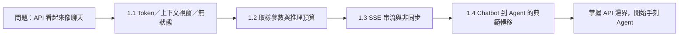
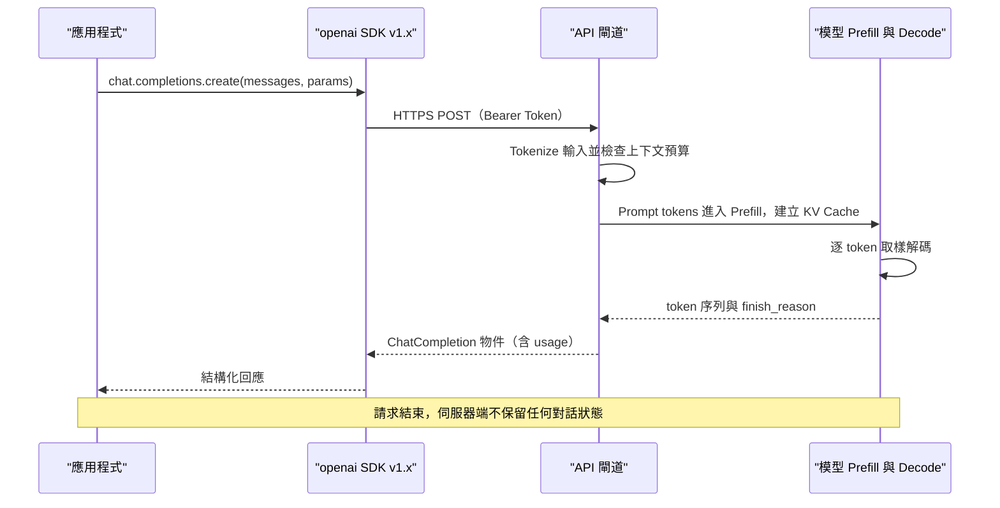
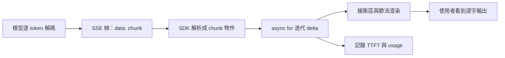
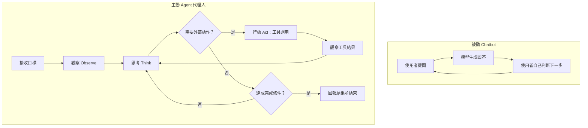

# 第 1 章：解構 LLM API 的本質與邊界

你以為自己在「聊天」，其實你只是在呼叫一個無狀態的機率預測函式。本章從一次 API 呼叫的生命週期出發，拆開 Token、上下文視窗、取樣參數與 SSE 串流，最後對比被動問答的 Chatbot 與主動任務閉環的 Agent（代理人）。讀完你會明白：Agent 不是某種神奇模型，而是工程師在 API 之外補上的那一層迴圈與狀態。

> 本章你將學到
>
> - 看懂一次請求從 token 化、Prefill、Decode 到回應的完整生命週期，理解「無狀態」的真正代價。
> - 把 Temperature、Top-P、Stop Sequences 與推理預算當成工程旋鈕，而非神秘的人格開關。
> - 用 SSE 串流搭配 `asyncio`，把「等待」轉化為使用者可接受的體感即時。
> - 分辨被動問答的 Chatbot 與主動任務閉環的 Agent，知道控制權應該放在哪一層。
> - 寫出具備重試、逾時、錯誤分類與 Token 預算檢查的原生 SDK 呼叫程式。



## 問題場景：上線第三天，客服機器人開始「忘記」自己的規則

某電商團隊把供應商的模型包了一層薄薄的 API，做了一個客服 Chatbot。上線前兩天一切順利：使用者問運費，它答運費；問退貨天數，它答七天。第三天上午，客服主管轉來一張截圖：一位顧客在第十二輪對話時問「那我剛才說的訂單怎麼辦」，robot 回了一段極其禮貌、但完全憑空捏造的退款流程，還把退款規則寫得像一首詩。

工程師的第一個直覺是「模型不夠聰明」，於是換了更貴的模型；第二個直覺是「提示詞不夠有力」，於是把系統提示詞再加五百字。結果延遲從 1.2 秒變成 4.8 秒，帳單翻倍，問題依舊。更微妙的是：同一個問題在單輪測試中永遠答對，只有在長對話裡才出錯。

另一組問題來自前端。使用者看著空白畫面等待三到五秒，然後一次收到整段八十字回答，體感像是「卡住後突然嘖出一篇作文」。產品經理要求「像市面上其他 AI 產品那樣逐字出現」，工程師只好自己在前端用 `setInterval` 把字串一個一個切開——看起來像了，但真正的等待時間一點也沒變。

這兩個痛點看似無關，其實指向同一件事：**我們把一個無狀態的文字預測 API，誤當成一個有記憶、有意圖、有即時性的對話伙伴**。

直覺解法為什麼不夠？

- 「把歷史全部塞回去」確實能延續上下文，但每一次請求都要重新傳一次完整歷史，成本與延遲隨對話長度上升，而且總有塞不下的那一天。
- 「Temperature 調高一點會比較有創意」在客服場景是災難：你要的是穩定一致，不是創意。而且 Temperature 無法保證任何事，它只是改變機率分佈的形狀。
- 「前端逐字打印」只是假裝串流，沒有碰到真正的串流協定，無法提早拿到第一個 token，也無法在生成中途取消請求。
- 「換更強的模型」掩蓋了架構問題：即使模型再強，它依然不知道你上個請求做了什麼，也不會主動決定下一步。

本章要做的，是把這層幻象拆掉。只有先看清楚 API 的邊界在哪裡，我們才知道該在工程層補什麼。

## 核心設計模式：把 API 當成一台機器，而不是一個人

### 1.1 一次呼叫真正發生了什麼

大多數人學 LLM API 是從 `messages` 陣列開始的，但真正重要的單位是 **token**。模型不看「字」，它看的是經由 BPE 之類演算法切出的整數序列。中文一個漢字通常落在 1～2 個 token，英文一個單字可能是 1～3 個 token，標點與空格也算錢。因此「這段話有幾個字」和「這段話要付多少錢」是兩個不同問題。

一次請求可以拆成兩個階段。**Prefill（預填充）**把整段輸入一次讀完，建立注意力機制需要的 KV Cache；**Decode（解碼）**則一個 token 一個 token 地往外生成。這解釋了為什麼「上傳一份三十頁文件再問一個簡短問題」仍然很慢：時間花在 Prefill，不在你的問題。也解釋了第一個 token 的時間（TTFT, Time To First Token）與整體完成時間是兩個獨立指標。



第三個關鍵詞是 **無狀態（Stateless）**。伺服器在回完那一瞬間就忘記了你。你之所以覺得它「記得」，是因為你的應用程式把前面每一輪都重新送了一次。換句話說，「對話歷史」不是模型的記憶，是你自己的資料結構。真正的記憶、摘要、壓縮與快取，都是應用層的責任（第 7、8 章會正式處理）。

**上下文視窗（Context Window）**則是硬上限：輸入 token 加上輸出 token 必須擠在同一個視窗裡。很多人只算輸入，忘了輸出也要留位置，結果回答到一半被 `finish_reason="length"` 切斷。

| 概念 | 工程含義 | 常見誤解 |
| --- | --- | --- |
| Token | 計費、計時、截斷的基本單位 | 以為等於字元數或字數 |
| Prefill | 一次處理完整輸入，建立 KV Cache | 以為「問題很短就很快」 |
| Context Window | 輸入＋輸出的共同預算 | 只算輸入，忘記留輸出空間 |
| Stateless | 每次請求都要自帶全部脈絡 | 以為伺服器幫你記得上一輪 |
| usage | 實際 prompt/completion token 數 | 用字符數自己估算成本 |

最後一個忠告：能塞進上下文，不等於模型真的看清楚了。長度增加時，中段資訊容易被忽略，也就是所謂的「迷失在中間（Lost in the Middle）」。這是第 7 章要解決的問題，但現在你該先建立預算意識：**每送一次請求，都在為整個歷史付費**。

### 1.2 參數不是人格開關

模型在輸出下一個 token 前，會先對詞彙表裡每個候選算出一個分數（logits）。取樣參數作用在「分數變成機率」的這一步。

**Temperature** 會先把 logits 除以 T，再經過 softmax。T 很小（例如 0）時分佈變得尖銳，幾乎總是選最高分；T 變大時分佈被抹平，冷門詞有更多機會。所以 Temperature 控制的是「保守與發散的程度」，不是「親切度」或「創意開關」。客服、抽取、分類任務應該用低值；腦力激盪可以高一點。

**Top-P（nucleus sampling）** 換一個角度：把候選依機率由高到低排序，累加到達 P 就截斷，其餘全部 masking，然後重新正規化。實務上通常「二選一」——要嘛固定 Temperature、Top-P 設 1，要嘛固定 Top-P、Temperature 設 1；同時大幅調整兩者會讓行為很難解釋。

**Stop Sequences** 是字串層級的煞車。模型一旦生成到指定字串就停止，且該字串不包含在回應中。當你用固定分隔符（例如 `\nUSER:`）組織提示詞時，它能避免模型把下一輪使用者的話也「幫你寫出來」，同時省下不必要的 token。

**推理預算（Reasoning Effort）** 是近幾年才出現的旋鈕。在推理模型上，它決定模型花多少「思考 token」再給出答案：調高通常換來較佳的複雜推理能力，代價是延遲、成本與輸出前的等待。要特別注意，推理模型通常不支援 `temperature`、`top_p`，而且 `max_completion_tokens` 會把思考 token 一起算進去——你以為預算給了 1000，實際答案可能只有 200。

| 參數 | 控制的對象 | 典型值 | 副作用與陷阱 |
| --- | --- | --- | --- |
| `temperature` | 機率分佈的尖銳度 | 抽取 0；對話 0.2～0.7 | 推理模型可能直接拒收；`0` 也不是百分之百確定 |
| `top_p` | 候選 token 的累積機率門檻 | 1.0 或 0.9 | 與 Temperature 同時亂調會難以除錯 |
| `stop` | 生成終止的字串 | `["\nUSER:"]` | 分隔符沒出現在輸出時無效 |
| `reasoning_effort` | 思考 token 的多寡 | low / medium / high | 不適合低延遲問答；思考 token 也算在輸出預算裡 |
| `max_tokens` | 輸出上限 | 依任務 | 超標會得到截斷的回應 |
| `seed` | 取樣隨機種子 | 整數 | 多數文件標註為 best-effort，別當成交易保證 |

工程上的建議很樸實：**先把參數固定下來、寫進設定檔，再用評估（Eval）去驗證**。每一次改參數都要能回答「我改善了哪一個可量測指標」。

### 1.3 串流：把延遲變成體感

即使 Prefill 與 Decode 的總時間不變，先看到第一個字與一次看到整段，使用者的感受完全不同。串流（Streaming）的底層通常是 **SSE（Server-Sent Events）**：伺服器回傳 `Content-Type: text/event-stream`，之後每一幀長得像 `data: {...}\n\n`，最後送出 `data: [DONE]`。幀內的 `choices[0].delta.content` 就是新增的文字片段。

有幾個細節常被忽略。第一幀往往只有 `role`，`content` 是空的；最後一幀可能沒有 `choices`，只帶 `usage`。所以迭代時必須先檢查 `choices` 是否為空，否則會吃到 `IndexError`。另外，在 `stream=True` 時要加上 `stream_options={"include_usage": True}`，才會在尾幀拿到 token 用量，否則你的成本追蹤會憑空消失。



前端也要配合。直接把每一次 delta 拿去重新解析完整 Markdown，會造成大量重複工作；比較好的做法是累積原始字串，用約 30～50 ms 的節流更新畫面，等 `finish_reason` 出現再做一次完整剖析。還要記得處理「使用者關閉分頁」：連線中斷後，伺服器可能仍在生成並計費，客戶端應該主動取消請求。

非同步的時機很明確：當你的服務需要同時處理大量並發請求、或串流要與 WebSocket／資料庫寫入交錯進行時，用 `AsyncOpenAI` 搭配 `asyncio`；單機腳本、一次性批次任務用同步版本反而簡單。

### 1.4 從 Chatbot 到 Agent 的典範轉移

前面三節都在描述同一件事：API 只會「你問，它答」。Chatbot 把這個動作包進一個迴圈，但**迴圈的控制權在使用者手上**——下一步做什麼，永遠由人決定。

Agent（代理人）把控制權搬進程式。你給的是「目標」而不是「問題」，程式負責觀察現況、決定下一步、呼叫工具、讀取結果，再判斷是否達成條件。模型仍然只是那個無狀態的預測器，差別在於外面多了一個 while 迴圈、一份狀態、一組工具以及明確的終止條件。



| 維度 | Chatbot | Agent（代理人） |
| --- | --- | --- |
| 輸入 | 具體問題 | 目標與成功條件 |
| 控制流程 | 人在迴圈裡 | 程式在迴圈裡 |
| 下一步 | 使用者輸入 | 模型提案＋程式仲裁 |
| 外部副作用 | 幾乎沒有 | 工具調用與狀態寫入 |
| 終止 | 使用者不再問 | 條件成立、預算耗盡或人為中斷 |
| 失敗處理 | 重新問一次 | 重試、改規劃、升級給人 |

這正是本書「無框架優先」的理由。第 3～6 章我們會用官方 SDK 與純 Python 把工具調用、迴圈、終止與反思一層層手刻出來；等讀到第 10 章再看框架，你會清楚知道框架到底幫你搬家了哪些磚，而不是只會呼叫 `Agent.run()`。

## 原生程式碼實作：三個可直接執行的起點

> 以下範例以 Python 3.11+、`openai-python` v1.x、`pydantic` v2 為例。的金鑰一律由 `.env` 讀取，不要寫死在程式裡。

首先是同步呼叫的底座。我們自己實作重試而非使用 SDK 內建的 `max_retries`，是為了清楚區分「值得重試」與「重試也不會變好」的錯誤。

```python
# agent/ch01/basics.py
"""最小但可上線的 LLM 呼叫：Token 計數、參數、重試與錯誤分類。"""
from __future__ import annotations

import os
import random
import time
from dataclasses import dataclass

import tiktoken
from dotenv import load_dotenv
from openai import (
    APIConnectionError,
    APIError,
    APITimeoutError,
    OpenAI,
    RateLimitError,
)

load_dotenv()  # .env: OPENAI_API_KEY=sk-...

# max_retries=0：重試策略由我們自己控制，才不會出現雙層重試
client = OpenAI(api_key=os.environ["OPENAI_API_KEY"], timeout=30.0, max_retries=0)
ENCODING = tiktoken.encoding_for_model("gpt-4o")


def count_tokens(text: str) -> int:
    """用官方 tokenizer 估算 token 數，不要用字數除 4 這種近似。"""
    return len(ENCODING.encode(text))


@dataclass(frozen=True)
class Reply:
    content: str
    prompt_tokens: int
    completion_tokens: int
    finish_reason: str


RETRYABLE = (RateLimitError, APITimeoutError, APIConnectionError)


def chat(
    messages: list[dict[str, str]],
    *,
    model: str = "gpt-4o",
    temperature: float = 0.2,
    top_p: float = 1.0,
    max_tokens: int = 512,
    stop: list[str] | None = None,
    context_limit: int = 128_000,
    retries: int = 3,
) -> Reply:
    prompt_tokens = sum(count_tokens(str(m.get("content", ""))) for m in messages)
    if prompt_tokens + max_tokens > context_limit:
        raise ValueError(f"上下文預算超標：{prompt_tokens} + {max_tokens}")

    for attempt in range(1, retries + 1):
        try:
            resp = client.chat.completions.create(
                model=model,
                messages=messages,
                temperature=temperature,
                top_p=top_p,
                max_tokens=max_tokens,
                stop=stop,
            )
            choice = resp.choices[0]
            usage = resp.usage
            return Reply(
                content=choice.message.content or "",
                prompt_tokens=usage.prompt_tokens if usage else 0,
                completion_tokens=usage.completion_tokens if usage else 0,
                finish_reason=choice.finish_reason or "",
            )
        except RETRYABLE as exc:
            if attempt == retries:
                raise
            # 指數退避 + jitter，避免大量實例同時重試造成雷鳴群效應
            time.sleep(min(2 ** attempt, 8) + random.uniform(0, 0.3))
        except APIError as exc:
            # 參數不支援、內容政策拒絕等 4xx，重試不會變好
            raise RuntimeError(f"不可重試的 API 錯誤：{exc}") from exc

    raise AssertionError("unreachable")


def reason_once(prompt: str) -> Reply:
    """推理模型：不設 temperature/top_p，改用推理預算。"""
    resp = client.chat.completions.create(
        model="o3-mini",
        messages=[{"role": "user", "content": prompt}],
        reasoning_effort="low",
        max_completion_tokens=1024,  # 注意：思考 token 也算在這裡
    )
    choice = resp.choices[0]
    usage = resp.usage
    return Reply(
        content=choice.message.content or "",
        prompt_tokens=usage.prompt_tokens if usage else 0,
        completion_tokens=usage.completion_tokens if usage else 0,
        finish_reason=choice.finish_reason or "",
    )


if __name__ == "__main__":
    answer = chat(
        [
            {"role": "system", "content": "你是電商客服，回答不超過兩句。"},
            {"role": "user", "content": "退貨期限是幾天？"},
        ],
        temperature=0,
        stop=["\nUSER:"],
    )
    print(answer.content, answer.prompt_tokens, answer.completion_tokens)
```

這段程式示範了四件事：送請求前先算預算、把錯誤分成可重試與不可重試、保留 `usage` 供成本追蹤，以及針對推理模型走不同的參數路徑。

第二個檔案處理串流。非同步版本能同時服務多個連線，也能在等待第一個 token 時做別的事。

```python
# agent/ch01/streaming.py
"""SSE 串流的非同步消耗：TTFT 記錄、增量回呼、優雅降級。"""
from __future__ import annotations

import asyncio
import os
import time
from collections.abc import Awaitable, Callable

from dotenv import load_dotenv
from openai import APIConnectionError, APITimeoutError, AsyncOpenAI

load_dotenv()
aclient = AsyncOpenAI(api_key=os.environ["OPENAI_API_KEY"], timeout=30.0)

DeltaHandler = Callable[[str], Awaitable[None]]


async def stream_answer(question: str, on_delta: DeltaHandler) -> str:
    parts: list[str] = []
    started = time.perf_counter()
    try:
        async with aclient.chat.completions.create(
            model="gpt-4o",
            messages=[{"role": "user", "content": question}],
            temperature=0.2,
            stream=True,
            stream_options={"include_usage": True},  # 尾幀才會帶 usage
        ) as stream:
            async for chunk in stream:
                if not chunk.choices:
                    continue  # 最後一幀可能只有 usage
                choice = chunk.choices[0]
                if choice.delta.content:
                    if not parts:
                        print(f"TTFT = {time.perf_counter() - started:.2f}s")
                    parts.append(choice.delta.content)
                    await on_delta(choice.delta.content)  # 推送到 WebSocket 等
                if choice.finish_reason == "length":
                    await on_delta("\n[警告] 輸出被截斷")
            return "".join(parts)
    except (APITimeoutError, APIConnectionError) as exc:
        # 串流中途失敗：已送出的文字不能收回，交給上層決定是否重新生成
        await on_delta(f"\n[串流中斷] {exc}")
        return "".join(parts)


async def main() -> None:
    async def render(delta: str) -> None:
        print(delta, end="", flush=True)

    text = await asyncio.wait_for(
        stream_answer("用三句話解釋什麼是無狀態 API。", render), timeout=60
    )
    print(f"\n完成，共 {len(text)} 字元")


if __name__ == "__main__":
    asyncio.run(main())
```

如果你想知道 SDK 幫你藏在衍生物裡的細節，下面用 `httpx` 直接讀 SSE 原始幀。這段程式很適合拿來驗證「串流到底是什麼」。

```python
# agent/ch01/sse_wire.py
"""不透過 SDK，直接讀 SSE 原始幀，用來看懂協定。"""
import asyncio
import json
import os

import httpx
from dotenv import load_dotenv

load_dotenv()

URL = "https://api.openai.com/v1/chat/completions"


async def raw_sse(question: str) -> None:
    payload = {
        "model": "gpt-4o",
        "messages": [{"role": "user", "content": question}],
        "stream": True,
    }
    headers = {
        "Authorization": f"Bearer {os.environ['OPENAI_API_KEY']}",
        "Content-Type": "application/json",
    }
    async with httpx.AsyncClient(timeout=httpx.Timeout(30.0, read=None)) as http:
        async with http.stream("POST", URL, json=payload, headers=headers) as resp:
            resp.raise_for_status()
            async for line in resp.aiter_lines():
                if not line.startswith("data: "):
                    continue
                data = line.removeprefix("data: ")
                if data == "[DONE]":
                    break
                chunk = json.loads(data)
                delta = chunk["choices"][0]["delta"].get("content", "")
                if delta:
                    print(delta, end="", flush=True)


if __name__ == "__main__":
    asyncio.wait_for(raw_sse("說一句話。"), timeout=60)  # 自己做總逾時
```

最後是一個刻意「很陽春」的 Agent 雛形。它沒有工具，只有控制權翻轉的示意；第 5 章才會把它補成真正的迴圈。

```python
# agent/ch01/agent_seed.py
"""Agent 雛形：控制流程從使用者手上搬到程式裡。"""
from basics import chat


def run_agent(goal: str, max_steps: int = 5) -> str:
    history = [
        {"role": "system", "content": "逐步處理目標；完成時以 DONE: 開頭。"},
        {"role": "user", "content": goal},
    ]
    for _ in range(max_steps):
        reply = chat(history, temperature=0)
        history.append({"role": "assistant", "content": reply.content})
        if "DONE:" in reply.content:
            return reply.content.split("DONE:", 1)[1].strip()
        # 真實系統在這裡呼叫工具，並把結果放回 history（見第 3～5 章）
        history.append({"role": "user", "content": "請繼續下一步。"})
    raise RuntimeError("超過最大步數，需要終止條件與檢查點")


if __name__ == "__main__":
    print(run_agent("比較兩種資料庫並給出建議"))
```

對比一下：Chatbot 版本會等使用者輸入下一句；Agent 版本自己決定何時停。這個差異看似微小，卻是後面所有章節的地基。

## 生產環境踩坑指南

### 坑 1：把「對話歷史」當成模型的記憶

- **症狀**：對話到第 20 輪，延遲與帳單同時爆增，模型開始忽略前面的規則。
- **原因**：每次請求都重送完整歷史，成本近似隨長度平方成長；中段資訊還會被稀釋。
- **解法**：先設 `max_history_tokens` 硬上限；超出時用滑動視窗或摘要替代（第 7 章）。在送請求前用 `tiktoken` 做預算檢查，不要事後才看帳單。

### 坑 2：以為 `temperature=0` 就等於完全確定

- **症狀**：同一組輸入偶爾仍出現不同用字，或推理模型直接回 400。
- **原因**：貪心解碼在多數實作中仍是 best-effort；推理模型不支援該參數。
- **解法**：需要穩定結構時改用 Structured Outputs（第 2 章）；推理模型走 `reasoning_effort`，不要沿用同一份參數表。

### 坑 3：串流中斷後直接整個重試

- **症狀**：使用者看到兩次開頭，或費用翻倍。
- **原因**：第一串流已經送出部分 delta，重試等於重新生成一次完整回應。
- **解法**：只有「尚未送出任何 delta」時才自動重試；否則保留已收到內容，標記為部分回應，讓使用者手動重來。理想狀況下為請求帶上 idempotency key。

### 坑 4：忘了處理輸出 token 上限

- **症狀**：JSON 只回了一半，或解答在結尾前被切斷，`finish_reason="length"` 無人檢查。
- **原因**：上下文視窗是輸入＋輸出，許多人只算輸入。
- **解法**：把 `finish_reason` 放進日誌與告警；預留輸出預算；推理模型改用 `max_completion_tokens` 並記得思考 token 也包含在內。

### 坑 5：前端逐字重新解析 Markdown

- **症狀**：長回應時頁面明顯卡頓，捲軸亂跳。
- **原因**：每收到一個 delta 就重新剖析整份累積字串。
- **解法**：累積原始字串，以 30～50 ms 節流渲染；完成後再做一次完整剖析與語法高亮。

### 坑 6：沒有總逾時與取消機制

- **症狀**：使用者關閉分頁後，背景連線仍掛著並持續計費。
- **原因**：只設了 HTTP read timeout，沒有請求層級的總時限。
- **解法**：用 `asyncio.wait_for` 包住串流協程，並在前端 `AbortController`／WebSocket 關閉時通知後端取消。

## 小結

- LLM API 是無狀態的 token 預測器；你感受到的「記憶」全部由應用程式自己維護。
- 上下文視窗是輸入與輸出共享的預算，送請求前就該用 tokenizer 算清楚。
- 取樣參數控制的是機率分佈與終止行為，寫進設定檔並用評估驗證，別憑感覺調整。
- 推理模型是另一套參數路徑：用推理預算，不要設 Temperature／Top-P。
- SSE 串流改善的是體感延遲與取消能力，不是總生成時間；搭配 `asyncio` 才能處理並發。
- Agent 與 Chatbot 的關鍵差異是「誰掌握迴圈與下一步」，而不是模型有多聰明。

## 練習題

1. 取一段 300 字的中文文章，用 `tiktoken` 計算 token 數，再與「字數 ÷ 4」的近似比較。把結果寫成一個 `count_budget(messages, max_output)` 函式，超過 8,000 token 就 raise。
2. 修改 `streaming.py`，同時統計 TTFT、總耗時與平均每秒 token 數；再刻意把 `stream_options` 拿掉，觀察 `usage` 消失後你的成本追蹤會出什麼問題。
3. 把 `agent_seed.py` 的 `run_agent` 改成「遇到輸出中包含 `NEED_TOOL:` 就形式上記錄一次工具呼叫，並把假結果放回 history」。寫完後回答：如果工具永遠失敗，你的終止條件是什麼？該如何避免無限迴圈？

## 延伸閱讀

- [OpenAI：Text generation 指南](https://platform.openai.com/docs/guides/text-generation)——token、參數與輸出控制的官方說明。
- [OpenAI API：Chat Completions 參考文件](https://platform.openai.com/docs/api-reference/chat/create)——`stream_options`、`stop`、`finish_reason` 的精確定義。
- [OpenAI Cookbook：How to stream completions](https://cookbook.openai.com/examples/how_to_stream_completions)——同步與非同步串流的官方範例。
- [openai/tiktoken](https://github.com/openai/tiktoken)——官方 tokenizer 實作與模型對應表。
