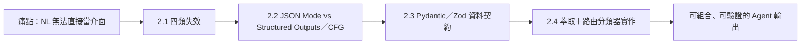
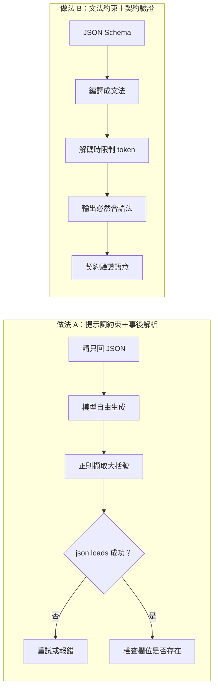
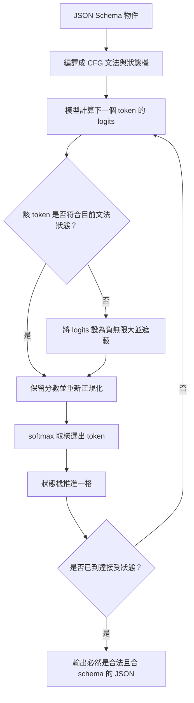

# 第 2 章：結構化輸出——打通程式碼與自然語言的橋樑

模型天生擅長生成文字，程式天生需要穩定的型別。兩者之間那道裂隙，是無數 Agent 上線後崩潰的起點。本章從「自然語言為什麼不適合當介面」講起，拆解 JSON Mode 與 Structured Outputs（結構化輸出）的底層差異——尤其是 CFG 文法如何在解碼當下封鎖不合法 token——再以 Pydantic／Zod 建立單一真實來源的資料契約（Data Contract），最後手刻一個具備重試與路由的分類萃取器。

> 本章你將學到
>
> - 辨識自然語言輸出在系統整合中的四類失效：語法漂移、型別漂移、語意歧義、不可組合。
> - 說清楚 JSON Mode 與 Structured Outputs 的差別：一個事後檢查，一個事前約束。
> - 理解 CFG（上下文無關文法）如何把 JSON Schema 編譯成解碼階段的 token 遮罩。
> - 用 Pydantic v2（或 TypeScript 的 Zod）定義同時供生成與驗證使用的強型別契約。
> - 打造一個會把驗證錯誤回饋給模型、並依意圖分派的資料萃取與路由分類器。



## 問題場景：正則表達式撐不起來的資料管線

一家金融科技新創要做「客服信件自動分單」。需求聽起來很單純：從信件中抽出退款金額、幣別、訂單編號與預期日期，再依意圖路由到退款組、取消組或客訴組。第一版工程師寫了一條提示詞：

> 請閱讀以下信件，只回傳 JSON，不要有任何其他文字。

然後用 `re.search(r"\{.*\}", text, re.S)` 把第一個大區塊撈出來，丟給 `json.loads`。上線第一天就有 12% 失敗。失敗的樣態五花八門：

- 模型回「好的，這是您要的 JSON：」再接一個 Markdown code fence，正則把前綴一起吃進去。
- 金額有時是 `"1250"`，有時是 `1250`，有時是 `"1,250 元"`；下游的 `float()` 直接炸掉。
- 沒有明確金額時，模型自行補了 `0`，有時又補 `null`，有時乾脆省略欄位。
- 「下週三」被寫成 `next Wednesday`，下游需要的卻是 ISO 8601 日期。
- 最糟的一次，模型把「我想取消訂單」判成 refund，錢就這樣進了退款流程。

工程師的直覺是「再加強提示詞」：把「只回 JSON」改成「只回合法 JSON！不要加任何說明！重要性：極高」。失敗率從 12% 降到 8%，但沒有歸零。於是他開始寫更長的正則、更多的 `try/except`、更多的「如果欄位不存在就…」補丁。三週後，這段解析程式比真正的商業邏輯還長，而且沒有人敢改。

問題的根源在於：**提示詞是建議，不是保證**。模型是在做機率性的文字接龍，它「傾向於」照做，但沒有任何機制讓它「不可能」違反格式。只要輸出還要經過一道字串解析，你的系統就永遠存在一個隨機失敗的入口。而在一條十步的 Agent 流程裡，若每一步成功率是 98%，整體成功率就只剩 `0.98¹⁰ ≈ 0.82`——接近五分之一的任務會莫名其妙地失敗。

第二個直覺是「那我自己寫個 JSON  validator 不就好了？」 validator 確實必要，但它只能事後告訴你「壞了」，不能讓它不壞。要真正降低失敗率，必須把約束推進生成過程本身。

## 核心設計模式：把格式從「請求」變成「文法」

### 2.1 為什麼自然語言是系統整合的噩夢

自然語言是人與人之間的介面，不是程式與程式之間的介面。它缺少程式需要的三個性質：明確的語法、穩定的型別、以及可窮舉的取值範圍。

| 失效類型 | 典型樣態 | 對系統的衝擊 |
| --- | --- | --- |
| 語法漂移 | code fence、前綴問候、多餘逗點 | `json.loads` 直接失敗 |
| 型別漂移 | `"1250"` vs `1250` vs `null` | 下游轉型例外、資料欄位污染 |
| 語意歧義 | 「下週三」沒有參照日期 | 看似合法但其實錯誤的值 |
| 不可組合 | 欄位時有時無、命名不一致 | 無法定義穩定介面，每次都要寫補丁 |

值得注意的是，四類問題的性質不同。語法漂移可以靠文法約束解決；型別漂移可以靠 Schema 解決；**語意歧義只能靠更好的提示詞、脈絡與應用層驗證解決**；不可組合則需要契約設計。把它們混為一談，就會出現「我都用 Structured Outputs 了，為什麼答案還是錯？」的誤解。

工程上還有一個更隱蔽的成本：不確定的輸出會讓「失敗」變得不可觀測。你不知道這是模型能力問題、提示詞問題還是解析問題，因為所有失敗都被同一個 `except` 吞掉了。這也是第 12 章要談追蹤與評估的原因。



### 2.2 JSON Mode 與 Structured Outputs 的底層機制

**JSON Mode** 的使用方式很簡單：

```python
response_format={"type": "json_object"}
```

它只保證一件事：回應是**合法的 JSON**。不保證欄位名稱、不保證型別、不保證你需要的 key 一定存在。文件還要求訊息中必須出現 `json` 這個字，否則 API 會拒絕。它適合「我只要一段能 parse 的 JSON，結構我自己看」的輕量場景，但對資料管線來說遠遠不夠。

**Structured Outputs（結構化輸出）** 則更進一步：

```python
response_format={
    "type": "json_schema",
    "json_schema": {
        "name": "extraction",
        "strict": True,
        "schema": {...},  # 你的 JSON Schema
    },
}
```

在 `strict=True` 且 Schema 落在支援範圍內時，模型輸出**保證符合 Schema**。差別不在「模型更乖」，而在生成机制本身。



這張圖就是 **CFG（Context-Free Grammar，上下文無關文法）約束解碼** 的核心：把 Schema 變成一套「現在可以接什麼」的規則。每生成一個 token，就在 softmax 之前把不合法的候選遮蔽掉（機率為 0）。因此模型不是「被提醒要寫正確格式」，而是**在物理上沒有機會寫出錯誤格式**。這也解釋了為什麼 Structured Outputs 不太需要「重試格式」——格式錯誤在解碼時根本不會發生。

不過它有清楚邊界，千萬別誤用：

- **只保證結構，不保證語意。** 欄位一定在、型別一定對，但金額可以是錯的、日期可以是幻覺。
- **strict 模式要求所有欄位必填，且物件要 `additionalProperties: false`。** 少了這兩件事，API 可能直接回 400。
- **只支援 JSON Schema 的子集。** 像是 `minLength`、`maximum`、`pattern` 等驗證型關鍵字在 strict 模式下可能被忽略或拒絕；把限制寫進 `description`，再交給應用程式驗證。
- **帶有 `$defs`／`$ref`、`anyOf` 或遞迴結構的 Schema 要特別小心。** 有些版本支援，有些不支援；最穩妥的做法是攤平模型或自行解析引用。
- **首次使用一個新 Schema 時，延遲可能偏高**，因為文法需要準備；高流量場景要預熱。
- **不是每個模型都支援。** 上線前用你的目標模型實測一次，不要假設所有模型行為一致。

> > 以 openai-python v1.x 為例；推理模型與 Structured Outputs 的組合支援度隨版本變動，請以官方文件與實測為準。

### 2.3 用 Pydantic／Zod 建立強型別資料契約

既然 Schema 如此關鍵，就不應該讓它和程式碼中的型別各寫一份——兩份遲早會不同步。正確做法是 **單一真實來源（Single Source of Truth）**：定義一個 Pydantic 模型，同時拿它產生送給 API 的 JSON Schema，以及拿它驗證回傳內容。

Pydantic v2 的兩個方法剛好對應這兩件事：

- `Model.model_json_schema()`：產生 JSON Schema，送進 `response_format`。
- `Model.model_validate_json(raw)`：把模型回傳的字串驗證成強型別物件。

設計契約時有幾個實用原則：

1. **用 `Literal` 或 `Enum` 取代自由字串。** 路由意圖只有四種，就別給模型無限多種寫法。
2. **每個欄位都必填，沒有值就用明確的哨兵值**（例如空字串或 0），並在 `description` 寫清楚規則。這是為了配合 strict 模式。
3. **`description` 是寫給模型看的指令**，不是給工程師看的註解。把「若無明確金額請填 0」這種規則直接寫進去。
4. **不要巢狀太深。** 攤平的結構更容易通過 Schema 檢查，也更容易驗證。
5. **數值範圍交給應用程式檢查**，不要在 Schema 裡放 strict 模式不保證支援的關鍵字。

TypeScript 陣營的對應工具是 Zod。Zod 3 搭配 `zod-to-json-schema`，Zod 4 則可用內建的 `z.toJSONSchema()`。兩者都能從同一份 schema 同時得到靜態型別與 JSON Schema。

### 2.4 資料萃取與路由分類器：完整設計

我們要做的系統有兩層：

1. **萃取層**：一次 API 呼叫同時完成意圖分類與欄位抽取，回傳強型別的 `Extraction`。
2. **路由層**：依 `intent` 分派到不同處理函式，完全不碰字串比對。

關鍵設計是「失敗回饋」：當驗證失敗時，不是默默重試同一個提示詞，而是把 `ValidationError` 的內容放回訊息歷史，明確告訴模型哪裡不對。這讓每一次重試都比上一次擁有更多資訊。同時保留 async 版本，因為真實服務通常要並處理數百封信件。

## 原生程式碼實作：從契約到分類器

> 以下範例以 Python 3.11+、`openai-python` v1.x、`pydantic` v2 為例。

#### 資料契約：`agent/ch02/contracts.py`

```python
# agent/ch02/contracts.py
"""單一真實來源：同一份模型同時產生 Schema 並驗證回應。"""
from __future__ import annotations

import json
from typing import Literal

from pydantic import BaseModel, ConfigDict, Field

Intent = Literal["refund", "cancel", "complaint", "other"]
Currency = Literal["TWD", "USD", "UNKNOWN"]


class Extraction(BaseModel):
    # extra="forbid" 會轉成 additionalProperties: false，符合 strict 模式要求
    model_config = ConfigDict(extra="forbid")

    intent: Intent = Field(
        description="信件意圖：refund 退款、cancel 取消訂單、complaint 客訴、other 其他"
    )
    amount: float = Field(
        description="退款或爭議金額，純數字；沒有明確金額時填 0"
    )
    currency: Currency = Field(
        description="幣別；沒有明確標示時填 UNKNOWN"
    )
    order_id: str = Field(
        description="訂單編號；沒有時填空字串，不要猜測"
    )
    due_date: str = Field(
        description="ISO 8601 日期（YYYY-MM-DD）；相對日期請以信件日期 2026-11-27 推算，無法判斷填空字串"
    )
    summary: str = Field(
        description="不超過 30 字的中文摘要"
    )


def build_schema() -> dict:
    """產生送給 response_format 的 JSON Schema。"""
    schema = Extraction.model_json_schema()
    # 注意：若未來加入巢狀模型，schema 可能出現 $defs/$ref，
    # 上線前務必用目標模型實測是否接受。
    return schema


if __name__ == "__main__":
    print(json.dumps(build_schema(), ensure_ascii=False, indent=2))
```

這裡刻意不用 `Optional`：`Optional[str]` 會產生 `anyOf` 結構，在 strict 模式下比較容易踩到相容性問題。改用「哨兵值＋清楚描述」反而更穩定，也讓下游永遠拿到同樣的型別。

#### 重試與回饋：`agent/ch02/extractor.py`

```python
# agent/ch02/extractor.py
"""高可靠性萃取＋路由分類器：結構化輸出、驗證回饋、重試與分派。"""
from __future__ import annotations

import asyncio
import logging
import os

from dotenv import load_dotenv
from openai import (
    APIConnectionError,
    APITimeoutError,
    AsyncOpenAI,
    BadRequestError,
    RateLimitError,
)
from pydantic import ValidationError

from contracts import Extraction, build_schema

load_dotenv()
log = logging.getLogger(__name__)

MODEL = "gpt-4o-2024-08-06"  # 確認此模型支援 Structured Outputs
MAX_ATTEMPTS = 3
RETRYABLE = (RateLimitError, APITimeoutError, APIConnectionError)

aclient = AsyncOpenAI(
    api_key=os.environ["OPENAI_API_KEY"], timeout=30.0, max_retries=0
)

SYSTEM = (
    "你是客服信件解析器。請依照 schema 描述填入每一個欄位。"
    "不要推測看不出來的資訊；相對日期以信件日期 2026-11-27 為基準。"
)


def sanity_check(result: Extraction) -> None:
    """結構保證不了語意：應用層自己檢查合理範圍。"""
    if result.intent == "refund" and result.amount <= 0:
        raise ValueError("refund 意圖必須有正數金額，目前為 0")
    if result.due_date:
        try:
            year, month, day = map(int, result.due_date.split("-"))
            if len(result.due_date) != 10 or not (1 <= month <= 12 and 1 <= day <= 31):
                raise ValueError
        except ValueError as exc:
            raise ValueError(f"due_date 不是有效的 YYYY-MM-DD：{result.due_date}") from exc


async def extract(text: str) -> Extraction:
    messages = [
        {"role": "system", "content": SYSTEM},
        {"role": "user", "content": text},
    ]

    for attempt in range(1, MAX_ATTEMPTS + 1):
        try:
            resp = await aclient.chat.completions.create(
                model=MODEL,
                messages=messages,
                temperature=0,
                response_format={
                    "type": "json_schema",
                    "json_schema": {
                        "name": "extraction",
                        "strict": True,
                        "schema": build_schema(),
                    },
                },
            )
            raw = resp.choices[0].message.content or ""
            result = Extraction.model_validate_json(raw)
            sanity_check(result)
            usage = resp.usage
            log.info(
                "萃取成功 attempt=%s prompt=%s completion=%s",
                attempt,
                usage.prompt_tokens if usage else 0,
                usage.completion_tokens if usage else 0,
            )
            return result

        except (ValidationError, ValueError) as exc:
            # 把錯誤回饋給模型，而不是毫無資訊地重試
            if attempt == MAX_ATTEMPTS:
                raise RuntimeError(f"驗證重試用盡：{exc}") from exc
            messages.append({"role": "assistant", "content": raw})
            messages.append(
                {
                    "role": "user",
                    "content": f"上一次輸出未通過驗證：{exc}。請重新輸出符合 schema 的 JSON。",
                }
            )
            log.warning("驗證失敗，準備回饋重試：%s", exc)

        except BadRequestError as exc:
            # 通常是 schema 不被接受（strict 規則、關鍵字、模型不支援）
            raise RuntimeError(f"請求被拒，請檢查 Schema：{exc}") from exc

        except RETRYABLE as exc:
            if attempt == MAX_ATTEMPTS:
                raise
            await asyncio.sleep(min(2**attempt, 8))  # 指數退避

    raise AssertionError("unreachable")


def dispatch(result: Extraction) -> str:
    """路由層只看強型別欄位，不再碰任何字串解析。"""
    match result.intent:
        case "refund":
            return f"轉退款組：訂單 {result.order_id}，金額 {result.amount} {result.currency}"
        case "cancel":
            return f"轉取消組：訂單 {result.order_id}"
        case "complaint":
            return f"轉客訴組：{result.summary}"
        case _:
            return "轉一般客服佇列"


async def handle_many(letters: list[str]) -> list[str]:
    """並行處理多封信；用 gather 而不是一層層 await。"""
    results = await asyncio.gather(
        *(extract(letter) for letter in letters), return_exceptions=True
    )
    output: list[str] = []
    for letter, result in zip(letters, results):
        if isinstance(result, Exception):
            output.append(f"[需要人工處理] {result} | 原文：{letter[:30]}…")
        else:
            output.append(dispatch(result))
    return output


if __name__ == "__main__":
    logging.basicConfig(level=logging.INFO)
    sample = (
        "你好，我的訂單 A-10293 收到瑕疵品，想申請退款 1,250 元，"
        "希望下週三前處理完畢。"
    )
    print(asyncio.run(handle_many([sample])))
```

這段程式有幾個刻意設計：

- `sanity_check` 把「語意合理性」從 Schema 中分離出來，避免把驗證 responsibility 推給不支援驗證關鍵字的 strict 模式。
- 驗證失敗時把模型原本的輸出放回 `assistant` 訊息，再以 `user` 訊息附上錯誤；這讓模型知道「你剛剛寫了什麼」以及「哪裡錯了」。
- `BadRequestError` 單獨處理，因為它通常代表 Schema 設計問題，重試一百次也不會變好。
- `handle_many` 用 `asyncio.gather(..., return_exceptions=True)`，讓單封失敗不拖垮整批；失敗者被丟進人工佇列，而不是被 silently 忽略。

#### TypeScript 版本：`agent/ch02/contracts.ts`

如果你的前端或 Node 服務也要用同一份契約，Zod 是常見選擇。

```ts
// agent/ch02/contracts.ts
// Zod 3 寫法；若用 Zod 4，可改為 Extraction.toJSONSchema()
import { z } from "zod";
import { zodToJsonSchema } from "zod-to-json-schema";

export const ExtractionSchema = z.object({
  intent: z.enum(["refund", "cancel", "complaint", "other"]),
  amount: z.number(),
  currency: z.enum(["TWD", "USD", "UNKNOWN"]),
  order_id: z.string(),
  due_date: z.string(),
  summary: z.string(),
});

export type Extraction = z.infer<typeof ExtractionSchema>;

const jsonSchema = zodToJsonSchema(ExtractionSchema, {
  name: "extraction",
  target: "openApi",
});
// 將 jsonSchema 送進 response_format.json_schema.schema
// 收到回應後用 ExtractionSchema.parse(JSON.parse(raw)) 驗證
```

> 以 `zod-to-json-schema` v3.x 為例；Zod 4 已有內建 `z.toJSONSchema()`，舊版本請以實際安裝的版本為準。

請注意：Python 與 TypeScript 兩份契約仍是人為維護的「兩份」，跨語言團隊應該把 Schema 抽成獨立的 `.json` 檔，再由兩邊讀取，或用程式碼產生工具從單一來源生成。

## 生產環境踩坑指南

### 坑 1：以為 Structured Outputs 保證答案正確

- **症狀**：JSON 完美通過驗證，但退款金額被模型憑空捏造。
- **原因**：文法約束只管「長相」，不管「事實」。
- **解法**：保留 `sanity_check` 一類的應用層規則；高風險欄位（金額、日期、帳號）交叉比對原始文字或外部系統，並保留原文供稽核。

### 坑 2：strict 模式忘了必填與 `additionalProperties: false`

- **症狀**：API 直接回 400，錯誤訊息提到 `strict`、`required` 或 `additionalProperties`。
- **原因**：strict 模式要求所有欄位都列在 `required`，物件必須禁止額外欄位。
- **解法**：Pydantic 使用 `ConfigDict(extra="forbid")` 且不要給欄位預設值；把 `BadRequestError` 當成設定錯誤而非暫時性錯誤，不要重試。

### 坑 3：把 JSON Mode 當成 Schema 保證

- **症狀**：明明設了 `json_object`，還是少欄位、型別亂掉。
- **原因**：JSON Mode 只保證合法性，不保證結構；且提示詞中若沒有 `json` 字樣會被拒絕。
- **解法**：需要穩定介面一律用 `json_schema` + `strict=True`；JSON Mode 留給「只要能 parse」的探索性用途。

### 坑 4：`$defs`、`anyOf` 與驗證關鍵字踩到相容性地雷

- **症狀**：Schema 被拒，或是限制（例如 `maximum`）明明寫了卻没生效。
- **原因**：strict 模式只支援 JSON Schema 子集，不同模型與 SDK 版本支援度不同。
- **解法**：用 `Literal` 代替 `Optional`／巢狀 enum；把數值與長度限制寫進 `description`，並在應用程式驗證；上線前用目標模型做一次 Schema 相容性測試。

### 坑 5：重試時不帶錯誤回饋

- **症狀**：同一個語意錯誤連續出現三次，白白多花三倍 token。
- **原因**：每次重試都是全新的、完全一樣的提示詞。
- **解法**：把驗證錯誤訊息與上一次輸出放回訊息歷史（如 `extract` 所示），並限制最大嘗試次數；若三次都失敗，交給人工或降級流程。

### 坑 6：串流＋結構化輸出時邊收邊解析

- **症狀**：拿到的 JSON 只到一半，`json.loads` 失敗。
- **原因**：把逐字 delta 直接當成完整 JSON 處理。
- **解法**：先將所有 delta 拼成完整字串，等 `finish_reason` 出現後再一次驗證。若需要即時回饋，只渲染摘要文字，不要渲染尚未完成的 JSON。

### 坑 7：首次使用新 Schema 的延遲尖峰

- **症狀**：冷啟動的第一個請求特別慢，之後就快了。
- **原因**：文法／約束需要準備。
- **解法**：服務啟動時用一個小範例預熱每個 Schema；把這個延遲納入 TTFT 監測，避免誤判為模型故障。

## 小結

- 自然語言輸出有四類失效：語法漂移、型別漂移、語意歧義與不可組合；不是全部都能靠提示詞修好。
- JSON Mode 只保證合法 JSON；Structured Outputs 保證符合 Schema，差別在生成机制而非模型聽話程度。
- CFG 約束解碼會在 softmax 前遮蔽不合法 token，讓錯誤格式「不可能被生成」，而非事後補救。
- 結構正确不等於內容正確；語意驗證仍须由應用程式負責。
- Pydantic／Zod 模型應該是單一真實來源：同一份定義既產生 Schema，也驗證回應。
- 失敗回饋＋指數退避＋人工降級，才是能在生產環境活下來的重試策略。

## 練習題

1. 把 `Extraction` 加入一個巢狀的 `Address` 模型（含城市、郵遞區號），呼叫 `build_schema()` 观察是否出現 `$defs`／`$ref`。用目標模型實測 strict 模式是否接受；若不接受，改寫成攤平欄位並比較差異。
2. 刻意把 `due_date` 改成 `Optional[str] = None`，重新產生 Schema。記錄 API 的反應，並對照本章「用哨兵值取代 Optional」的建議，寫下你觀察到的差別。
3. 在 `handle_many` 中加入一個「失敗率超過 20% 就熔斷」的保護：停止送出新請求 30 秒。提示：可用一個簡單的計數器與時間戳記，不必引入第三方套件。完成後思考：熔斷時該如何避免遺失已送出的信件？

## 延伸閱讀

- [OpenAI：Structured Outputs 指南](https://platform.openai.com/docs/guides/structured-outputs)——支援範圍、strict 規則與官方範例。
- [OpenAI：JSON Mode 指南](https://platform.openai.com/docs/guides/json-mode)——了解它與 Structured Outputs 的邊界。
- [Pydantic：JSON Schema](https://docs.pydantic.dev/latest/concepts/json_schema/)——`model_json_schema()` 的產生規則與自訂方式。
- [Zod：JSON Schema](https://zod.dev/json-schema)——TypeScript 陣營從 schema 產生 JSON Schema 的官方作法。
