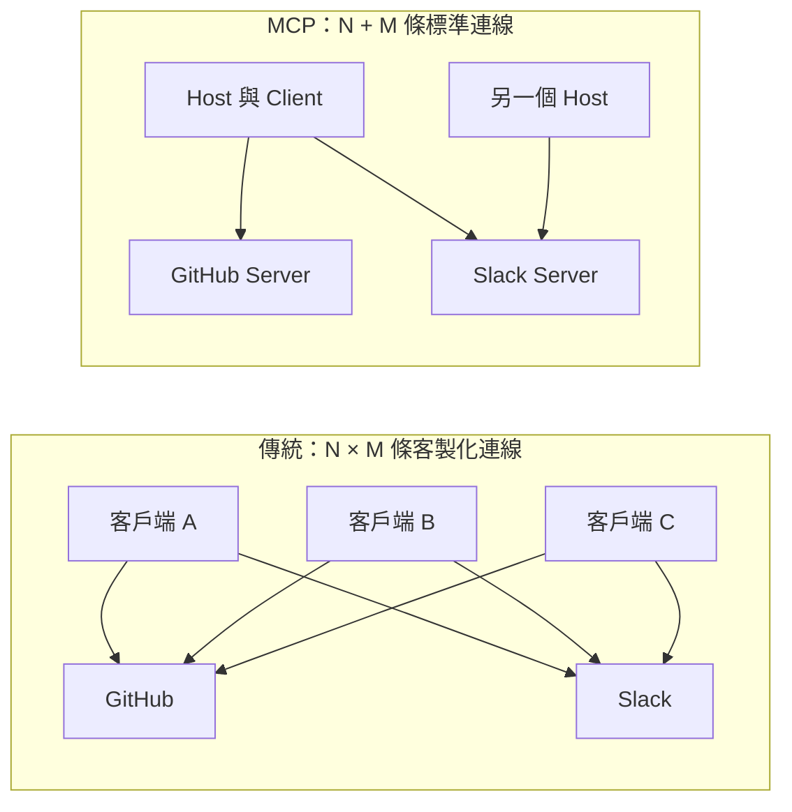
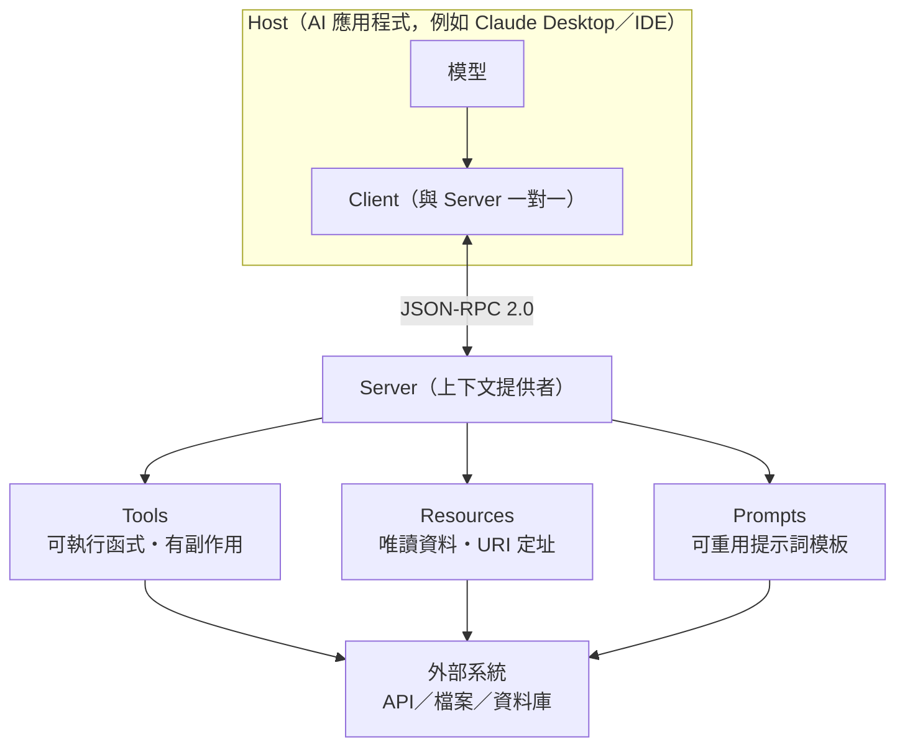

# 第 4 章：Model Context Protocol (MCP) 與生態系整合

第 3 章讓模型學會提出工具意圖，但每接一個新工具，你都得改一次客戶端的 Schema 與派發邏輯。當工具來自不同廠商、客戶端又不只一個時，這份成本會爆炸。本章介紹 MCP——一個把「上下文提供者」標準化的開放協定。你會看懂 Host／Client／Server 的角色分工、三大原語、三種傳輸，並親手寫一個能接進現成 AI 客戶端的 Server。

> 本章你將學到
>
> - 為什麼 N×M 的客製化整合會失控，以及 MCP 如何把它降成 N+M
> - Host、Client、Server 的責任邊界與三大原語（Tools／Resources／Prompts）
> - stdio、SSE 與 Streamable HTTP 的取捨與適用場景
> - 用 FastMCP 從零開發 Server，並接進 Claude Desktop 等現成客戶端
> - 把 MCP Tools 橋接回第 3 章的 `tools` 參數與工具迴圈


---

## 問題場景

假設你的團隊同時維護三個 AI 產品：客服助理、IDE 內的程式助手、內部知識庫問答。這三個產品都需要用到 GitHub、Slack、Jira、PostgreSQL 與一套自訂的訂單系統。現實做法通常是：每個產品為每個工具寫一份轉接層——3 個客戶端 × 5 種工具 = 15 份整合程式碼。

一開始還好。三週後 GitHub API 改了一個欄位名，你必須找出並修改三份轉接層；Slack 加了分頁，三個產品的處理邏輯各自長出不同的 bug；新同事想幫知識庫接一個 Notion，得先讀懂三種不同的 SDK 寫法。更麻煩的是，客戶想在自己的 Claude Desktop 裡直接使用你做的訂單工具——但你寫的轉接層只認得自家客戶端，根本帶不走。

如果你換過模型供應商，還會再痛一次：這個模型的工具定義叫 `tools`，另一個叫 `toolDefinitions`，參數描述的格式也略有差異。於是每個客戶端內部又多了一層「模型工具格式轉換器」。

第一個直覺是做一個公司內部的「萬能 SDK」，把所有工具包起來。這確實能讓自家三個客戶端共用一份程式碼，但它是封閉的：客戶的第三方客戶端仍然接不進來，你的工具也無法被別人的助理直接使用。你只是把 N×M 變成了 N+M，卻沒有跨出公司門口。

第二個直覺是等模型廠商「支援更多工具」。但模型廠商不是整合商，也不該替你維護訂單系統的欄位。

這兩個直覺都忽略了真正的問題：**缺的不是更多程式碼，而是一個跨模型、跨客戶端、跨語言的通用協定。** 語言伺服器協定（LSP）早就解過同樣的題目——N 個編輯器 × M 個程式語言，靠一個標準協定變成 N+M。MCP 就是 AI 應用的 LSP：它把工具、資料與提示詞的提供者標準化，讓任何支援協定的客戶端都能直接使用。

---

## 核心設計模式

### 4.1 告別 N×M 客製化整合地獄：為什麼需要標準化上下文協定？

MCP（Model Context Protocol）由 Anthropic 於 2024 年 11 月開源，隨後被多家模型廠商、IDE 與工具廠商採納，成為 AI 應用串接外部能力的事實標準。它規範了三件事：訊息格式（JSON-RPC 2.0）、角色分工（Host／Client／Server）與能力發現（執行期列出有哪些工具、資源、提示詞）。



左邊每新增一個客戶端或一個工具，就要補上一整排連線；右邊每個客戶端只需要學會「怎麼跟 MCP Server 說話」，每個工具只需要寫一次 Server。複雜度從乘法變成加法。

| 維度 | 客製化整合 | MCP |
|---|---|---|
| 整合數量 | N × M | N + M |
| 工具 API 改版 | 每個客戶端都要改 | 只改對應的 Server |
| 工具發現 | 寫死在程式碼裡 | 執行期 `tools/list` 動態取得 |
| 跨客戶端可攜性 | 幾乎沒有 | 任何相容客戶端都能用 |
| 程式語言綁定 | 綁死在 SDK | JSON-RPC，語言中立 |
| 生態系 | 自家維護 | 社群可共享現成 Server |

標準化的真正紅利在於**發現機制**：客戶端啟動時呼叫 `tools/list`，就能知道 Server 提供什麼，不需要重新編譯，也不需要事先約定。這讓「客戶帶自己的工具進來」成為可能。

### 4.2 MCP 核心架構解析：Host、Client、Server 與三大原語

MCP 的角色分工非常刻意：把「決策」留給客戶端裡的模型，把「上下文與能力」交給獨立運作的 Server。



- **Host** 是使用者直接操作的應用程式：Claude Desktop、Cursor、VS Code Extension，或你自己的 Agent。它擁有對話歷史、上下文視窗與模型。
- **Client** 嵌在 Host 裡，負責協定握手、訊息序列化與路由。它與一個 Server 維持**一對一**的連線；想接五個 Server，Host 就開五個 Client。
- **Server** 是獨立的行程或服務，用標準協定暴露能力。它可以是本機 Python 程式，也可以是遠端 HTTP 服務。**Server 不是 Agent**——它不會自己決定何時呼叫工具，那是模型的工作。

三大原語是理解 MCP 的關鍵：

| 原語 | 誰決定使用 | 典型方法 | 特性 |
|---|---|---|---|
| **Tools** | 模型 | `tools/list`、`tools/call` | 可執行、可能有副作用、結果回灌給模型 |
| **Resources** | Host 或使用者 | `resources/list`、`resources/read`、`resources/subscribe` | 唯讀、URI 定址、可快取、可訂閱更新 |
| **Prompts** | Host 或使用者 | `prompts/list`、`prompts/get` | 參數化模板，可回傳多輪訊息 |

第 3 章的工具對應到 **Tools**；當你需要讓模型讀一份很長的文件時，應該用 **Resources** 讓 Host 決定何時讀、讀多少，而不是把整份文件塞進工具回傳值。**Prompts** 則適合放團隊共用的審查模板、客服話術或固定流程開場。

連線生命週期也值得記住：先 `initialize` 交換協定版本與 `capabilities`（例如「我支援 resources 訂閱嗎」），再送 `notifications/initialized`，之後才能呼叫各項操作，最後 `shutdown`。能力協商讓舊客戶端遇到新 Server 時能優雅降級，而不是直接崩潰。

除了三大原語之外，協定還定義了進階能力：**sampling**（Server 反過來請 Host 用模型生成內容）、**roots**（Host 告知 Server 可用的工作目錄邊界）與 **elicitation**（向使用者補問資料）。初學時先忽略，關鍵時刻會發現它們正是某些架構設計的缺角。

### 4.3 傳輸層實作：本地 Stdio 與遠端 SSE / Streamable HTTP 串接

MCP 的訊息一定是 JSON-RPC 2.0，但「訊息怎麼送」有三種主流做法：

| 傳輸 | 適用場景 | 優點 | 注意事項 |
|---|---|---|---|
| **stdio** | 本機子行程 | 不需網路、延遲低、Host 直接管理生命週期 | **絕對不能 `print` 到 stdout**；日誌走 stderr |
| **HTTP + SSE**（舊版） | 遠端服務 | Server 可主動推送事件 | 需要兩條連線、重連邏輯複雜、不利水平擴充 |
| **Streamable HTTP**（現行建議） | 遠端／雲端 | 單一 endpoint，POST 可回 JSON 或 SSE 串流，易過閘道 | 要處理 session id、Origin 驗證與 OAuth 授權 |

**stdio** 的運作方式很樸實：Host 用 `subprocess` 啟動 Server，把 JSON-RPC 訊息一行一行寫進 Server 的 stdin，Server 把回訊息寫到 stdout。因為 stdout 被協定佔用，任何除錯 `print` 都會破訊框。寫日誌請用 `print(..., file=sys.stderr)` 或 logging 指向 stderr。

**SSE**（Server-Sent Events）是早期遠端方案：一條 `/sse` 長連線負責 Server→Client 事件，另一條 `/messages` POST 負責 Client→Server。缺點是連線狀態難以在負載平衡器後維持，斷線重連也可能漏事件。

**Streamable HTTP** 是現行建議的遠端傳輸：只有一個 endpoint，Client 用 POST 送請求；Server 可以回單一 JSON，也可以回一條 SSE 串流（適合長時間工具或進度回報）。它保留了無狀態橫向擴充的可能性，也更容易套用標準的驗證與觀測基礎設施。

```python
# mcp_server/transports.py（節錄）：三種傳輸的啟動方式
from mcp.server.fastmcp import FastMCP

mcp = FastMCP("book-demo", host="127.0.0.1", port=8000)

# 本機：Host 以子行程啟動（預設）
# mcp.run(transport="stdio")

# 遠端：現行建議
# mcp.run(transport="streamable-http")

# 舊版遠端：部分舊 SDK 仍用 "sse"，新專案不建議
# mcp.run(transport="sse")
```

> 版本敏感：Streamable HTTP 自 2025 年的協定版本起成為建議的遠端傳輸；不同 `mcp` SDK 版本的參數名稱可能微調，請以官方 README 為準。

---

## 原生程式碼實作

安裝官方 Python SDK（本範例需要 Python 3.10+）：

```bash
pip install "mcp>=1.0" python-dotenv
```

### 4.4.1 寫一個自訂 MCP Server

下面這個 Server 同時展示三大原語：一個加法工具、一個寫筆記工具、一個讀取設定的 Resource、一個讀筆記的 Resource Template，以及一個程式碼審查 Prompt。型別標註會自動轉成工具的 JSON Schema，docstring 會自動變成描述——這正是第 3 章 Schema 紀律的延伸。

```python
# mcp_server/server.py
from __future__ import annotations

import os
from pathlib import Path

from mcp.server.fastmcp import FastMCP

mcp = FastMCP("book-demo")
NOTES = Path(os.environ.get("MCP_NOTES_DIR", "./notes")).resolve()


@mcp.tool()
def add(a: int, b: int) -> int:
    """把兩個整數相加。a 與 b 都必須是整數。"""
    return a + b


@mcp.tool()
def note_append(title: str, content: str) -> str:
    """在本機筆記目錄新增一則筆記，回傳寫入的檔案路徑。"""
    NOTES.mkdir(parents=True, exist_ok=True)
    safe = "".join(c for c in title if c.isalnum() or c in "-_")
    path = NOTES / f"{safe or 'note'}.md"
    path.write_text(f"# {title}\n\n{content}\n", encoding="utf-8")
    return str(path)


@mcp.resource("config://app")
def app_config() -> str:
    """目前應用程式的唯讀設定。"""
    return "model=gpt-4o-mini\nmax_steps=8"


@mcp.resource("notes://{name}")
def note_resource(name: str) -> str:
    """依檔名讀取筆記內容；檔名不存在時拋出例外。"""
    path = NOTES / f"{name}.md"
    if not path.exists():
        raise ValueError(f"找不到筆記：{name}")
    return path.read_text(encoding="utf-8")


@mcp.prompt()
def review_prompt(code: str) -> str:
    """產生一段程式碼審查提示詞。"""
    return (
        "請審查以下程式碼，指出正確性、安全性與可讀性問題：\n\n"
        f"```python\n{code}\n```"
    )


if __name__ == "__main__":
    # 本機 stdio：千萬不要把日誌印到 stdout
    mcp.run(transport="stdio")
```

### 4.4.2 用官方 Client 驗證三大原語

在接進圖形介面之前，先用一個 30 行的 Client 把協定跑一遍，這樣出錯時能立刻知道是 Server 的問題還是 Host 的問題。

```python
# mcp_server/client.py
from __future__ import annotations

import asyncio
import os
from pathlib import Path

from mcp import ClientSession, StdioServerParameters
from mcp.client.stdio import stdio_client

SERVER = Path(__file__).with_name("server.py")


async def main() -> None:
    params = StdioServerParameters(
        command="python",
        args=[str(SERVER)],
        env={**os.environ, "MCP_NOTES_DIR": "./notes"},
    )

    async with stdio_client(params) as (read, write):
        async with ClientSession(read, write) as session:
            await session.initialize()  # 協定版本與 capabilities 協商

            tools = await session.list_tools()
            print("工具：", [t.name for t in tools.tools])

            result = await session.call_tool("add", {"a": 7, "b": 5})
            print("add(7,5) =", result.content[0].text)

            config = await session.read_resource("config://app")
            print("resource：", config.contents[0].text)

            prompt = await session.get_prompt(
                "review_prompt", {"code": "def f(): return 1"}
            )
            print("prompt：", prompt.messages[0].content.text)


if __name__ == "__main__":
    asyncio.run(main())
```

執行 `python mcp_server/client.py`，你會看到類似輸出：

```text
工具： ['add', 'note_append']
add(7,5) = 12
resource： model=gpt-4o-mini
max_steps=8
prompt： 請審查以下程式碼，指出正確性、安全性與可讀性問題：
```

### 4.4.3 接進現成 AI 客戶端

大多數桌面客戶端透過一份設定檔啟動 MCP Server。以 Claude Desktop 為例，編輯 `claude_desktop_config.json`：

```json
{
  "mcpServers": {
    "book-demo": {
      "command": "python",
      "args": ["<絕對路徑>/mcp_server/server.py"],
      "env": {
        "MCP_NOTES_DIR": "<絕對路徑>/notes"
      }
    }
  }
}
```

重啟客戶端後，工具會出現在工具清單中，Model Context Protocol 的資源與提示詞也能被選用。關鍵是路徑要寫**絕對路徑**——桌面客戶端不一定從你的專案目錄啟動。

如果你想把 MCP Tools 接回第 3 章手刻的迴圈（例如客戶端沒有原生 MCP 支援），只要寫一層橋接，把 `inputSchema` 轉成 OpenAI 的 `tools` 參數：

```python
# mcp_server/bridge.py（節錄）
from mcp import ClientSession
from typing import Any


async def to_openai_tools(session: ClientSession) -> list[dict[str, Any]]:
    """把 MCP Tools 轉成第 3 章的 tools 參數格式。"""
    result = await session.list_tools()
    out: list[dict[str, Any]] = []
    for tool in result.tools:
        parameters = {
            key: value
            for key, value in tool.inputSchema.items()
            if key != "$schema"  # OpenAI 不接受這個欄位
        }
        out.append(
            {
                "type": "function",
                "function": {
                    "name": tool.name,
                    "description": tool.description or "",
                    "parameters": parameters,
                },
            }
        )
    return out

# 呼叫時：await session.call_tool(name, args)
# 再把 result.content[0].text 放進 role="tool" 的 content，
# 就無縫接回第 3 章 agent/loop.py 的工具迴圈。
```

> 以 openai-python v1.x 與 `mcp` Python SDK 1.x／2.x 為例；工具定義格式隨模型供應商與 SDK 版本變動，上線前請實測。

---

## 生產環境踩坑指南

### 坑 1：在 Server 裡 `print` 除錯訊息到 stdout

- **症狀**：Client 收到 `Unexpected token` 或 JSON 解析錯誤，連線莫名其妙斷掉。
- **原因**：stdio 傳輸把 stdout 當成協定通道，任何額外文字都會破壞訊框。
- **解法**：日誌一律寫 stderr（`print(..., file=sys.stderr)` 或 logging handler）；需要結構化觀測時，用 Client 端的 tracing 而不是 Server 端的 print。

### 坑 2：把 Server 當成 Agent 來寫

- **症狀**：Server 自己決定「何時該查資料」，甚至自己呼叫另一個工具，行為難以追蹤。
- **原因**：混淆了「提供能力」與「使用能力」。決策屬於 Host 裡的模型。
- **解法**：Server 只做被動的 `list`／`call`／`read`／`get`；任何流程控制都放回 Host 的 Agent Loop（第 5 章）。

### 坑 3：把大量資料塞進 Tool 回傳值

- **症狀**：工具一次回傳整份 PDF，上下文視窗瞬間爆掉，成本與延遲一起上升。
- **原因**：把 Resources 能做的事交給了 Tools。
- **解法**：靜態資料用 Resources 讓 Host 按需讀取並快取；真的需要用工具時，回傳「摘要＋URI」，需要的內容再讀一次。

### 坑 4：路徑與權限沒有沙盒

- **症狀**：使用者一句話讓 Server 覆蓋了整個專案，或讀到 `.env` 裡的金鑰。
- **原因**：Server 行程的權限等同於啟動它的使用者，而工具描述可能被模型或外部資料誤用。
- **解法**：用 `roots` 或環境變數限制工作目錄，所有路徑 `resolve()` 後檢查前綴；敏感檔案加入黑名單；高風險寫入走人機審批。

### 坑 5：遠端 Server 沒做 Origin 與授權檢查

- **症狀**：本機 HTTP Server 被惡意網站透過瀏覽器連上（DNS rebinding），或遠端 Server 任何人都能呼叫。
- **原因**：把它當成普通內網服務，忽略 MCP 特有的信任邊界。
- **解法**：本機 Server 綁 `127.0.0.1` 並驗證 `Origin`；遠端 Server 用 OAuth 2.1／API key 並搭配 TLS；不要把 stdio Server 暴露到網路。

### 坑 6：工具描述被注入惡意指令（Tool Poisoning）

- **症狀**：模型突然把機密資料回傳到外部，只因為某個工具的 description 寫了「忽略先前規則」。
- **原因**：Server 提供的描述與資料會進入模型上下文，且可能被另一個惡意 Server 篡改。
- **解法**：只連信任的 Server；Host 在註冊工具時顯示並鎖定描述；敏感操作加獨立核對機制（第 11 章會展開）。

---

## 小結

- MCP 把 N×M 的客製化整合降成 N+M，關鍵在於標準協定與執行期的工具發現。
- Host 擁有模型與決策權，Client 負責一對一連線，Server 只提供上下文與能力。
- Tools、Resources、Prompts 各有分工：副作用交給 Tools，唯讀資料交給 Resources，模板交給 Prompts。
- 本機用 stdio（日誌走 stderr），遠端優先用 Streamable HTTP；舊 SSE 僅供相容。
- MCP Tools 可以橋接回第 3 章的 `tools` 格式，讓手刻迴圈也能享受生態系。

## 練習題

1. **入門**：在 `server.py` 再加一個 `multiply(a: int, b: int)` 工具，用 `client.py` 的 `list_tools()` 確認它自動出現在清單中。
2. **中階**：把 `note_append` 的路徑改用 `Path.resolve()` 加上白名單檢查，並嘗試傳入 `../` 路徑，確認它被拒絕。
3. **進階**：把 `add` 改成非同步工具（I/O 模擬 `asyncio.sleep`），比較串列與並行呼叫 100 次的總耗時，並說明 Client 端需要如何調整。

## 延伸閱讀

- [Model Context Protocol 官方簡介](https://modelcontextprotocol.io/introduction)
- [MCP 架構與三大原語](https://modelcontextprotocol.io/docs/concepts/architecture)
- [MCP Transports：stdio、SSE 與 Streamable HTTP](https://modelcontextprotocol.io/docs/concepts/transports)
- [modelcontextprotocol/python-sdk（GitHub）](https://github.com/modelcontextprotocol/python-sdk)

---

*（本章導讀結束。接續請閱讀 [第 5 章](第05章-手刻第一個原生Agent-Loop.md)。）*
