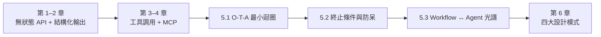
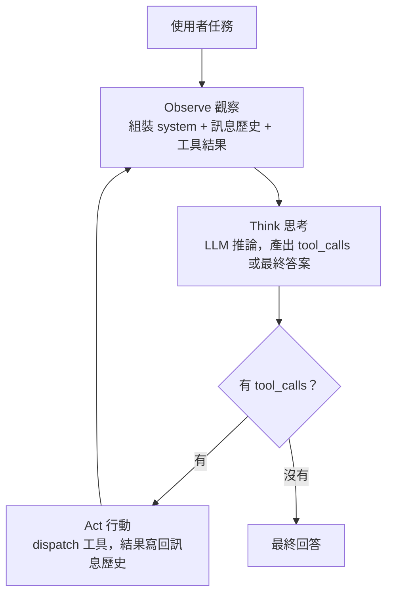
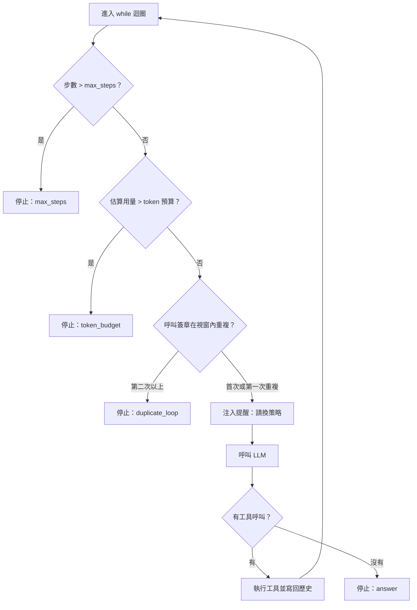

# 第 5 章：手刻第一個原生 Agent Loop

前四章做出來的大腦與雙手仍是被動的：你呼叫一次，它動一次。本章把它們裝進一個由你掌控的 `while` 迴圈，讓 Agent（代理人）第一次自己決定下一步。我們先拆解 Observe→Think→Act 最小架構，再加上步數、重複與 token 三道煞車，最後用一張光譜圖回答：該做工作流，還是自主代理人？

> **本章你將學到**
>
> - 看懂 Agent 不是模型的一種「能力」，而是你寫的迴圈加上模型給的下一步。
> - 手刻 O-T-A 迴圈，正確維護 `messages` 歷史與 `tool_call_id` 對應。
> - 用 `max_steps`、重複簽章偵測、token 預算三道煞車防止失控。
> - 判斷任務該用確定性 Workflow（工作流）還是有界自主 Agent。
> - 寫出一個可直接執行、含錯誤處理與重試的最小 Agent Loop。



---

## 問題場景：一個很禮貌、很貴、然後什麼都沒完成的助理

某家公司為維運團隊做了一個「訂單小助理」。它接得到公司內部的訂單 API，也查得到退款規則文件，上線第一週表現得相當不錯：問一筆訂單狀態，它答得又快又準。

第三週，有人問了第一個真正的問題：

> 「幫我整理上週所有已退款的訂單，算出總金額，再把摘要寄給財務。」

它的行為是這樣：先查退款規則，再查訂單列表；接著又查了一次退款規則（參數跟剛才幾乎一樣）；再查一次訂單列表；然後再查退款規則……第 37 次工具呼叫時，日誌裡的 token 累計來到十八萬，成本大約 2.7 美元。最後它回了一句非常流暢、非常有禮貌的話：

> 「抱歉，我目前無法完成您的請求，請提供更多資訊。」

沒有人被冒犯，也沒有人得到報表。這是最難除錯的一種故障：**系統沒有崩潰，它只是成功地一直花錢。**

### 直覺解法為什麼不夠

團隊通常會試三件事，而三件都踩不到重點。

**第一，加提示詞。**「請不要重複呼叫相同的工具。」第一天有效，第三天又犯了。因為提示詞是建議，不是控制流程；模型每一輪只看得到上下文裡的文字，它沒有「我已經做過什麼」的結構化狀態，也沒有強制停止的開關。

**第二，換更強的模型。**推理確實變好了，但它仍然不知道何時該停。更糟的是，每一步都要把整個歷史重新送一次，模型越貴，重複迴圈的帳單越可觀。

**第三，加 `try/except`。**這只能防止程式拋出例外，防止不了「程式正確地呼叫了 37 次 API」。

序言裡那個把退款規則寫成詩的客服機器人，本質上是同一個問題的模型版本：**我們把決策權交給了模型，卻沒有把終止權留在程式裡。**

真正的修法是承認一件事：模型擅長的是「決定下一步」，不擅長「決定什麼時候結束整個任務」。自主性必須是有界的（bounded autonomy）。而這個「界」，就是本章要親手寫出來的 `while` 迴圈與三道煞車。第 10 章的框架會幫你做這些事，但先自己寫一次，你才會知道框架到底替你扛了什麼。

---

## 核心設計模式

### 5.1 最小可行架構：Observe → Think → Act

先把 Agent 定義成一個可以拆開的公式：

```text
Agent = LLM(一次只決定一步) + while 迴圈(由程式擁有) + 狀態(訊息歷史)
```

這句話有三個主角，而**迴圈的主人必須是程式，不是模型**。模型不知道自己現在是第幾步、不知道已經花了多少錢、也不知道權限邊界在哪裡；這些都是程式的責任。



**Observe（觀察）不是被動感測，而是主動組裝上下文。**每一步呼叫模型前，你要把三樣東西重新拼起來：系統提示詞（角色、規則、工具使用守則）、一路累積的訊息歷史、以及剛剛工具回傳的結果。這裡有個年輕工程師最常踩的細節：工具結果必須以 `role="tool"` 的訊息回傳，而且要有對應的 `tool_call_id`；當模型一次給出三個平行工具呼叫時，你就要回三則 tool 訊息，順序最好與 `tool_calls` 一致。少一則，下一次呼叫會直接收到 API 的 400 錯誤。

**Think（思考）在原生 SDK 裡長得比想像中單純。**一次 `chat.completions.create` 只會產生兩種結果之一：帶著 `tool_calls` 的「我下一步想做某事」，或是沒有工具呼叫的「我答完了」。模型本身沒有「迴圈」的概念，它只是在接龍。想讓它知道自己被限制在幾步之內，你得把 `step 3 / max 8` 寫進提示詞——但請記住，那仍然是提示，不是保證。

**Act（行動）是一個查表動作。**`name → function` 的 dispatch dict，參數先用 JSON Schema／Pydantic 驗證，再把結果序列化成字串寫回歷史。第 3 章談過的 Error Feedback Loop 在這裡特別重要：**工具失敗也是一種 Observation**，要老老實實回傳 `{"error": "..."}`，讓模型有機會改策略；如果把例外往上拋，整個行程就死了。

這三件套出一個關鍵洞察：**模型是「一步規劃器」，不是「整個行程的操控者」。**ReAct 的 Thought、Planning 的計畫、Reflection 的批評，全都只是塞進這一步裡的不同提示詞與狀態結構（第 6 章會逐個拆）。當你理解這一點，就不會再問「要怎麼叫模型自己停下來」——正確問題是「我要在哪裡踩煞車」。

### 5.2 終止條件與防呆設計

一個沒有煞車的迴圈，在本質上是一台印鈔機。至少要裝四道：步數、token、重複、期限。



四道煞車的角色並不重疊：

| 煞車 | 防的是 | 實作位置 | 常見失敗模式 |
|---|---|---|---|
| `max_steps` | 無限「再查一次」 | 迴圈計數器（每次迭代 +1） | 設太大等於沒設 |
| `token_budget` | 成本暴衝、上下文過載 | 呼叫前估算、呼叫後用 `usage` 核帳 | 只算輸出不算輸入 |
| 重複簽章 | 同工具同參數反覆 | 正規化 JSON → SHA-256 + 滑動視窗 | 參數含時間戳就偵測不到 |
| 全域期限 | 單步很快但累計很久 | `time.monotonic()` 截止時間 | 只設單次 timeout |

**重複迴圈偵測的細節。**直接比較原始 `arguments` 字串是行不通的，因為模型每次產生的 key 順序、空白都可能不同。我們先把參數 `json.loads`、用 `sort_keys=True` 重新序列化，再和工具名稱一起做 SHA-256，得到一組固定長度的簽章，放進 `deque(maxlen=5)` 的滑動視窗。實務上還要先把 `timestamp`、`request_id` 之類每次都變的欄位剔除，否則簽章永遠不重複。第一次偵測到重複時，不要立刻殺掉行程，而是回一則工具訊息：「你已經用相同參數呼叫過這個工具，請換策略或直接回答」；這就是第 3 章的錯誤回饋。同一簽章第二次出現才硬停止，我們才不會因為模型一時手滑就中斷正當任務。

**token 預算為什麼必須在呼叫前算。**因為每次迭代都會把完整歷史重送一次，輸入 token 是逐步膨脹的；如果只靠回傳的 `usage` 事後記帳，你會在超標之後才發現。做法是呼叫前用 `tiktoken` 把 `messages` 裡的 content 編碼估算（每則訊息加 4 個 token 的協定開銷），加上預留的輸出上限，若超過剩餘預算就停；呼叫後再用真正的 `usage.prompt_tokens + usage.completion_tokens` 修正帳戶。第 7 章會持續壓縮、摘要與快取來拉高同一個預算能做的事。

**終止原因要被記錄，不能只留一個字串答案。**`answer`、`max_steps`、`token_budget`、`duplicate_loop`、`deadline`、`error`，每一種都要寫進追蹤。否則你會得到「它又失敗了」這種沒有資訊量的事故報告。第 12 章的評估與追蹤就是建立在這些結構化欄位上。

### 5.3 Workflow 與 Autonomous Agent 的抉擇光譜

業界最常犯的策略錯誤，是把「Agent」當成一個開關：要嘛全部寫死，要嘛全部交給模型。實際上它是一條光譜。

| 層級 | 名稱 | 誰決定下一步 | 適合任務 | 代價 |
|---|---|---|---|---|
| L0 | 固定流程 | 工程師寫死的 `if/else` | 高頻、法規明確、步驟固定 | 彈性最低，但最便宜可靠 |
| L1 | Workflow 工作流 | 圖的邊先定義好，模型只填節點 | 批量摘要、文件抽取、固定審核鏈 | 例外路徑要手寫 |
| L2 | 有界自主 Agent（本章） | 模型選下一步，程式踩煞車 | 工具多、路徑無法事前列舉 | 需要防呆與追蹤 |
| L3 | 全自主 Agent | 模型連終止時機也決定 | 開放式研究、探索任務 | 成本與不確定性最高 |

四個問題可以幫你定位：

1. **路徑能不能事前列舉？**「退款金額計算」永遠是查規則→查訂單→算總額，那就是 L1。
2. **每一步錯誤是否可逆？**唯讀查詢出錯頂多重查；退款、寄信、刪除不可逆，就該降一級或加第 6.4 節的人工審批。
3. **是否需要可稽核的固定輸出？**監管報表要求格式一致，讓模型自由發揮反而有害。
4. **延遲與成本上限有多嚴？**使用者在等答案的互動場景，L2 的多次工具呼叫可能太慢。

Anthropic 的〈Building Effective Agents〉把這件事說得很清楚：workflow 是預先定義好的路徑，agent 則是模型自己指揮路徑；而最佳實務是**先用最簡單能運作的方案**。所以我的建議是：**能用確定性流程解決的，不要用 Agent；真的需要自主性時，把自主性關在迴圈裡。**

---

## 原生程式碼實作：一個真正會動的最小迴圈

接下來的兩個檔案刻意不依賴任何 Agent 框架，只用官方 SDK。先安裝與設定：

```bash
pip install "openai>=1.0" python-dotenv tiktoken
```

在專案根目錄放一個 `.env`（**不要進版控**）：

```text
OPENAI_API_KEY=你的金鑰
OPENAI_MODEL=gpt-4o-mini
```

> 以 openai-python v1.x 為例。v0.x 的介面完全不同，請先升級。`max_tokens` 在部分新模型上改名為 `max_completion_tokens`，且 o 系列不支援 `temperature`；本例固定用 `gpt-4o-mini`。`tiktoken` 會隨 `openai` 一起安裝。

`agent/tools.py` 先定義工具。為了讓你直接在筆電上跑，全部用假資料；`calculator` 刻意不用 `eval`，而是用 `ast` 白名單解析，這同時也是第 11 章護欄議題的預告。

```python
# agent/tools.py
"""第 5 章示範工具：刻意使用假資料，便於沒有外部服務也能直接執行。"""
from __future__ import annotations

import ast
import operator
from typing import Any, Callable

TOOL_SCHEMAS: list[dict[str, Any]] = [
    {
        "type": "function",
        "function": {
            "name": "get_weather",
            "description": "查詢指定城市的目前天氣，回傳攝氏溫度與描述。",
            "parameters": {
                "type": "object",
                "properties": {
                    "city": {"type": "string", "description": "城市名稱，例如：台北"}
                },
                "required": ["city"],
                "additionalProperties": False,
            },
        },
    },
    {
        "type": "function",
        "function": {
            "name": "calculator",
            "description": "安全的四則運算與整數次方，輸入純算式字串。",
            "parameters": {
                "type": "object",
                "properties": {
                    "expression": {"type": "string", "description": "例如：(1280 + 450) * 0.9"}
                },
                "required": ["expression"],
                "additionalProperties": False,
            },
        },
    },
    {
        "type": "function",
        "function": {
            "name": "lookup_order",
            "description": "依訂單編號查詢訂單狀態與金額。",
            "parameters": {
                "type": "object",
                "properties": {
                    "order_id": {
                        "type": "string",
                        "enum": ["A1001", "A1002", "A1003"],
                        "description": "訂單編號",
                    }
                },
                "required": ["order_id"],
                "additionalProperties": False,
            },
        },
    },
]

_WEATHER: dict[str, dict[str, Any]] = {
    "台北": {"temp_c": 28, "condition": "多雲"},
    "台中": {"temp_c": 31, "condition": "晴"},
    "高雄": {"temp_c": 33, "condition": "午後雷陣雨"},
}

def get_weather(city: str) -> dict[str, Any]:
    return _WEATHER.get(city, {"error": "沒有這個城市的天氣資料", "city": city})

_BINOPS: dict[type[ast.operator], Callable[[float, float], float]] = {
    ast.Add: operator.add,
    ast.Sub: operator.sub,
    ast.Mult: operator.mul,
    ast.Div: operator.truediv,
    ast.Pow: operator.pow,
}
_UNARYOPS = {ast.UAdd: operator.pos, ast.USub: operator.neg}

def _eval(node: ast.AST) -> float:
    """只走白名單節點；模型給的算式永遠不會被 exec。"""
    if isinstance(node, ast.Constant) and isinstance(node.value, (int, float)):
        return float(node.value)
    if isinstance(node, ast.BinOp):
        op = _BINOPS.get(type(node.op))
        if op is None:
            raise ValueError(f"不支援的運算子：{type(node.op).__name__}")
        left, right = _eval(node.left), _eval(node.right)
        if isinstance(node.op, ast.Pow) and right > 100:
            raise ValueError("指數過大，拒絕計算")
        return op(left, right)
    if isinstance(node, ast.UnaryOp):
        op = _UNARYOPS.get(type(node.op))
        if op is None:
            raise ValueError(f"不支援的運算子：{type(node.op).__name__}")
        return op(_eval(node.operand))
    raise ValueError(f"不支援的節點：{type(node).__name__}")

def calculator(expression: str) -> dict[str, Any]:
    tree = ast.parse(expression, mode="eval")
    return {"expression": expression, "value": _eval(tree.body)}

_ORDERS: dict[str, dict[str, Any]] = {
    "A1001": {"status": "refunded", "amount": 1280, "currency": "TWD"},
    "A1002": {"status": "shipped", "amount": 890, "currency": "TWD"},
    "A1003": {"status": "refunded", "amount": 450, "currency": "TWD"},
}

def lookup_order(order_id: str) -> dict[str, Any]:
    return _ORDERS.get(order_id.upper(), {"error": "找不到訂單", "order_id": order_id})

TOOL_DISPATCH: dict[str, Callable[..., dict[str, Any]]] = {
    "get_weather": get_weather,
    "calculator": calculator,
    "lookup_order": lookup_order,
}
```

接著是心臟 `agent/loop.py`。請特別看 while 迴圈裡四道煞車的順序，以及平行工具呼叫時「每一則 `tool_call` 都要有一則回覆」的處理。

```python
# agent/loop.py
"""最小可行 Agent Loop：while + tool dispatch + 訊息歷史 + 四道煞車。"""
from __future__ import annotations

import hashlib
import json
import os
import time
from collections import deque
from dataclasses import dataclass, field
from typing import Any

import tiktoken
from dotenv import load_dotenv
from openai import APIError, OpenAI

from tools import TOOL_DISPATCH, TOOL_SCHEMAS

load_dotenv()
API_KEY = os.environ["OPENAI_API_KEY"]  # 明確讀取；.env 沒載入時直接失敗，不要靜默降級
MODEL = os.environ.get("OPENAI_MODEL", "gpt-4o-mini")
SYSTEM_PROMPT = (
    "你是一個嚴謹的助理。每一步只能做一件事：呼叫工具，或給出最終答案。"
    "不要重複已經執行過且參數相同的工具呼叫。"
    "若資訊不足，請明確說出缺少什麼，不要猜。"
)

@dataclass
class LoopConfig:
    max_steps: int = 8
    token_budget: int = 12_000
    dup_window: int = 5
    model: str = MODEL
    timeout_s: float = 30.0
    deadline_s: float = 120.0
    max_retries: int = 2
    max_output_tokens: int = 1_024

@dataclass
class LoopOutcome:
    answer: str
    stop_reason: str  # answer | max_steps | token_budget | duplicate_loop | deadline | error
    steps: int
    total_tokens: int
    trace: list[dict[str, Any]] = field(default_factory=list)
    messages: list[dict[str, Any]] = field(default_factory=list)

def _get_encoding(model: str) -> Any:
    try:
        return tiktoken.encoding_for_model(model)
    except KeyError:
        return tiktoken.get_encoding("cl100k_base")

def _signature(name: str, arguments: str) -> str:
    """正規化工具呼叫簽章：排序 key、去掉格式差異。"""
    try:
        args = json.loads(arguments or "{}")
    except json.JSONDecodeError:
        args = {"raw": arguments}
    canonical = json.dumps(args, sort_keys=True, ensure_ascii=False, separators=(",", ":"))
    return hashlib.sha256(f"{name}|{canonical}".encode("utf-8")).hexdigest()[:16]

def _estimate_tokens(messages: list[dict[str, Any]], encoding: Any) -> int:
    """呼叫前的保守估算：每則訊息加 4 個 token 的協定開銷。"""
    total = 0
    for m in messages:
        content = m.get("content") or ""
        if isinstance(content, list):
            content = json.dumps(content, ensure_ascii=False)
        total += len(encoding.encode(str(content))) + 4
    return total + 4

def _create_with_retry(
    client: OpenAI,
    *,
    messages: list[dict[str, Any]],
    config: LoopConfig,
    tools: list[dict[str, Any]],
) -> Any:
    """自己做重試，才能把退避時間算進全域 deadline。"""
    delay = 1.0
    for attempt in range(config.max_retries + 1):
        try:
            return client.chat.completions.create(
                model=config.model,
                messages=messages,
                tools=tools,
                tool_choice="auto",
                max_tokens=config.max_output_tokens,
                timeout=config.timeout_s,
            )
        except APIError:
            if attempt >= config.max_retries:
                raise
            time.sleep(delay)
            delay *= 2
    raise RuntimeError("unreachable")

def run_agent_loop(
    user_input: str,
    config: LoopConfig | None = None,
    *,
    system: str = SYSTEM_PROMPT,
    tools: list[dict[str, Any]] | None = None,
) -> LoopOutcome:
    cfg = config or LoopConfig()
    client = OpenAI(api_key=API_KEY, timeout=cfg.timeout_s, max_retries=0)  # 重試自己寫
    tools = tools if tools is not None else TOOL_SCHEMAS
    messages: list[dict[str, Any]] = [
        {"role": "system", "content": system},
        {"role": "user", "content": user_input},
    ]
    trace: list[dict[str, Any]] = []
    seen: deque[str] = deque(maxlen=cfg.dup_window)
    warned: set[str] = set()
    encoding = _get_encoding(cfg.model)
    started = time.monotonic()
    total_tokens = 0
    steps = 0
    final_answer = ""
    stop_reason = "error"

    try:
        while True:
            steps += 1
            # 煞車 1：步數
            if steps > cfg.max_steps:
                stop_reason = "max_steps"
                break
            # 煞車 2：全域期限
            if time.monotonic() - started > cfg.deadline_s:
                stop_reason = "deadline"
                break
            # 煞車 3：token 預算（呼叫前估算）
            if _estimate_tokens(messages, encoding) + cfg.max_output_tokens > cfg.token_budget - total_tokens:
                stop_reason = "token_budget"
                break

            response = _create_with_retry(client, messages=messages, config=cfg, tools=tools)
            if response.usage:
                total_tokens += (response.usage.prompt_tokens or 0) + (response.usage.completion_tokens or 0)

            choice = response.choices[0]
            message = choice.message
            if choice.finish_reason == "length":
                stop_reason = "length"
                break

            tool_calls = message.tool_calls or []
            if not tool_calls:
                final_answer = message.content or ""
                stop_reason = "answer"
                break

            # assistant 的意圖要原樣寫回，tool_calls 不能丟
            messages.append({
                "role": "assistant",
                "content": message.content or "",
                "tool_calls": [tc.model_dump() for tc in tool_calls],
            })

            hard_stop = False
            for call in tool_calls:
                name, args_raw = call.function.name, call.function.arguments
                sig = _signature(name, args_raw)
                result: dict[str, Any]

                # 煞車 4：重複簽章（含軟提醒與硬停止）
                if sig in seen:
                    if sig in warned:
                        result = {"error": "偵測到重複迴圈，已終止。"}
                        hard_stop = True
                    else:
                        warned.add(sig)
                        result = {"error": "你已經用相同參數呼叫過這個工具；請換策略或直接回答。"}
                else:
                    seen.append(sig)
                    try:
                        fn = TOOL_DISPATCH.get(name)
                        if fn is None:
                            result = {"error": f"未知工具：{name}"}
                        else:
                            result = fn(**json.loads(args_raw or "{}"))
                    except Exception as exc:  # 工具錯誤變成 Observation，不炸掉迴圈
                        result = {"error": f"{type(exc).__name__}: {exc}"}

                # 平行工具呼叫：每一則 tool_call 都要有對應回覆
                messages.append({
                    "role": "tool",
                    "tool_call_id": call.id,
                    "content": json.dumps(result, ensure_ascii=False),
                })
                trace.append({
                    "step": len(trace) + 1,
                    "thought": message.content or "",
                    "action": name,
                    "arguments": args_raw,
                    "observation": result,
                })

            if hard_stop:
                stop_reason = "duplicate_loop"
                break
    except APIError as exc:
        stop_reason = f"error:{type(exc).__name__}"

    if stop_reason != "answer":
        final_answer = f"（已停止：{stop_reason}）資訊不足以給出可靠答案，請縮小問題或放寬上限。"

    return LoopOutcome(
        answer=final_answer,
        stop_reason=stop_reason,
        steps=steps,
        total_tokens=total_tokens,
        trace=trace,
        messages=messages,
    )

if __name__ == "__main__":
    question = "查一下台北天氣，再用計算器算 (1280 + 450) * 0.9，最後查訂單 A1001。"
    outcome = run_agent_loop(question, LoopConfig(max_steps=6, token_budget=8_000))
    print(f"stop_reason={outcome.stop_reason} steps={outcome.steps} tokens={outcome.total_tokens}")
    print(outcome.answer)
    for item in outcome.trace:
        print(f"  [{item['step']}] {item['action']} -> {item['observation']}")
```

示範輸出（在 `agent/` 目錄下執行 `python loop.py`，實際內容會依模型而異）：

```text
stop_reason=answer steps=4 tokens=1187
台北 28°C 多雲；(1280 + 450) * 0.9 = 1557.0；訂單 A1001 已退款，金額 1280 TWD。
  [1] get_weather -> {'temp_c': 28, 'condition': '多雲'}
  [2] calculator -> {'expression': '(1280 + 450) * 0.9', 'value': 1557.0}
  [3] lookup_order -> {'status': 'refunded', 'amount': 1280, 'currency': 'TWD'}
```

**這段程式有幾個刻意的設計。**第一，`client = OpenAI(max_retries=0)`，重試自己寫，因為 SDK 內建重試不認識你的全域期限；退避用 `time.sleep`，每次加倍。第二，工具例外被轉成 `{"error": ...}` 的 tool 訊息，而不是往外丟——這是第 3 章錯誤回饋的直接落實。第三，平行工具呼叫即使遇到硬停止，仍然為每一則 `tool_call` 補上回覆，避免下一輪 API 回 400。第四，`trace` 保留了每一步的 `thought`，第 6 章的 ReAct 會直接用到它；現在先知道它「順手被記下來」即可。

> 同步版比較好讀，先從這裡開始。若要同時跑二十個 Agent，把 `OpenAI` 換成 `AsyncOpenAI`、`await client.chat.completions.create(...)`，並把 `time.sleep` 換成 `asyncio.sleep`；`threading` 相關的東西則留到第 6.4 節再談。

---

## 生產環境踩坑指南

### 坑 1：工具結果太大，把上下文視窗撐爆

- **症狀**：跑到第六輪，API 回 `context_length_exceeded`，前面五輪的錢都白花。
- **原因**：工具常常回傳整份 JSON（例如日誌、搜尋結果），一則就吃掉上萬 token；而每一輪都會把歷史重送。
- **解法**：在 dispatch 後立刻截斷（`json.dumps(...)[:4000]`）或只挑欄位；大結果改寫到暫存檔案，tool 訊息裡只放路徑與摘要。第 7 章會系統性處理這件事。

### 坑 2：`tool_call_id` 對不起來，API 直接 400

- **症狀**：平行工具呼叫後，下一次 `create` 噴「tool_call_id is invalid / missing」。
- **原因**：模型給了三個 `tool_calls`，你只回了一則 tool 訊息；或硬體錯誤時用 `break` 跳過了後面兩則。
- **解法**：把「每則 call 都必須有回覆」寫成不變式；終止前先補完所有回覆再 `break`。上面程式的 `hard_stop` 就是為了解決這個問題。

### 坑 3：模型幻覺工具名稱與參數

- **症狀**：日誌出現 `未知工具：get_weather_forecast`，或 `TypeError: missing required argument`。
- **原因**：工具描述寫得太模糊，或模型在歷史很長時開始「自由創作」。
- **解法**：dispatch 用 `dict.get` 而非直接索引，失敗轉成 error Observation；Schema 加 `enum` 與 `additionalProperties: false`（上面 `lookup_order` 已示範）；不要用 `eval` 解析參數。

### 坑 4：重試與逾時疊成重試風暴

- **症狀**：單一請求卡了五分鐘，帳單却多了十幾次呼叫。
- **原因**：SDK 的 `max_retries` 加上自己寫的重試，又各自獨立計算 timeout。
- **解法**：只保留一層重試（本例自己做），並用 `time.monotonic()` 算全域期限；每次重試前先檢查 `deadline` 是否已到。

### 坑 5：把終止條件只寫在提示詞裡

- **症狀**：提示詞明明寫了「最多五步」，日誌卻跑了十二步。
- **原因**：提示詞是語言，不是控制流程；模型可以（而且經常）忽略它。
- **解法**：`max_steps`、`token_budget`、deadline 必須是程式裡的 `if`。提示詞只拿來做柔性引導（例如要求模型在長任務中自我摘要）。

### 坑 6：忘了記 `stop_reason` 與 `usage`

- **症狀**：事故檢討會上，沒有人說得出它為什麼停、花了多少錢。
- **原因**：只把 `message.content` 回給使用者，其餘全部丟掉。
- **解法**：把 `stop_reason`、`total_tokens`、`trace`、完整 `messages` 一起持久化；這也是第 12 章追蹤與軌跡評估的原料。

---

## 小結

- Agent 不是模型的魔法能力，而是「模型給一步、程式管迴圈」的分工；而迴圈必須由程式擁有。
- O-T-A 三步看似簡單，真正的工程難度在 Observe 的狀態組裝與 Act 的錯誤回饋。
- 至少四道煞車：步數、token 預算、重複簽章、全域期限；終止原因要結構化記錄。
- 工具失敗要變成 Observation，而不是拋出例外；平行工具呼叫的回覆數量必須與 `tool_calls` 一致。
- Workflow 與 Agent 是光譜不是開關：能寫成工作流就別寫 Agent，需要自主性時就把它關在迴圈裡。

## 練習題

1. **入門**：把 `loop.py` 的 `max_steps` 改成 2，觀察 `stop_reason`。再提示一個需要三步的問題，親眼看到「有界停止」的樣子。
2. **中階**：在 `tools.py` 新增一個 `search_kb(query)` 工具（回傳固定假資料），並讓模型連續呼叫它三次。把 `dup_window` 從 5 改成 2，比較軟提醒與硬停止的差異。
3. **進階**：把 `run_agent_loop` 改寫成非同步版（AsyncOpenAI + asyncio），同時跑三個問題，並讓全域 deadline 覆盖三個任務的總時間。寫完後對照第 10 章框架的做法，列出你自己還得補哪些東西。

## 延伸閱讀

- OpenAI,〈Function calling〉官方指南：<https://platform.openai.com/docs/guides/function-calling>
- OpenAI API Reference,〈Create chat completion〉：<https://platform.openai.com/docs/api-reference/chat/create>
- Anthropic,〈Building effective agents〉：<https://www.anthropic.com/engineering/building-effective-agents>
- OpenAI, `tiktoken` 原始碼與計價說明：<https://github.com/openai/tiktoken>
