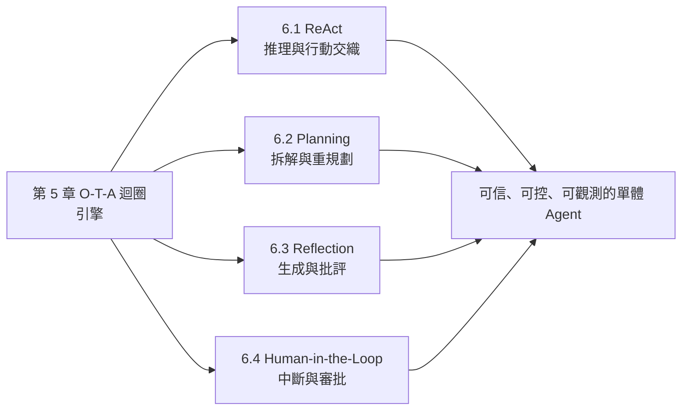
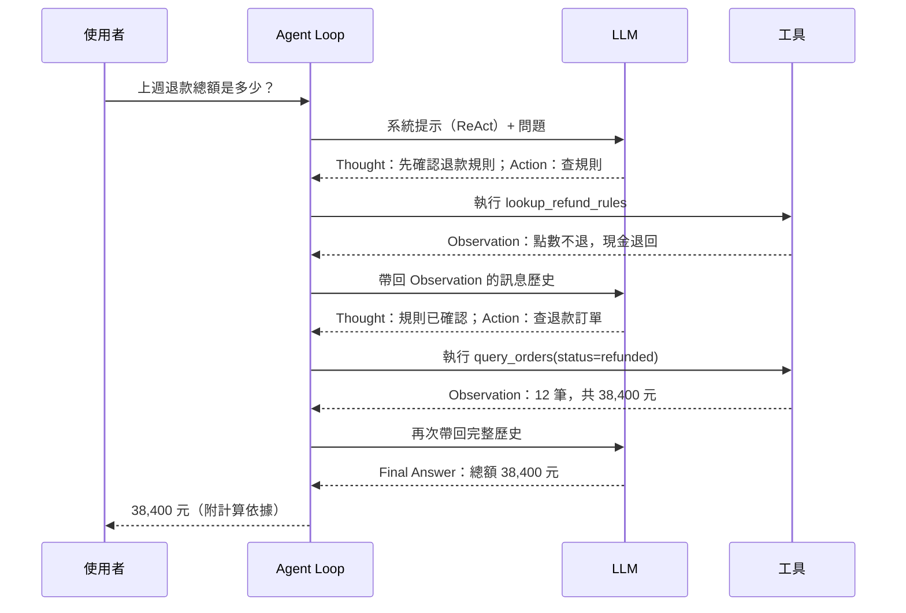
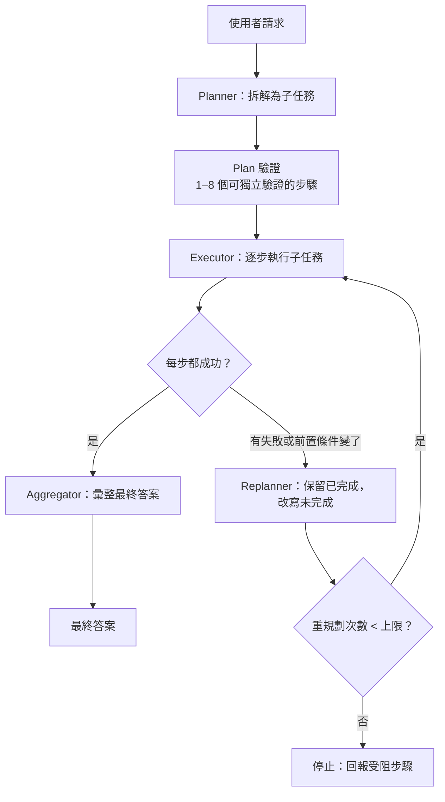
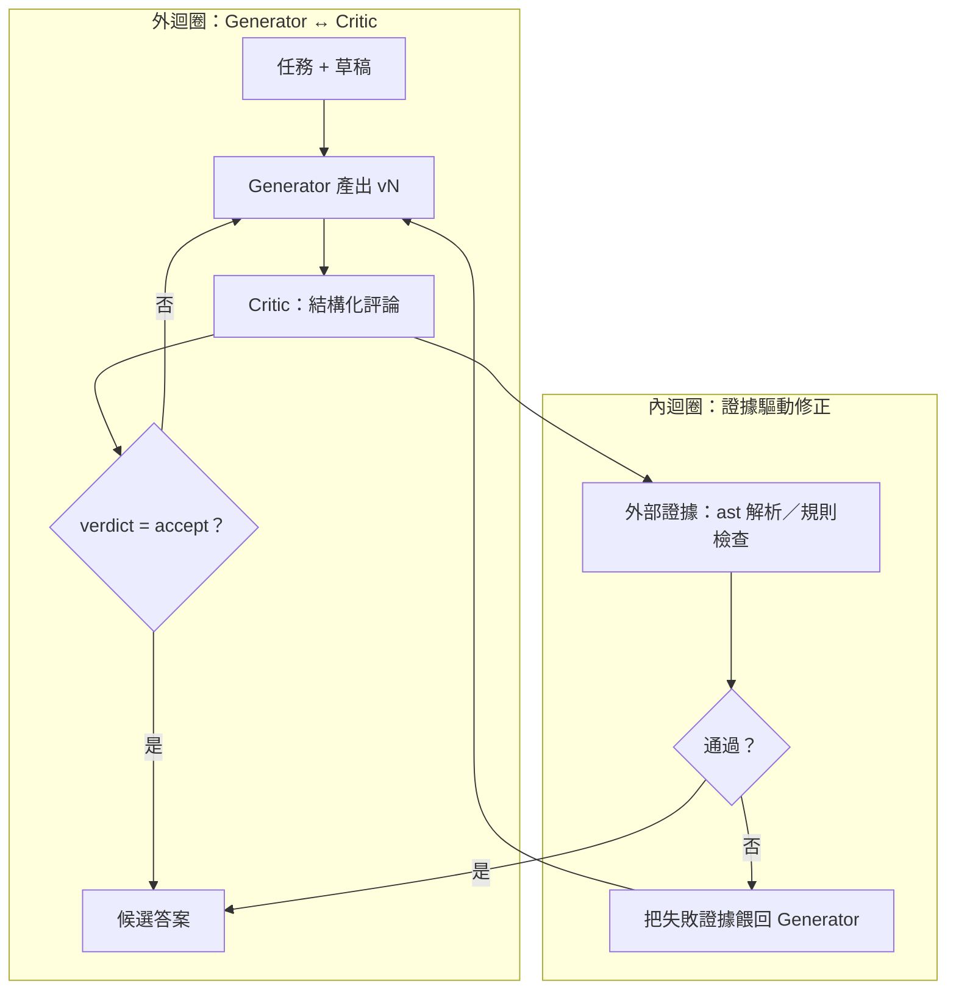
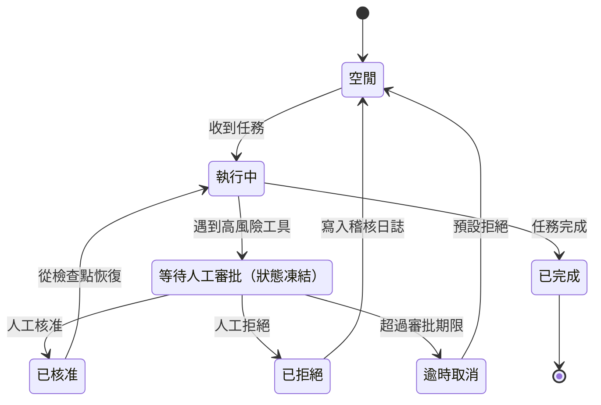

# 第 6 章：四大核心 Agent 設計模式

如果第 5 章的迴圈是引擎，這一章就是四種不同的變速箱。同一個 O-T-A 迴圈，換一種思考紀律，就能處理不同性質的難題：邊做邊看用 ReAct，先拆再做用 Planning，交貨前先自我挑錯用 Reflection，不可逆的動作先停下來問人用 Human-in-the-Loop。四者不是互斥的宗教，而是可以疊加的工具箱。

> **本章你將學到**
>
> - 分辨四種模式各自解決的失敗類型，而不是只背名字。
> - 用原生 SDK 寫出 ReAct 的 Thought／Action／Observation 追蹤。
> - 用 Pydantic 資料契約做出 Plan-and-Solve 與動態重規劃。
> - 用「外部證據 + Critic」讓 Reflection 不再自己給自己打分數。
> - 用檢查點與 idempotency key 實作真正凍結狀態的人工審批。



---

## 問題場景：三個看起來都很聰明的失敗

一位產品經理丟來一個看似單純的任務：

> 「比較三家雲端供應商的物件儲存定價，算出我們每月 12TB 最省的方案，再寫一封給採購的建議信。」

第一版 Agent 的動作順序是這樣：查 A 家定價，得到 $0.023/GB；它立刻在 `content` 裡寫下「最省的是 A 家」；接著查 B 家、查 C 家，卻在最後把一開始那句結論原封不動貼回建議信。信寫得非常流暢，數字是舊的。

第二版是另一個任務：「幫我寫一支呼叫內部 API 的報表腳本」。它產出的程式語法完全正確，卻把 API key 直接 `print` 到日誌。你請它「改掉」，它回覆「已修正，移除了敏感資訊」——但檔案一個字也沒變。

第三版最嚴重。客戶問的是「取消訂單的流程是什麼」，Agent 卻把它理解成執行請求，直接呼叫了 `refund(order_id, amount)`。錢出去了，客戶其實只是想問流程。

### 直覺解法為什麼不夠

最常見的反應是「換更強的模型」或「把提示詞寫得更長」。這兩招在示範場合有效，在上線後會失效，因為這三個失敗對應的是**流程缺陷**，不是**智力缺陷**：

| 失敗 | 表面症狀 | 真正的缺陷 | 需要的模式 |
|---|---|---|---|
| 查到一半就下結論 | 數字過時、前後矛盾 | 缺少「先蒐集再判斷」的結構 | ReAct／Planning |
| 說改了卻沒改 | 自我評估失真 | 沒有外部證據，自己批改自己 | Reflection |
| 誤執行退款 | 不可逆副作用 | 模型不該擁有終局執行權 | Human-in-the-Loop |

模型的單步推理再強，也不等於流程正確。四個設計模式其實是四種流程手術：讓每一步的推理留下痕跡（ReAct）、把長任務拆成可驗證的片段（Planning）、在交付前引入獨立的批評者與證據（Reflection）、在不可逆的動作前把控制權交還給人（Human-in-the-Loop）。

更重要的是：**這一章不介紹任何新的 SDK。**四種模式都建立在第 5 章的迴圈上，差的只是「系統提示詞 + 狀態結構 + 誰握有終止權」。理解這件事，你就不會把它們當成四個要背的框架名詞。

---

## 核心設計模式

### 6.1 ReAct：推理與行動的交織演進

ReAct 來自 Yao 等人 2022 年的論文（見延伸閱讀）。核心主張很優雅：與其讓模型悶著頭一步到位，不如強迫它把**推理也寫成行動的一部分**——先說「我現在要查什麼、為什麼」，再呼叫工具；工具回來後，再根據 Observation 調整下一步。

形式是「Thought → Action → Observation → Thought → … → Answer」：



在原生 tool calling 裡，ReAct 幾乎不需要新東西，只需要你**別把東西丟掉**：

- **Thought** 就是Assistant 訊息的 `content`（當它同時回傳 `tool_calls` 時）。很多人手刻迴圈只取 `tool_calls`、把 `content` 丟掉，ReAct 就消失了一半。
- **Action** 就是 `tool_calls` 裡的 name 與 arguments。
- **Observation** 就是你寫回歷史的 `role="tool"` 訊息。

三種常見誤用值得提醒。第一，Thought 變成「事後摘要」：模型先決定了工具，再補一段漂亮理由；這時追蹤看起來很完整，其實沒有推理價值。解法是要求 Thought 在工具呼叫前就存在，且限制字數（例如 60 字），逼它寫「根據」而不是寫作文。第二，Observation 被截斷得太狠，模型看不到關鍵欄位，於是開始猜。第三，Thought 太長，把第 5 章的 token 預算吃光——長思考不等於好思考。

ReAct 最大的工程價值其實是**可評估性**：每一步的 Thought／Action／Observation 都是結構化軌跡，第 12 章的 trajectory eval 就是拿它來打分。換句話說，ReAct 不只是讓模型變聰明，更是讓你事後看得懂它為什麼這樣做。

### 6.2 Planning：任務拆解、Plan-and-Solve 與動態重規劃

ReAct 擅長邊做邊看，但當任務有八個步驟、且步驟之間有依賴時，邊做邊看很容易走到一半失焦。Planning 的做法是把「規劃」與「執行」拆成兩個角色：Planner 只拆解，不碰工具；Executor 只執行眼前的步驟，不重新設計全局。這種上下文隔離（第 9 章會再談）能明顯降低注意力分散。

Plan-and-Solve（Wang 等人，2023）把這件事形式化：先產出一份計畫，再逐步求解。相較於直接的 chain-of-thought，它在數學與符號任務上更穩。工程上最重要的細節是：**計畫必須是結構化資料，不是一段自然語言**。用 Pydantic 定義 `Plan(steps: list[str])`，才能檢查步驟數量、做版本控制、把它持久化成檢查點。



**動態重規劃是這模式的靈魂。**現實世界會變：你查到 A 家定價後，才發現方案已經下架。這時把整份計畫重寫是浪費——已完成的步驟有真實成本，而且結論仍然有效。正確做法是保留已完成步驟的結果，只重規劃未完成的項目，並把「已完成的事實」連同失敗原因一起餵給 Replanner。

同時要給重規劃設上限（1～2 次）。否則你會得到另一種無限迴圈：「規劃 → 失敗 → 再規劃 → 再失敗」。這正是第 5 章煞車觀念的延伸：**任何會自己召喚自己的流程，都需要一個計數器。**

什麼時候該用 Planning？有三個訊號：步驟數 ≥ 3、子任務可以獨立驗證、你需要把中间產出給人看。如果一個問題兩次工具呼叫就能答完，直接 ReAct 更便宜。

### 6.3 Reflection：Generator-Critic 雙迴圈與自我修正

Reflection 處理的是「輸出品質不穩定」。最基本的形態是兩個角色：Generator 產出，Critic 批評，Generator 拿著批評重寫。但這裡藏著一個幾乎所有人都踩過的陷阱：**如果 Critic 只是同一個模型換個提示詞，它會跟 Generator 共享同一組偏見，分數會收斂到「看起來不錯」。**

解法是分成兩個迴圈：



**內迴圈負責事實。**程式碼用 `ast.parse`／`py_compile`／單元測試取得真正的語法與行為證據；文案用規則檢查（禁語、字數、是否標示資料來源）；結構化資料用 Pydantic 驗證。這些都是 deterministic 的訊號，模型無法用流暢的文字蒙混。順帶一提，執行模型產生的程式碼非常危險，所以範例只做語法解析、不 `exec`；真的要跑請看第 11 章的沙盒。

**外迴圈負責偏好。**Critic 輸出固定 JSON：`{"score": 0-10, "issues": [...], "verdict": "accept|revise"}`，用 Pydantic 驗證後才採信。接受條件應該是「分數達閾值 **且** 沒有外部證據問題」，兩者缺一不可。

收斂控制有三件事：最多三輪；每一輪把上一輪的 `issues` 明確帶進提示詞（而不是指望模型記得）；同一個 issue 重複出現兩次就停止並轉人工——因為這通常代表 Generator 沒有能力修正，再改只是浪費 token。Reflexion（Shinn 等人，2023）更進一步把反思寫入記憶，讓教訓跨任務累積；那就是第 8 章長期記憶的主題。

### 6.4 Human-in-the-Loop：中斷、狀態凍結與人工審批

Human-in-the-Loop（HITL）最常被誤解成「加一個確認對話框」。真正的 HITL 是一個狀態機，而且有三個不可缺少的要件：



**Interrupt（中斷）要發生在工具 dispatch 之前，不是在副作用之後。**判定條件可以是工具名稱（退款、寄信、刪除、下單），也可以是名稱加參數閾值（退款金額 ≥ 5000 才攔截）。把判定寫成一個 `is_high_risk(name, args)` 函式，才能被測試與版本控制。

**狀態凍結要凍結「可繼續的狀態」，不是凍結畫面上的進度條。**具體做法是先把整份 `messages`、目前步數、工具名稱與參數序列化成檢查點寫入磁碟，然後才停下來等人。順序很重要：先落盤，再等待。否則審批到一半程式當掉，你就永遠不知道它原本要做什麼。檢查點裡還要放版本號，避免用舊檢查點配上新提示詞。

**人工審批的結果要回到 Agent 的語言裡。**核准後從檢查點恢復執行，並帶上 idempotency key，防止重複扣款；拒絕或逾時則預設拒絕，把結果寫成一則 tool Observation（例如「人工審批未通過，請換策略」），讓 Agent 有機會改答案，而不是直接丟例外把行程炸掉。誰、何時、根據什麼、做了什麼決定，都要寫入稽核日誌——那是第 11 章與第 12 章的進階議題。

最後，用一張表決定何時該疊哪一層：

| 模式 | 解決的失敗 | 增加的成本 | 典型觸發 |
|---|---|---|---|
| ReAct | 不知道下一步該做什麼 | + 少量 Thought token | 預設即可開啟 |
| Planning | 多步驟任務走偏、前後矛盾 | + 1～2 次 LLM 呼叫 | 步驟 ≥ 3 且有依賴 |
| Reflection | 輸出品質不穩、自我批改失真 | + 2～4 次 LLM 呼叫 | 交付物會被外部使用 |
| HITL | 不可逆副作用、權限越界 | + 人的延遲 | 高風險工具 |

---

## 原生程式碼實作：四種模式落到同一個迴圈上

接下來的範例延續第 5 章的 `loop.py` 與 `tools.py`，請把三個檔案放在同一個 `agent/` 目錄。仍使用官方 SDK，模型預設為 `gpt-4o-mini`。

> 以 openai-python v1.x 與 pydantic v2 為例；Pydantic v1 的驗證方法是 `parse_obj`，不是 `model_validate`。

`agent/patterns.py` 先把前面三種模式實作出來。刻意讓 `react()` 直接呼叫第 5 章的 `run_agent_loop`，正是為了示範「ReAct 是紀律，不是新的迴圈」。

```python
# agent/patterns.py
"""ReAct / Planning / Reflection 的原生實作；HITL 見 hitl.py。
需與第 5 章的 loop.py、tools.py 放在同一資料夾。"""
from __future__ import annotations

import ast
import json
import os
from typing import Any

from dotenv import load_dotenv
from openai import OpenAI
from pydantic import BaseModel, Field

from loop import LoopConfig, SYSTEM_PROMPT, run_agent_loop

load_dotenv()
API_KEY = os.environ["OPENAI_API_KEY"]
client = OpenAI(api_key=API_KEY, timeout=30.0, max_retries=2)
MODEL = os.environ.get("OPENAI_MODEL", "gpt-4o-mini")


def _json_call(system: str, user: str, *, model: str = MODEL) -> dict[str, Any]:
    """共用助手：用 json_object 模式取得可驗證的結構化回應。"""
    resp = client.chat.completions.create(
        model=model,
        response_format={"type": "json_object"},
        messages=[
            {"role": "system", "content": system + "\n只輸出合法 JSON，不要用 Markdown 包裹。"},
            {"role": "user", "content": user},
        ],
        timeout=30.0,
    )
    return json.loads(resp.choices[0].message.content or "{}")


# ---------- 6.1 ReAct ----------
REACT_SYSTEM = SYSTEM_PROMPT + (
    "\n每一步請先在 content 寫一小段 Thought（為什麼這樣做，最多 60 字），"
    "再決定呼叫工具或回答。Thought 會被記錄成追蹤。"
)

def react(question: str, cfg: LoopConfig | None = None) -> dict[str, Any]:
    """ReAct = 提示詞要求推理外顯 + 保留第 5 章 trace 中的 thought。"""
    outcome = run_agent_loop(question, cfg, system=REACT_SYSTEM)
    return {
        "answer": outcome.answer,
        "stop_reason": outcome.stop_reason,
        "react_trace": [
            {"thought": s["thought"], "action": s["action"], "observation": s["observation"]}
            for s in outcome.trace
        ],
    }


# ---------- 6.2 Planning ----------
class Plan(BaseModel):
    steps: list[str] = Field(min_length=1, max_length=8)

class StepResult(BaseModel):
    step: str
    ok: bool
    detail: str

PLANNER_SYSTEM = (
    "你是規劃器。把任務拆成 1–8 個可獨立驗證的步驟，"
    "只輸出 JSON：{\"steps\": [\"步驟一\", \"步驟二\"]}。"
)
EXEC_SYSTEM = "你是執行器。只執行指定步驟，必要時使用工具；完成後簡述結果。"
AGG_SYSTEM = "你是彙整器。根據步驟結果寫出最終回答，所有數字必須來自工具結果。"
REPLAN_SYSTEM = (
    "你是重規劃器。保留已完成的事實，只重寫未完成的步驟，"
    "輸出 JSON：{\"steps\": [...]}。"
)

def plan_and_solve(
    question: str, *, replan_limit: int = 1, cfg: LoopConfig | None = None
) -> dict[str, Any]:
    plan = Plan.model_validate(_json_call(PLANNER_SYSTEM, question))
    results: list[StepResult] = []
    pending = list(plan.steps)
    replans = 0

    while pending:
        step = pending.pop(0)
        outcome = run_agent_loop(
            f"整體任務：{question}\n目前步驟：{step}\n已完成：{[r.step for r in results]}",
            cfg,
            system=EXEC_SYSTEM,
        )
        ok = outcome.stop_reason == "answer"
        results.append(StepResult(step=step, ok=ok, detail=outcome.answer[:400]))

        # 動態重規劃：只改寫未完成的步驟，且最多 replan_limit 次
        if not ok and replans < replan_limit:
            replans += 1
            fixed = _json_call(
                REPLAN_SYSTEM,
                json.dumps(
                    {
                        "已完成": [r.model_dump() for r in results if r.ok],
                        "失敗步驟": step,
                        "未完成": pending,
                        "失敗原因": outcome.stop_reason,
                    },
                    ensure_ascii=False,
                ),
            )
            pending = Plan.model_validate(fixed).steps

    final = client.chat.completions.create(
        model=MODEL,
        messages=[
            {"role": "system", "content": AGG_SYSTEM},
            {
                "role": "user",
                "content": json.dumps(
                    {"任務": question, "步驟結果": [r.model_dump() for r in results]},
                    ensure_ascii=False,
                ),
            },
        ],
        timeout=30.0,
    )
    return {
        "answer": final.choices[0].message.content or "",
        "steps": [r.model_dump() for r in results],
        "replans": replans,
    }


# ---------- 6.3 Reflection ----------
class Review(BaseModel):
    score: int = Field(ge=0, le=10)
    issues: list[str] = Field(default_factory=list)
    verdict: str  # accept | revise

CRITIC_SYSTEM = (
    "你是嚴格的審稿人。只根據任務、草稿與外部證據評分，"
    "不要因為文字流暢就給高分。輸出 JSON："
    "{\"score\": 0-10, \"issues\": [\"具體問題\"], \"verdict\": \"accept|revise\"}。"
)

def _syntax_evidence(draft: str) -> list[str]:
    """程式碼的外部證據：只解析語法，不執行模型產生的程式。"""
    try:
        ast.parse(draft)
    except SyntaxError as exc:
        return [f"語法錯誤：{exc.msg}（第 {exc.lineno} 行）"]
    issues: list[str] = []
    if "eval(" in draft or "exec(" in draft:
        issues.append("出現 eval/exec，請改用安全的解析方式")
    return issues

def _prose_evidence(draft: str) -> list[str]:
    """文案的外部證據：規則檢查，避免純主觀打分。"""
    issues: list[str] = []
    if len(draft) < 80:
        issues.append("內容少於 80 字，論述不足")
    if "根據" not in draft and "資料" not in draft:
        issues.append("沒有標示任何資料來源")
    return issues

def reflect(task: str, *, kind: str = "prose", max_rounds: int = 3) -> dict[str, Any]:
    generator_msg: list[dict[str, Any]] = [
        {"role": "system", "content": "你是產出者。根據任務與批評改寫，直接給最終內容。"},
        {"role": "user", "content": task},
    ]
    history: list[dict[str, Any]] = []
    draft = ""

    for round_no in range(1, max_rounds + 1):
        draft = client.chat.completions.create(
            model=MODEL, messages=generator_msg, timeout=30.0
        ).choices[0].message.content or ""

        evidence = _syntax_evidence(draft) if kind == "code" else _prose_evidence(draft)
        review = Review.model_validate(
            _json_call(
                CRITIC_SYSTEM,
                json.dumps(
                    {"任務": task, "草稿": draft, "外部證據": evidence},
                    ensure_ascii=False,
                ),
            )
        )
        history.append(
            {"round": round_no, "score": review.score, "issues": review.issues, "evidence": evidence}
        )

        if review.verdict == "accept" and review.score >= 8 and not evidence:
            return {"answer": draft, "rounds": round_no, "history": history}

        generator_msg.append({"role": "assistant", "content": draft})
        generator_msg.append(
            {
                "role": "user",
                "content": "批評與證據："
                + json.dumps({"issues": review.issues, "evidence": evidence}, ensure_ascii=False)
                + "\n請重寫。",
            }
        )

    return {
        "answer": draft,
        "rounds": max_rounds,
        "history": history,
        "warning": "未達閾值，建議轉人工審批",
    }


if __name__ == "__main__":
    import sys

    mode = sys.argv[1] if len(sys.argv) > 1 else "react"
    if mode == "react":
        print(json.dumps(react("查台北天氣，再用計算器算 (28 + 5) * 2。"), ensure_ascii=False, indent=2))
    elif mode == "plan":
        print(json.dumps(plan_and_solve("比較台北與高雄天氣，並算出溫差。"), ensure_ascii=False, indent=2))
    elif mode == "reflect":
        print(json.dumps(reflect("寫一段 100 字介紹 Agent Loop 的技術說明。"), ensure_ascii=False, indent=2))
```

`agent/hitl.py` 處理最敏感的一塊：中斷、凍結、審批與恢復。這裡用 `threading.Event` 做阻塞式閘道，方便單機理解；分散式部署請換成訊息佇列加資料庫。

```python
# agent/hitl.py
"""Human-in-the-Loop：中斷 → 凍結 → 審批 → 從檢查點恢復。"""
from __future__ import annotations

import inspect
import json
import os
import threading
import time
import uuid
from dataclasses import dataclass, field
from enum import Enum
from pathlib import Path
from typing import Any, Callable

from dotenv import load_dotenv

load_dotenv()
CHECKPOINT_DIR = Path(os.environ.get("CHECKPOINT_DIR", ".checkpoints"))
CHECKPOINT_DIR.mkdir(exist_ok=True)

class Status(str, Enum):
    IDLE = "idle"
    RUNNING = "running"
    WAITING = "waiting_approval"
    APPROVED = "approved"
    REJECTED = "rejected"
    TIMEOUT = "timeout"
    DONE = "done"

@dataclass
class Checkpoint:
    id: str
    status: Status
    tool_name: str
    arguments: dict[str, Any]
    messages: list[dict[str, Any]] = field(default_factory=list)
    step: int = 0
    idempotency_key: str = ""
    created_at: float = field(default_factory=time.time)

    def save(self) -> None:
        (CHECKPOINT_DIR / f"{self.id}.json").write_text(
            json.dumps(
                {
                    "id": self.id,
                    "status": self.status.value,
                    "tool_name": self.tool_name,
                    "arguments": self.arguments,
                    "messages": self.messages,
                    "step": self.step,
                    "idempotency_key": self.idempotency_key,
                    "created_at": self.created_at,
                    "version": 1,
                },
                ensure_ascii=False,
                indent=2,
            ),
            encoding="utf-8",
        )

class ApprovalGate:
    """阻塞式審批閘；分散式部署請換成訊息佇列 + 資料庫。"""

    def __init__(self, *, timeout_s: float = 300.0, high_risk: set[str] | None = None) -> None:
        self.timeout_s = timeout_s
        self.high_risk = high_risk or {"refund", "send_email", "delete_order"}
        self._events: dict[str, threading.Event] = {}
        self._decisions: dict[str, str] = {}

    def is_high_risk(self, tool_name: str, arguments: dict[str, Any]) -> bool:
        if tool_name in self.high_risk:
            return True
        # 名稱不在高風險清單，但金額超標時照樣攔截
        if tool_name == "refund":
            try:
                return float(arguments.get("amount", 0)) >= 5000
            except (TypeError, ValueError):
                return True  # 參數無法解析時，預設攔截
        return False

    def request(
        self,
        tool_name: str,
        arguments: dict[str, Any],
        *,
        messages: list[dict[str, Any]],
        step: int,
    ) -> tuple[bool, Checkpoint]:
        cp = Checkpoint(
            id=uuid.uuid4().hex,
            status=Status.WAITING,
            tool_name=tool_name,
            arguments=arguments,
            messages=messages,
            step=step,
            idempotency_key=uuid.uuid5(
                uuid.NAMESPACE_URL,
                f"{tool_name}:{json.dumps(arguments, sort_keys=True, ensure_ascii=False)}",
            ).hex,
        )
        cp.save()  # 先落盤再等待：程式當掉也能從檢查點恢復
        event = threading.Event()
        self._events[cp.id] = event
        approved = event.wait(self.timeout_s) and self._decisions.get(cp.id) == "approve"
        cp.status = (
            Status.APPROVED
            if approved
            else Status.REJECTED
            if self._decisions.get(cp.id) == "reject"
            else Status.TIMEOUT
        )
        cp.save()  # 凍結狀態的完整生命週期都留在磁碟上
        return approved, cp

    def decide(self, checkpoint_id: str, decision: str) -> None:
        if decision not in {"approve", "reject"}:
            raise ValueError("decision 必須是 approve 或 reject")
        event = self._events.get(checkpoint_id)
        if event is None:
            raise KeyError(f"找不到檢查點：{checkpoint_id}")
        self._decisions[checkpoint_id] = decision
        event.set()


def guarded_dispatch(
    gate: ApprovalGate,
    dispatch: dict[str, Callable[..., dict[str, Any]]],
    tool_name: str,
    arguments: dict[str, Any],
    *,
    messages: list[dict[str, Any]],
    step: int,
) -> dict[str, Any]:
    """在工具派遣前呼叫它；拒絕時回傳 Observation，而非拋出例外。"""
    cp: Checkpoint | None = None
    if gate.is_high_risk(tool_name, arguments):
        approved, cp = gate.request(tool_name, arguments, messages=messages, step=step)
        if not approved:
            return {
                "error": f"人工審批未通過（{cp.status.value}），不得執行 {tool_name}。請換策略或終止。"
            }

    try:
        fn = dispatch[tool_name]
        call_args = dict(arguments)
        if cp is not None and "_idempotency_key" in inspect.signature(fn).parameters:
            call_args["_idempotency_key"] = cp.idempotency_key
        return fn(**call_args)
    except KeyError:
        return {"error": f"未知工具：{tool_name}"}
    except Exception as exc:
        return {"error": f"{type(exc).__name__}: {exc}"}


if __name__ == "__main__":
    # 示範：另一條執行緒在 3 秒後核准
    gate = ApprovalGate(timeout_s=10.0)
    demo_dispatch: dict[str, Callable[..., dict[str, Any]]] = {
        "refund": lambda order_id, amount: {"ok": True, "order_id": order_id, "amount": amount}
    }
    threading.Timer(3.0, lambda: gate.decide(gate._events and next(iter(gate._events)) or "", "approve")).start()
    print(guarded_dispatch(
        gate, demo_dispatch, "refund", {"order_id": "A1001", "amount": 6000},
        messages=[], step=1,
    ))
```

> 上面 `__main__` 的示範用 `next(iter(gate._events))` 取得檢查點 ID，是為了保持範例精簡；實務上審批端一定會拿到明確的 `checkpoint_id`（例如從 API 回傳或通知信件），不該靠遍歷內部 dict。

第 5 章的 `tools.py` 刻意沒有高風險工具。上線時把 `refund`、`send_email` 註冊進 `TOOL_DISPATCH`，然後在 `loop.py` 的 Act 階段用 `guarded_dispatch(...)` 取代 `fn(**arguments)`，整條迴圈就獲得了中斷能力。注意拒絕時回傳的是 error Observation——模型有機會改口「那我僅說明退款流程」，而不是收到一個例外然後死掉。

> 同步版適合理解狀態機。若整條流程改成非同步，把 `threading.Event` 換成 `asyncio.Event`、`event.wait` 改成 `await event.wait()`，其餘檢查點邏輯不變。

---

## 生產環境踩坑指南

### 坑 1：ReAct 的 Thought 變成事後表演

- **症狀**：軌跡裡每一步都有漂亮的「因為……所以……」，但 Action 跟 Thought 對不起來。
- **原因**：模型先決定了工具，再補一段理由；你只檢查了有沒有 Thought，沒檢查它是否在工具呼叫前就存在且相關。
- **解法**：用結構化輸出同時要求 `thought` 與 `action`，限制 Thought 字數；評估時看「Thought → Action 是否一致」，而不是看文筆。

### 坑 2：Plan 做好就不改，或一直改

- **症狀**：前置條件變了，Agent 仍照著舊計畫執行；或反覆重規劃直到 token 用盡。
- **原因**：把計畫當成不可變的聖旨，或重規劃沒設上限。
- **解法**：每個 StepResult 帶 `ok` 與 `stop_reason`；重規劃時保留已完成事實、只改未完成部分；`replan_limit` 設 1～2，超過就轉人工。

### 坑 3：Reflection 自己打分數，分數永遠很高

- **症狀**：Critic 每次都給 9 分，但產出的程式還是不能編譯時才被抓到。
- **原因**：Generator 與 Critic 是同一個模型、同一組偏見；Critic 只看草稿，沒有外部證據。
- **解法**：Critic 的輸入一定要包含 deterministic 證據（語法解析、規則檢查、schema 驗證）；分數與「無證據問題」同時滿足才接受；讓 Critic 用不同模型或不同角色提示詞。

### 坑 4：HITL 只凍了畫面，沒凍狀態

- **症狀**：審批時程式重啟，恢復後又執行了一次退款，等於扣了兩次款。
- **原因**：檢查點只存了「目前在第幾步」，沒有存完整 `messages`、工具參數與 idempotency key。
- **解法**：先落盤再等待；檢查點帶版本號與 idempotency key；高風險工具本身也要支援冪等（用 key 查重）。

### 坑 5：四種模式全部疊上，延遲與成本爆炸

- **症狀**：一個簡單查天氣的問題，跑了 Planning + Reflection，等了 40 秒、花了十幾次呼叫。
- **原因**：把模式當成「越多越可靠」，沒有依任務分級。
- **解法**：ReAct 當預設；步驟 ≥ 3 才加 Planning；交付物會被外部使用才加 Reflection；只有不可逆工具才加 HITL。把這個判斷寫成路由規則，而不是交給模型即興決定。

### 坑 6：中斷逾時沒有預設行為

- **症狀**：審批通知沒人點，Agent 卡在那裡直到次日，期間佔住一條 worker。
- **原因**：只實作了「核准／拒絕」，沒有定義逾時。
- **解法**：逾時一律視為拒絕（default deny），並寫入稽核日誌；把結果轉成 Observation 讓 Agent 收尾；另設告警通知 human owner。

---

## 小結

- 四種模式不是新 SDK，而是同一個 O-T-A 迴圈上的不同提示詞、狀態結構與終止權配置。
- ReAct 的價值在於把推理外顯成可追蹤的 Thought／Action／Observation；別把 `message.content` 丟掉。
- Planning 的關鍵是結構化計畫、只重規劃未完成部分、並給重規劃設上限。
- Reflection 必須有外部證據，否則 Critic 只是 Generator 的複製品。
- HITL 是狀態機：先落盤凍結，再等人審批；拒絕與逾時都要回到 Agent 能理解的 Observation。
- 依失敗類型選模式，不要全部疊上；模式越多，成本與延遲越高。

## 練習題

1. **入門**：執行 `python patterns.py react`，把 `react_trace` 印出來。逐一標示哪一段是 Thought、哪一段是 Observation，並檢查它們是否相互對應。
2. **中階**：修改 `reflect()`，加一個「同一 issue 連續兩輪出現就停止並回傳 `warning`」的規則；再用一段故意有語法錯誤的程式碼（kind=`code`）測試它是否真的被 `ast.parse` 攔下。
3. **進階**：把 `guarded_dispatch` 接回第 5 章的 `loop.py`，註冊一個假的 `refund(order_id, amount)` 工具；寫一個小測試，分別驗證核准、拒絕、逾時三種路徑，並確認 `.checkpoints/` 裡的檔案內容包含完整的 `messages` 與 `idempotency_key`。

## 延伸閱讀

- Yao 等人,〈ReAct: Synergizing Reasoning and Acting in Language Models〉：<https://arxiv.org/abs/2210.03629>
- Wang 等人,〈Plan-and-Solve Prompting〉：<https://arxiv.org/abs/2305.04091>
- Shinn 等人,〈Reflexion: Language Agents with Verbal Reinforcement Learning〉：<https://arxiv.org/abs/2303.11366>
- Anthropic,〈Building Effective Agents〉：<https://www.anthropic.com/engineering/building-effective-agents>
