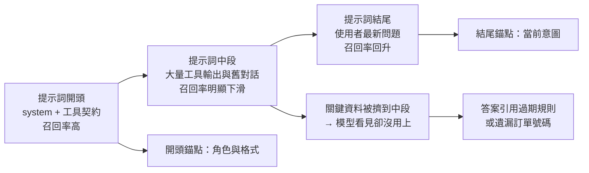
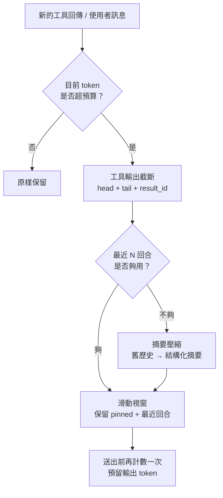
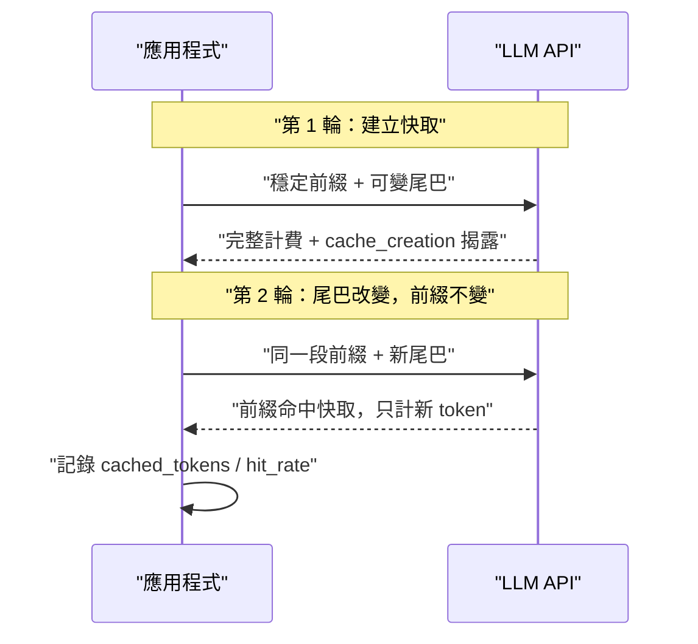

# 第 7 章：短期記憶與上下文視窗管理

前六章我們手刻了代理人（Agent）的迴圈、工具與設計模式，但對話仍全部擠在同一個上下文視窗裡。本章從真實的延遲與成本數字出發，解釋歷史為何越長越慢、越貴、越容易出錯；再介紹滑動視窗、摘要壓縮與工具輸出截斷三種手段，最後把不變的提示詞前綴變成可重複使用的快取資產。

> 本章你將學到
>
> - 用 token 而不是「字數」建立可解釋的成本與延遲模型
> - 理解「迷失在中間（Lost in the Middle）」效應為何讓長對話變笨
> - 比較滑動視窗、摘要壓縮、工具輸出截斷三種壓縮策略的取捨
> - 寫出可統計費用的 token 計數器與上下文壓縮管線
> - 設計對提示詞快取（Prompt Caching）友好的請求結構，讓命中率可觀測


---

## 問題場景：一場越聊越貴、越聊越笨的對話

上線第四天的客服代理人（Agent）收到一張客服主管的工單：「它前五輪還很正常，聊到四十輪之後，回答要等十幾秒，帳單是上周的五倍，而且它居然把三月就廢止的退款規則當成現行政策引用。」我們把追蹤（trace）拉出來看，數字非常一致：第一輪輸入只有 2.4k tokens，第四十輪已經到 58k；p95 延遲從 1.8 秒升到 11 秒；單場對話成本從 0.02 美元升到 0.31 美元。更糟的是，使用者在第八輪給的訂單號碼，在後面的回答裡消失不見——它不是忘記「查訂單」這件事，而是忘記了「哪一個訂單」。

直覺解法很自然地冒出來：把 `max_tokens` 調大、換更便宜的模型、或直接砍掉前二十則訊息。但三條都踩空。`max_tokens` 管的是輸出，真正的爆炸在輸入；換便宜模型會同時削掉推理能力，而且 58k 輸入照樣計費；直接砍前二十則訊息，則很可能把某個工具調用的 `tool_calls` 和對應的 `role=tool` 回傳拆散，模型會看到孤立的結果，甚至讓 API 直接回 400。

更深一層的誤解是「只要在上下文視窗容量內，模型就能平均分吸收」。實際情況是，注意力不是均勻聚光燈：開頭的系統指令和結尾的最新問題被高度關注，中段的大量歷史則被「看見卻沒用上」。這就是「迷失在中間」效應——資訊明明在提示詞裡，召回率卻明顯下滑。換句話說，上下文視窗既是容量限制，也是注意力預算；把它塞滿，不等於把記憶交給模型。

真正該做的是三件事：先能量測（哪些 token 在花錢、哪些能被快取），再能取捨（哪些歷史值得留下、哪些只要留下摘要），最後讓不變的部分 reusable。這一章就是圍繞這條主線展開。

---

## 核心設計模式

### 7.1 對話歷史膨脹的代價：延遲、成本與「迷失在中間」

的成本帳分三筆。第一筆是 **prefill 延遲**：模型必須先把整段提示詞算完才能開始生成，輸入越長，首字延遲越高；自注意力的計算量隨序列長度呈平方成長，所以「輸入翻倍」常常感覺比翻倍更慢。第二筆是 **計費**：主流 API 按輸入／輸出 token 分別計價，對話歷史每輪都被重新傳一次，穩定的 system prompt、工具 schema、few-shot 範例也會跟著重複計費。第三筆是 **注意力稀釋**：關鍵事實淹沒在數十則工具輸出裡，模型傾向依賴開頭與結尾的錨點，中段事實被忽略。



Lost in the Middle 的實務含義不是「模型記性差」，而是**位置是一種稀缺資源**。所以壓縮時有一個簡單卻好用的原則：**重要的東西放頭尾，或想辦法讓它反覆出現在結尾附近**。工具回傳的長 JSON、搜尋結果、除錯日誌，應該在源頭就被裁剪，而不是一路帶到第 40 輪。

| 成本項目 | 與 token 的關係 | 能否被快取 | 常見誤判 |
|---|---|---|---|
| Prefill 延遲 | 超線性（注意力平方項） | 部分可 | 以為換便宜模型就能解決 |
| 輸入計費 | 線性，且每輪重複 | 可（前綴） | 只盯輸出 token |
| 輸出計費 | 線性，單價通常較高 | 不可 | `max_tokens` 設太大 |
| 注意力稀釋 | 與「無關 token 數量」正相關 | 不適用 | 以為全部塞進去就等於記住 |

### 7.2 上下文壓縮策略：三種槓桿，三種取捨

**滑動視窗（Sliding Window）** 最直觀：保留 system prompt 與最近 N 個完整回合，舊的丟掉。它的優點是實作簡單、行為可預測、延遲穩定；缺點是長程依賴會被切斷——第 3 輪確定的折扣規則，在第 30 輪就不見了。實務上應「以回合為單位」切，而不是以訊息為單位，確保 `assistant(tool_calls)` 與 `tool` 回傳成對保留；另一個技巧是另設一列 **pinned messages**（不可壓縮的硬約束：當前任務、安全規則、使用者明確要求）永遠放在最前面。

**摘要壓縮（Summarization）** 把舊對話換成一段結構化摘要。關鍵不在「叫模型隨便總結」，而在把摘要當成**資料契約**：固定欄位如 `decisions`（已決定事項）、`open_questions`、`pending_actions`、`key_facts`，並用 Pydantic 驗證。這樣一來，摘要不會漂移成「客服很禮貌地道了很多次歉」這種毫無資訊量的文字。觸發條件應該用 token 閾值，而不是「每 10 輪摘要一次」——中文、程式碼、JSON 的 token 密度差異極大。

**工具輸出截斷** 常被低估，卻是 CP 值最高的一招：搜尋工具動輒回傳 8k tokens，但模型真正需要的可能只是標題、連結和兩行摘要。做法是在工具邊界就做 head/tail 保留（頭部放欄位與結論，尾部放錯誤與狀態）、結構化抽取，或直接把完整結果寫到外部儲存體、只把一個 `result_id` 放回上下文，需要時再查。



| 策略 | 保留的資訊 | 主要風險 | 適合場景 |
|---|---|---|---|
| 滑動視窗 | 最近 N 回合、完整工具配對 | 長程事實被切掉 | 即時聊天、工具的上下文很短 |
| 摘要壓縮 | 決策、待辦、關鍵事實 | 摘要漂移、幻覺新增事實 | 跨多輪任務、除錯與研究 |
| 工具輸出截斷 | 欄位、結論、引用 ID | 截掉中段關鍵錯誤 | RAG、查詢型工具、日誌 |

三者不是互斥，而是**依序套用**：先截斷工具輸出（最便宜），再看是否需要摘要（中等成本），最後才用滑動視窗限制回合數（最廉價但要付代價）。每次壓縮後都要重新計數，並為輸出預留額度。

### 7.3 Prompt Caching 架構設計：把不變的前綴變成資產

提示詞快取的核心直覺：LLM 服務供應商會對**完全相同的 token 前綴**建立快取，命中後不用重新計算 attention，費用也大幅折扣。也就是說，請求不是一段字串，而是「穩定前綴 + 可變尾巴」的組合。

架構上請把提示詞分成四層，順序永遠固定：① 角色與安全規則（長期不變）；② 工具 schema 與 few-shot 範例（版本化，不變）；③ 任務脈絡（較少變動，例如當前工單摘要）；④ 當前使用者訊息與最近幾輪對話（每輪都變）。快取只可能發生前③層結束之前，所以**任何動態內容——時間戳、UUID、隨機排序的字典鍵——都不能出現在前綴**。實務上最常犯的錯，是把「現在時間：2026-11-27 10:03:12」寫進 system prompt，結果每輪都是新前綴，命中率直接歸零；正確做法是放進尾巴。

計費可以寫成一條式子：

```text
有效輸入成本 = 原始輸入成本 × (1 − r + r × (1 − d))
r = 命中快取的輸入比例；d = 供應商給的折扣
```

以 Anthropic 的快取（明確 `cache_control` 斷點，折扣約 90%）為例，若 90% 的輸入命中快取，有效輸入成本變成 `0.1 + 0.9 × 0.1 = 0.19`，輸入部分降約 81%——這就是章名「降低 80% 成本」的由來。請注意：這是**輸入部分**的降幅，整體帳單仍受輸出 token 影響。OpenAI 的自動提示詞快取不需要斷點，但折扣依模型而異（常見 50% 或 75%），且有最小前綴長度限制；數字請以官方定價與文件為準，不要把示意值寫死在程式裡。



觀測指標至少要三個：`cached_tokens / prompt_tokens`（命中率）、`cache_creation_tokens`（建立成本）、每次請求的有效成本。沒有這三個數字，你會以為「開啟快取」就等於省錢，其實前綴稍一抖動就全白費。

---

## 原生程式碼實作

以下範例以 Python 3.11+、openai-python v1.x 為例，依賴 `pip install openai tiktoken python-dotenv pydantic chromadb networkx`。所有金鑰由 `.env` 提供。

### `context/token_budget.py`：token 計數與成本估算

```python
# context/token_budget.py
from __future__ import annotations

from dataclasses import dataclass

import tiktoken

# 示意定價（USD / 1M tokens），請定期以官方定價頁更新
PRICING: dict[str, dict[str, float]] = {
    "gpt-4o": {"input": 2.5, "cached_input": 1.25, "output": 10.0},
    "gpt-4o-mini": {"input": 0.15, "cached_input": 0.075, "output": 0.6},
}
CONTEXT_LIMITS: dict[str, int] = {"gpt-4o": 128_000, "gpt-4o-mini": 128_000}

# 快取折扣僅供試算；Anthropic 等供應商請改用其官方數值
CACHE_DISCOUNT: dict[str, float] = {"gpt-4o": 0.5, "gpt-4o-mini": 0.5}


def get_encoding(model: str = "gpt-4o") -> tiktoken.Encoding:
    try:
        return tiktoken.encoding_for_model(model)
    except KeyError:  # 未知模型（含SDK尚未收錄的新模型）退回通用編碼
        return tiktoken.get_encoding("cl100k_base")


def count_tokens(text: str, model: str = "gpt-4o") -> int:
    return len(get_encoding(model).encode(text))


def count_messages_tokens(messages: list[dict], model: str = "gpt-4o") -> int:
    """近似 chat completions 的計費方式；精確值以 response.usage 為準。"""
    total = 3  # 每次請求的固定開銷
    for msg in messages:
        total += 4  # 每則訊息的 role 等固定開銷
        for value in msg.values():
            if isinstance(value, str) and value:
                total += count_tokens(value, model)
            elif isinstance(value, list):  # 例如 tool_calls / 多模組內容
                total += count_tokens(str(value), model)
    return total


@dataclass(frozen=True)
class CostEstimate:
    input_tokens: int
    cached_tokens: int
    output_tokens: int
    usd: float


def estimate_cost(
    model: str,
    input_tokens: int,
    output_tokens: int,
    cached_tokens: int = 0,
) -> CostEstimate:
    price = PRICING.get(model)
    if price is None:
        raise ValueError(f"沒有 {model} 的定價資料，請先更新 PRICING")
    cached = min(max(cached_tokens, 0), input_tokens)
    fresh = input_tokens - cached
    usd = (
        fresh * price["input"]
        + cached * price["cached_input"]
        + output_tokens * price["output"]
    ) / 1_000_000
    return CostEstimate(input_tokens, cached, output_tokens, usd)


def assert_fits(messages: list[dict], model: str, reserve: int = 4_096) -> None:
    limit = CONTEXT_LIMITS.get(model, 128_000)
    used = count_messages_tokens(messages, model)
    if used + reserve > limit:
        raise ValueError(f"上下文不足：已用 {used} + 預留 {reserve} > {limit}")
```

> 注意：中文字元在 tiktoken 裡通常不止 1 token，「字元數 ÷ 4」的粗略算法在中文與程式碼上誤差很大，請一律用真實編碼計數。

### `context/compaction.py`：三種壓縮策略的管線

```python
# context/compaction.py
from __future__ import annotations

import os
import time
from typing import Any

from dotenv import load_dotenv
from openai import APIError, OpenAI
from pydantic import BaseModel, ValidationError

from context.token_budget import count_messages_tokens, get_encoding

load_dotenv()
client = OpenAI(api_key=os.environ["OPENAI_API_KEY"], timeout=30.0, max_retries=2)

Message = dict[str, Any]
SUMMARY_SYSTEM = (
    "你是對話壓縮器。只輸出 JSON，欄位：decisions, open_questions, "
    "pending_actions, key_facts；每項是字串陣列。保留具體數字、代號與決定，"
    "不要改寫事實，不要加入原文沒有的資訊。"
)


class Summary(BaseModel):
    decisions: list[str] = []
    open_questions: list[str] = []
    pending_actions: list[str] = []
    key_facts: list[str] = []


def _complete(messages: list[Message], model: str = "gpt-4o-mini") -> str:
    for attempt in range(3):
        try:
            resp = client.chat.completions.create(
                model=model, messages=messages, temperature=0, max_tokens=1_024
            )
            return resp.choices[0].message.content or ""
        except APIError:
            if attempt == 2:
                raise
            time.sleep(2**attempt)  # 同步情境；大量並行時改 AsyncOpenAI + asyncio
    raise RuntimeError("不可達")


def split_into_turns(history: list[Message]) -> list[list[Message]]:
    """以使用者訊息為邊界切回合，避免拆散 tool_calls / tool 配對。"""
    turns: list[list[Message]] = []
    for msg in history:
        if msg.get("role") == "user" or not turns:
            turns.append([msg])
        else:
            turns[-1].append(msg)
    return turns


def sliding_window(
    history: list[Message], keep_turns: int = 6, pinned: list[Message] | None = None
) -> list[Message]:
    turns = split_into_turns(history)
    return (pinned or []) + [m for turn in turns[-keep_turns:] for m in turn]


def truncate_tool_output(text: str, limit: int = 2_000) -> str:
    if limit <= 0:
        return ""
    parts = get_encoding().encode(text)
    if len(parts) <= limit:
        return text
    head = limit * 2 // 3
    tail = limit - head
    kept = (
        get_encoding().decode(parts[:head])
        + "\n…[中間省略]…\n"
        + get_encoding().decode(parts[-tail:])
    )
    return f"{kept}\n[已截斷：原始 {len(parts)} tokens]"


def summarize(history: list[Message]) -> Summary:
    convo = "\n".join(
        f"{m.get('role')}: {str(m.get('content', ''))[:4_000]}" for m in history
    )
    raw = _complete(
        [
            {"role": "system", "content": SUMMARY_SYSTEM},
            {"role": "user", "content": convo},
        ]
    )
    try:
        return Summary.model_validate_json(raw)
    except ValidationError:
        # 模型沒照格式回時不要讓整條請求炸掉，退化成原始文字的一小段
        return Summary(key_facts=[raw[:500]])


def compact_messages(
    system: Message,
    history: list[Message],
    budget: int = 32_000,
    model: str = "gpt-4o",
) -> list[Message]:
    """依序：工具輸出截斷 → 摘要舊歷史 → 滑動視窗 → 重新計數。"""
    truncated: list[Message] = []
    for msg in history:
        if msg.get("role") == "tool" and isinstance(msg.get("content"), str):
            truncated.append({**msg, "content": truncate_tool_output(msg["content"])})
        else:
            truncated.append(msg)

    pinned = [system]
    if count_messages_tokens(pinned + truncated, model) <= budget:
        return pinned + truncated

    old, recent = truncated[:-8], truncated[-8:]
    summary_msg: Message = {
        "role": "system",
        "content": "先前對話摘要：" + summarize(old).model_dump_json(),
    }
    for keep in (6, 4, 2, 0):
        candidate = pinned + [summary_msg] + sliding_window(truncated, keep, pinned=None)
        if count_messages_tokens(candidate, model) <= budget:
            return candidate
    return pinned + [summary_msg]  # 極端情況：只留摘要
```

### `context/cached_client.py`：對快取友好的請求組裝

```python
# context/cached_client.py
from __future__ import annotations

import os
import time
from dataclasses import dataclass

from dotenv import load_dotenv
from openai import APIError, OpenAI

from context.token_budget import estimate_cost

load_dotenv()
client = OpenAI(api_key=os.environ["OPENAI_API_KEY"], timeout=30.0)

STABLE_PREFIX = "你是嚴謹的客服助理。退款規則以 2026 版政策為準，不得引用舊版。"


def build_messages(
    tool_schema_text: str, dynamic_tail: list[dict], stable_prefix: str = STABLE_PREFIX
) -> list[dict]:
    """順序固定：不變的東西一律放前面，會變的放最後。"""
    return [
        {"role": "system", "content": stable_prefix},
        {"role": "system", "content": "工具契約（版本 v3，不可變）：\n" + tool_schema_text},
        *dynamic_tail,  # 當前時間、新訊息、壓縮後的近期對話都放這裡
    ]


@dataclass(frozen=True)
class CacheStats:
    prompt_tokens: int
    cached_tokens: int
    hit_rate: float
    usd: float


def ask(messages: list[dict], model: str = "gpt-4o-mini") -> tuple[str, CacheStats]:
    for attempt in range(3):
        try:
            resp = client.chat.completions.create(
                model=model, messages=messages, temperature=0, max_tokens=512
            )
            usage = resp.usage
            prompt = usage.prompt_tokens if usage else 0
            cached = (
                (usage.prompt_tokens_details.cached_tokens or 0)
                if usage and usage.prompt_tokens_details
                else 0
            )
            output = usage.completion_tokens if usage else 0
            return (
                resp.choices[0].message.content or "",
                CacheStats(
                    prompt_tokens=prompt,
                    cached_tokens=cached,
                    hit_rate=cached / prompt if prompt else 0.0,
                    usd=estimate_cost(model, prompt, output, cached).usd,
                ),
            )
        except APIError:
            if attempt == 2:
                raise
            time.sleep(2**attempt)
    raise RuntimeError("不可達")


# 若使用 Anthropic，需「明確」宣告快取斷點（以 anthropic-sdk-python v0.4x 為例）：
#
# from anthropic import Anthropic
# anthropic_client = Anthropic(api_key=os.environ["ANTHROPIC_API_KEY"])
# resp = anthropic_client.messages.create(
#     model="claude-sonnet-4-5",  # 模型名稱請換成官方目前版本
#     max_tokens=512,
#     system=[{
#         "type": "text",
#         "text": STABLE_PREFIX,
#         "cache_control": {"type": "ephemeral"},  # 快取斷點
#     }],
#     messages=[{"role": "user", "content": "我的訂單延遲了"}],
# )
# print(resp.usage.cache_creation_input_tokens, resp.usage.cache_read_input_tokens)
```

> 以 openai-python v1.x 為例：`usage.prompt_tokens_details.cached_tokens` 是自動快取的觀測欄位；若 SDK 版本較舊沒有這個欄位，程式會安全地回報 0，請升級 SDK 再上線。

---

## 生產環境踩坑指南

### 坑 1：滑動視窗把工具呼叫與回傳拆散

- **症狀**：API 回 400，或模型針對「不存在的工具結果」開始編故事。
- **原因**：按訊息條數裁剪，切走了 `assistant(tool_calls)` 或對應的 `role=tool`。
- **解法**：以「使用者回合」為切割單位（見 `split_into_turns`）；送出前檢查每則 `tool_calls.id` 都有對應的 `tool_call_id`。

### 坑 2：摘要壓縮把「待辦事項」弄丟

- **症狀**：壓縮後代理人忘了答應要執行的動作，或反覆問同一個問題。
- **原因**：自由格式摘要傾向留下「討論過程」，卻丟掉 `pending_actions`。
- **解法**：用 Pydantic 固定欄位，並對 `pending_actions` 做規則檢查（非空的行動項不可在下一輪變成空）。摘要版本號也要寫進 metadata，方便回溯。

### 坑 3：工具輸出截掉最關鍵的錯誤訊息

- **症狀**：模型說「查詢成功」，但實際上工具回傳 Timeout，且錯誤藏在 JSON 尾巴。
- **原因**：只取前 N 個字元，或把 head/tail 比例設得太偏。
- **解法**：結構化抽取工具輸出（先取 `status`、`error`、`summary` 欄位），截斷時保留尾端；必要時回傳 `result_id` 並提供「重新讀取完整結果」工具。

### 坑 4：快取命中率一夜之間從 95% 掉到 0

- **症狀**：成本曲線突然回到未快取的水準，延遲也跟著上升。
- **原因**：有人把當前時間、request id、隨機排序的工具 schema 放進 system prompt，或調整了前綴中任何一個字元。前綴是「完全匹配」，差一個 token 就失效。
- **解法**：建立前綴的雜湊值與命中率儀表板；把穩定內容放版本控制，動態內容一律放尾巴；部署前用固定請求做快取回歸測試。

### 坑 5：用字元數估 token，中文與程式碼直接爆預算

- **症狀**：自認還剩 20k 空間，API 卻回 context length exceeded。
- **原因**：「1 字元 ≈ 4 token」只適用部分英文散文；中文、emoji、JSON、程式碼的密度完全不同。
- **解法**：一律用 `tiktoken` 實際計數，並為輸出預留 `max_tokens`（範例預留 4k）。成本核算最終以 `response.usage` 為準。

### 坑 6：只優化輸入，忘了輸出才是單價最高的部分

- **症狀**：輸入壓下來了，帳單還是居高不下。
- **原因**：Reflection 模式反覆生成長草稿，`max_tokens` 又設得很大。
- **解法**：對輸出做預算與結構化限制（JSON/Enum、精簡格式），把「草稿」改成差異補丁（diff）而不是整篇重寫。

---

## 小結

- 上下文視窗不只是容量上限，更是注意力預算；中段資訊容易被忽略。
- 成本要拆成 prefill 延遲、輸入計費、輸出計費三筆獨立觀察。
- 壓縮依序採用「工具輸出截斷 → 結構化摘要 → 以回合為單位的滑動視窗」，每一步後都要重新計數。
- 摘要必須是契約（固定欄位 + 驗證），不能是自由文字。
- 提示詞快取的關鍵是前綴完全穩定；動態變動的內容只能放在尾巴。
- 80% 是「輸入部分」在高命中率與高折扣下的理想降幅，整體節省仍取決於輸出量與命中率。

## 練習題

1. 用 `tiktoken` 統計一段 500 字中文與 500 字英文的 token 數，比較差異，並解釋為什麼「字元數 ÷ 4」在中文不可靠。
2. 替 `compact_messages` 加入「pinned 硬約束」：即使超出預算也必須保留的系統規則，並寫一個測試證明工具配對不會被拆散。
3. 改造 `cached_client.py`：送出 10 次相同前綴、不同尾巴的請求，畫出命中率曲線；接著故意在前綴插入時間戳，觀察命中率如何崩塌，並提出防止回歸的 CI 檢查。

## 延伸閱讀

- Liu et al., *Lost in the Middle: How Language Models Use Long Contexts*：https://arxiv.org/abs/2307.03172
- OpenAI, *Prompt caching*（自動快取與 `cached_tokens` 欄位）：https://platform.openai.com/docs/guides/prompt-caching
- Anthropic, *Prompt caching*（明確 `cache_control` 斷點與定價）：https://docs.anthropic.com/en/docs/build-with-claude/prompt-caching
- tiktoken（官方 token 編碼工具）：https://github.com/openai/tiktoken
