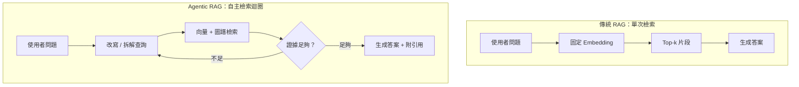
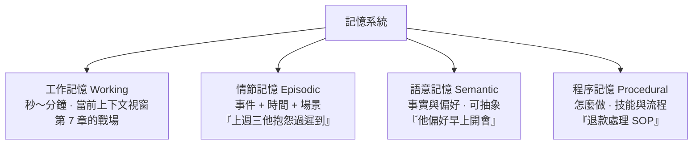
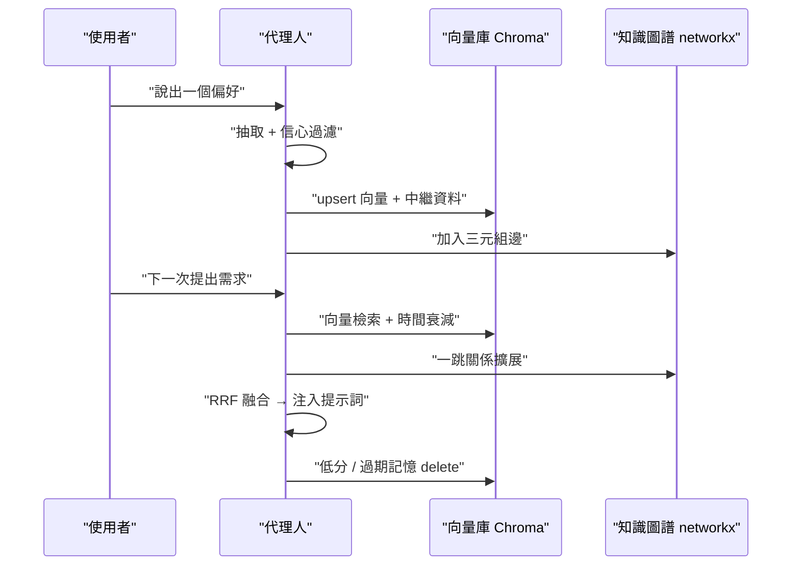

# 第 8 章：Agentic RAG 與長期記憶系統

第 7 章處理的是「這一輪該看什麼」，第 8 章則要回答「下次見面還記得什麼」。我們先從傳統 RAG 的一次性檢索講起，看它為什麼答不了需要多跳推理的問題；接著用認知科學的四類記憶替長期記憶分層，再把向量資料庫與知識圖譜縫合成可寫入、可檢索、可遺忘的系統，最後動手替個人助理做出跨對話週期的使用者偏好記憶庫。

> 本章你將學到
>
> - 辨識傳統 RAG 在查詢改寫、多跳推理與證據評估上的瓶頸
> - 用工作／情節／語意／程序記憶四層來設計長期記憶
> - 實作 OpenAI embeddings + Chroma 向量檢索與 networkx 知識圖譜的混合查詢
> - 寫出記憶的寫入、衝突覆寫、時間衰減與遺忘策略
> - 完成一個跨對話記得使用者偏好的個人助理雛形


---

## 問題場景：它記得所有對話，卻什麼都沒記住

「小秘」是我們替一位產品經理做的個人助理。上線三週後，他丟來一句抱怨：「我第一週明明說過我習慣早上九點開會、討厭超過三行的摘要。昨天我叫它排明天的行程，它又把會議排在下午；我問它摘要為什麼這麼長，它說『依照你的偏好，摘要應簡短』——它是在背我的話，不是在用我的話。」

我們把日誌翻出來，問題很清楚。系統確實把所有對話都做了 embedding 存進向量庫，但檢索時用的是當下的問題「幫我排明天行程」。這句話跟三週前那句「我習慣早上九點開會」在向量空間裡距離很遠，Top-5 召回的全是「行程安排模板」「日曆 API 用法」之類的文件。更糟的是，摘要回覆時它又召回了自己上一輪生成的「依照你的偏好，摘要應簡短」——模型把自己的幻覺當成使用者偏好，形成自我強化的閉環。

另一半問題在「只進不出」：三週內記憶庫累積了 4,200 條記憶，其中將近半數是「好的」「嗯」「收到」這種空記錄，還有一條過期資訊——「我現在住桃園」，但他上週已經搬到台北。檢索結果被噪音稀釋，舊偏好又沒有被新偏好覆寫。

直覺解法是「把更多文件塞進向量庫」或「把 top-k 從 5 調到 20」。前者讓噪音更多，後者直接把上下文視窗塞爆（還記得第 7 章的迷失在中間效應嗎）。真正缺的是三件東西：讓代理人**自己決定何時、用什麼查詢去檢索**；把記憶分成「事件」「事實」「技能」而不是一鍋粥；以及一套**寫入關卡與遺忘機制**，讓過期與低價值記憶自然退場。這三件事，就是本章的主題。

---

## 核心設計模式

### 8.1 傳統 RAG 的瓶頸 vs. Agentic RAG

傳統 RAG 是一條直線：使用者問題 → 固定 embedding → Top-k → 拼進提示詞 → 生成。它便宜、快、好除錯，在「文件裡有現成答案」的場景非常夠用。但它有四個結構性弱點：**詞彙鴻溝**（使用者的說法和文件不同）、**一次機會**（召回失敗就沒有補救）、**固定 k**（不管問題難易都拿一樣多）、**不會 multi-hop**（答案散落在多份文件，需要 A → B → C 串起來時就斷鏈）。

Agentic RAG 把檢索從「一步」變成「一個可由代理人控制的迴圈」：先規劃／改寫查詢，再檢索，接著對證據自我評分，不足就換個說法再查，直到足夠或达到步數上限才生成答案。



這裡的關鍵不是「多查幾次」而已，而是把**查詢改寫**當成模型的一個工具調用：把「它貴嗎」改寫成「產品 A 定價 方案 月費」，把多跳問題拆成「先找訂單號 → 再找該訂單的退款狀態 → 再找對應規則」。同時要有停止條件（步數與成本上限），否則代理人會陷入「再查一次」的無限循環。

| 維度 | 傳統 RAG | Agentic RAG |
|---|---|---|
| 檢索次數 | 固定 1 次 | 依證據品質決定，0～N 次 |
| 查詢 | 原始問題直接 embedding | 改寫、拆分、加入同義詞 |
| 失敗恢復 | 無 | 自我評分後換查詢重試 |
| 多跳推理 | 弱 | 逐跳累積證據 |
| 延遲與成本 | 低且可預測 | 較高，需預算護欄 |
| 適用場景 | FAQ、文件問答 | 個人助理、除錯、跨域研究 |

### 8.2 記憶的認知科學分類：四層，而不是一鍋粥

認知科學把記憶分成幾個功能不同的系統，這個分類直接對應到工程上的儲存選型：



- **工作記憶（Working Memory）**：就是第 7 章的上下文視窗，容量小、易失，但模型當下只能用這一層。
- **情節記憶（Episodic Memory）**：帶時間與場景的事件，例如「使用者昨天上傳了發票」。適合存成帶有 `timestamp` 的文件片段，用向量檢索召回「那一天發生過什麼」。
- **語意記憶（Semantic Memory）**：從多次事件中抽象出的穩定事實與偏好，例如「他偏好早上九點開會」。這是本章偏好記憶庫的主角，適合「主詞—述詞—受詞」三元組 plus 向量索引。
- **程序記憶（Procedural Memory）**：「怎麼做」的知識，例如公司的退款流程、团隊的程式碼風格、某工具的調用範本。它變化慢、複用性高，通常放system prompt或工具 schema，而不是每次重新檢索。

| 類別 | 內容 | 生命週期 | 建議儲存 | 範例 |
|---|---|---|---|---|
| 工作記憶 | 當前對話 | 秒～分鐘 | 上下文視窗 | 這一輪的使用者問題 |
| 情節記憶 | 事件與時間 | 天～月 | 向量庫 + 時間中繼資料 | 「3/12 抱怨過遲到」 |
| 語意記憶 | 事實與偏好 | 月～年，可覆寫 | 向量庫 + 知識圖譜 | 「偏好早上開會」 |
| 程序記憶 | 流程與技能 | 極長，版本化 | 提示詞 / 工具Schema / 檔案 | 「退款需先查訂單」 |

實務上的判斷口訣：**「什麼時候發生的」放情節，「是什麼」放語意，「怎麼做」放程序**。把這三類混在同一個 collection 裡，是記憶系統變髒的開始。

### 8.3 記憶的寫入、檢索與遺忘機制

一條記憶的生命週期是：**抽取 → 驗證 → 寫入 → 檢索 → 衰減 → 遺忘**。

寫入要設關卡：不是所有對話都值得記。用模型抽取候選偏好後，以 `confidence`（抽取信心）與 `importance`（對使用者的長期價值）過濾，低於門檻的直接丟棄；同時檢查是否與既有記憶衝突——同一 `subject + predicate` 的新值應該覆寫舊值，而不是兩筆並存。

檢索採混合策略：向量庫擅長「語意相近但字面不同」的召回，知識圖譜擅長「沿著關係走一跳或多跳」。兩者用倒數排名融合（Reciprocal Rank Fusion, RRF）合併：`score = Σ 1/(60 + rank)`，簡單且不需要額外訓練。最後再乘上時間衰減與信心，讓舊記憶自然降低權重。

遺忘有三種：時間衰減（分數越來越低，自然不會被召回）、容量淘汰（超過上限時清掉分數最低的）、明確刪除（使用者要求「忘了這件事」時，物理刪除向量與圖邊）。注意「遺忘」在技術上不等於「合規刪除」——備份、日誌與稽核軌跡也要一併處理。



### 8.4 實作練習：跨對話週期的使用者偏好記憶庫

目標很具體：讓助理在第 1 次對話聽到「我習慣早上九點開會，討厭超過三行的摘要」，在第 2 次對話（可能是不同天、完全不同措辭）自動套用這兩個偏好，並在使用者說「我改成十點開會了」時覆寫舊值。

驗收條件：① 偏好以結構化欄位寫入，不是整段對話；② 檢索時向量與圖譜都有貢獻，並記錄來源；③ 舊偏好被新偏好覆寫，不會產生矛盾；④ 低於閾值或過期的記憶會被遺忘；⑤ 偏好放在提示詞的「動態區」，不破壞第 7 章的快取前綴。

---

## 原生程式碼實作

以下以 Python 3.11+、openai-python v1.x 為例，依賴 `pip install openai python-dotenv pydantic chromadb networkx`。金鑰由 `.env` 讀取。

### `memory/embeddings.py`：embeddings 封裝（含重試與正規化）

```python
# memory/embeddings.py
from __future__ import annotations

import math
import os
import time

from dotenv import load_dotenv
from openai import APIError, OpenAI

load_dotenv()
client = OpenAI(api_key=os.environ["OPENAI_API_KEY"], timeout=30.0)

EMBED_MODEL = "text-embedding-3-small"
EMBED_DIM = 1_536  # text-embedding-3-small 的維度；換模型時必須一起改


class Embedder:
    def __init__(self, model: str = EMBED_MODEL, dim: int = EMBED_DIM) -> None:
        self.model = model
        self.dim = dim

    def embed(self, texts: list[str]) -> list[list[float]]:
        if not texts:
            return []
        for attempt in range(3):
            try:
                resp = client.embeddings.create(model=self.model, input=texts)
                # API 回傳順序與 input 一致；仍照 index 排序，避免版本差異
                vectors = sorted(resp.data, key=lambda item: item.index)
                return [self._normalize(item.embedding) for item in vectors]
            except APIError:
                if attempt == 2:
                    raise
                time.sleep(2**attempt)  # 同步；高並行時改 AsyncOpenAI + asyncio
        raise RuntimeError("不可達")

    @staticmethod
    def _normalize(vec: list[float]) -> list[float]:
        norm = math.sqrt(sum(v * v for v in vec)) or 1.0
        return [v / norm for v in vec]
```

> `> 以 openai-python v1.x 為例`：`client.embeddings.create(...)` 回傳 `data[i].embedding`；不要把模型名稱或維度寫死在多個地方，換模型時要重建索引（見踩坑指南）。

### `memory/preference_store.py`：向量 + 圖譜混合記憶庫

```python
# memory/preference_store.py
from __future__ import annotations

import json
from dataclasses import dataclass
from datetime import datetime, timezone
from pathlib import Path

import chromadb
import networkx as nx
from pydantic import BaseModel

from memory.embeddings import Embedder


class Preference(BaseModel):
    subject: str
    predicate: str
    object: str
    importance: float = 0.5  # 0～1
    confidence: float = 0.8   # 0～1


@dataclass(frozen=True)
class Hit:
    text: str
    score: float
    source: str


class PreferenceStore:
    def __init__(
        self, chroma_path: str = "./.chroma", graph_path: str = "./.memory/graph.json"
    ) -> None:
        self.embedder = Embedder()
        self.client = chromadb.PersistentClient(path=chroma_path)
        self.collection = self.client.get_or_create_collection("preferences")
        self.graph_path = Path(graph_path)
        self.graph = self._load_graph()

    @staticmethod
    def _as_text(pref: Preference) -> str:
        return f"{pref.subject} 的 {pref.predicate} 是 {pref.object}"

    def _load_graph(self) -> nx.DiGraph:
        if self.graph_path.exists():
            data = json.loads(self.graph_path.read_text(encoding="utf-8"))
            return nx.node_link_graph(data, edges="links")
        return nx.DiGraph()

    def _save_graph(self) -> None:
        self.graph_path.parent.mkdir(parents=True, exist_ok=True)
        data = nx.node_link_data(self.graph, edges="links")
        self.graph_path.write_text(
            json.dumps(data, ensure_ascii=False), encoding="utf-8"
        )

    def write(self, user_id: str, pref: Preference) -> str:
        """同一 subject + predicate 視為同一件事：新值覆寫舊值（supersede）。"""
        pref_id = f"{user_id}:{pref.predicate}:{pref.subject}"
        created_at = datetime.now(timezone.utc).isoformat()
        # Chroma 的 metadata 只接受 str / int / float / bool
        metadata = {
            "user_id": user_id,
            "predicate": pref.predicate,
            "importance": float(pref.importance),
            "confidence": float(pref.confidence),
            "created_at": created_at,
        }
        self.collection.upsert(
            ids=[pref_id],
            embeddings=self.embedder.embed([self._as_text(pref)]),
            documents=[self._as_text(pref)],
            metadatas=[metadata],
        )
        self.graph.add_edge(
            pref.subject,
            pref.object,
            predicate=pref.predicate,
            weight=float(pref.importance),
            created_at=created_at,
        )
        self._save_graph()
        return pref_id

    def retrieve(
        self, user_id: str, query: str, k: int = 5, half_life_days: float = 90.0
    ) -> list[Hit]:
        qv = self.embedder.embed([query])[0]
        res = self.collection.query(
            query_embeddings=[qv],
            n_results=k,
            where={"user_id": user_id},  # 租戶 / 使用者隔離
            include=["documents", "metadatas", "distances"],
        )
        now = datetime.now(timezone.utc)
        vector_hits: list[Hit] = []
        for pid, doc, meta, dist in zip(
            res["ids"][0] or [],
            res["documents"][0] or [],
            res["metadatas"][0] or [],
            res["distances"][0] or [],
        ):
            meta = meta or {}
            created = datetime.fromisoformat(
                str(meta.get("created_at", now.isoformat()))
            )
            age_days = max((now - created).days, 0)
            decay = 0.5 ** (age_days / half_life_days)  # 半衰期衰減
            similarity = 1.0 / (1.0 + float(dist))      # L2 距離 → 0～1
            score = (
                similarity
                * decay
                * float(meta.get("importance", 0.5))
                * float(meta.get("confidence", 0.8))
            )
            vector_hits.append(Hit(str(doc), score, f"vector:{pid}"))

        graph_hits = self._graph_expand(query)
        return self._rrf([vector_hits, graph_hits])[:k]

    def _graph_expand(self, query: str) -> list[Hit]:
        """沿著一跳關係補充：把『開會』連到『早上九點』。"""
        lowered = query.lower()
        hits: list[Hit] = []
        for node in self.graph.nodes:
            if str(node).lower() in lowered:
                for _, dst, data in self.graph.out_edges(node, data=True):
                    hits.append(
                        Hit(
                            f"{node} —{data.get('predicate', '關聯')}→ {dst}",
                            float(data.get("weight", 0.5)),
                            "graph",
                        )
                    )
        return hits

    @staticmethod
    def _rrf(lists: list[list[Hit]], k: int = 60) -> list[Hit]:
        scores: dict[str, float] = {}
        best: dict[str, Hit] = {}
        for hits in lists:
            for rank, hit in enumerate(hits, start=1):
                scores[hit.text] = scores.get(hit.text, 0.0) + 1.0 / (k + rank)
                best.setdefault(hit.text, hit)
        merged = [Hit(h.text, scores[h.text], h.source) for h in best.values()]
        return sorted(merged, key=lambda h: h.score, reverse=True)

    def forget(
        self, user_id: str, min_weight: float = 0.2, max_age_days: float = 365.0
    ) -> int:
        """遺忘：低價值或過期的記憶直接刪除向量，圖上的邊也一併移除。"""
        items = self.collection.get(where={"user_id": user_id}, include=["metadatas"])
        now = datetime.now(timezone.utc)
        removed = 0
        for pid, meta in zip(items["ids"], items["metadatas"] or []):
            meta = meta or {}
            created = datetime.fromisoformat(
                str(meta.get("created_at", now.isoformat()))
            )
            age = (now - created).days
            weight = float(meta.get("importance", 0.5)) * float(
                meta.get("confidence", 0.8)
            )
            if weight < min_weight or age > max_age_days:
                self.collection.delete(ids=[pid])
                removed += 1
                # 圖的清理更保守：只刪掉權重過低的邊，避免誤刪重要結構
                for u, v, data in list(self.graph.edges(data=True)):
                    if float(data.get("weight", 0.5)) < min_weight:
                        self.graph.remove_edge(u, v)
        self._save_graph()
        return removed
```

### `memory/agentic_rag.py`：改寫查詢、多跳檢索與停止條件

```python
# memory/agentic_rag.py
from __future__ import annotations

import json
import os
import time

from dotenv import load_dotenv
from openai import APIError, OpenAI
from pydantic import BaseModel, ValidationError

from memory.preference_store import PreferenceStore

load_dotenv()
client = OpenAI(api_key=os.environ["OPENAI_API_KEY"], timeout=30.0)

PLAN_SYSTEM = (
    "你是檢索規劃器。根據問題與已有證據，決定下一步要查什麼。"
    "只回 JSON：{\"queries\": 字串陣列, \"enough\": 布林, \"reason\": 字串}。"
    "若證據已足以回答，queries 回空陣列且 enough=true。"
)
ANSWER_SYSTEM = "只根據『證據』回答，不要捏造。若證據不足，明確說不知道。"


class RetrievalPlan(BaseModel):
    queries: list[str] = []
    enough: bool = False
    reason: str = ""


def _chat_json(system: str, user: str, model: str = "gpt-4o-mini") -> dict:
    for attempt in range(3):
        try:
            resp = client.chat.completions.create(
                model=model,
                temperature=0,
                max_tokens=512,
                messages=[
                    {"role": "system", "content": system},
                    {"role": "user", "content": user},
                ],
            )
            return json.loads(resp.choices[0].message.content or "{}")
        except (json.JSONDecodeError, ValidationError):
            return {}
        except APIError:
            if attempt == 2:
                raise
            time.sleep(2**attempt)
    return {}


def agentic_answer(
    user_id: str, question: str, max_steps: int = 3
) -> tuple[str, list[str]]:
    store = PreferenceStore()
    evidence: list[str] = []
    for _ in range(max_steps):  # 步數上限就是成本護欄
        raw = _chat_json(
            PLAN_SYSTEM,
            f"問題：{question}\n已有證據：\n" + ("\n".join(evidence) or "（無）"),
        )
        try:
            plan = RetrievalPlan.model_validate(raw)
        except ValidationError:
            plan = RetrievalPlan()
        if plan.enough or not plan.queries:
            break
        for query in plan.queries[:3]:  # 每一步最多 3 個並行查詢
            for hit in store.retrieve(user_id, query, k=4):
                if hit.text not in evidence:
                    evidence.append(f"[{hit.source}] {hit.text}")

    context = "\n".join(evidence) or "（無相關記憶）"
    resp = client.chat.completions.create(
        model="gpt-4o-mini",
        temperature=0.2,
        max_tokens=512,
        messages=[
            {"role": "system", "content": ANSWER_SYSTEM},
            {"role": "user", "content": f"證據：\n{context}\n\n問題：{question}"},
        ],
    )
    return resp.choices[0].message.content or "", evidence
```

> 以 openai-python v1.x 為例：模型輸出用 `temperature=0` 搭配 JSON 格式要求；正式環境可改用 `response_format={"type": "json_object"}` 或 Structured Outputs 提高穩定性。

### `memory/assistant.py`：跨對話週期的個人助理

```python
# memory/assistant.py
from __future__ import annotations

import json
import os

from dotenv import load_dotenv
from openai import APIError, OpenAI
from pydantic import ValidationError

from memory.preference_store import Preference, PreferenceStore

load_dotenv()
client = OpenAI(api_key=os.environ["OPENAI_API_KEY"], timeout=30.0)
store = PreferenceStore()

# 不變的前綴：依第 7 章，這一段要固定才能命中提示詞快取
ROLE_PREFIX = "你是個人助理。回答精簡、具體，不使用未被證實的使用者偏好。"

# 動態萃取：只抽「明確表達的穩定偏好」，不要抽助理自己的發言
EXTRACT_SYSTEM = (
    "從使用者的話中抽取穩定偏好，只回 JSON 陣列，每項含 "
    "subject, predicate, object, importance, confidence。"
    "沒有偏好就回 []。不要把助理說過的話當成偏好。"
)


def extract_preferences(text: str) -> list[Preference]:
    try:
        resp = client.chat.completions.create(
            model="gpt-4o-mini",
            temperature=0,
            max_tokens=512,
            messages=[
                {"role": "system", "content": EXTRACT_SYSTEM},
                {"role": "user", "content": text},
            ],
        )
        items = json.loads(resp.choices[0].message.content or "[]")
        return [Preference.model_validate(item) for item in items]
    except (json.JSONDecodeError, ValidationError, APIError):
        return []  # 抽取失敗不影響主要回答


def chat(user_id: str, user_text: str) -> str:
    hits = store.retrieve(user_id, user_text, k=6)
    preference_block = "\n".join(
        f"- {hit.text}（信心 {hit.score:.2f}，來源 {hit.source}）" for hit in hits
    )
    messages = [
        {"role": "system", "content": ROLE_PREFIX},  # 穩定前綴
        {
            "role": "system",
            "content": "已知使用者偏好（僅供參考，不得覆蓋最新指令）：\n"
            + (preference_block or "（尚無）"),
        },
        {"role": "user", "content": user_text},
    ]
    resp = client.chat.completions.create(
        model="gpt-4o-mini", temperature=0.3, max_tokens=512, messages=messages
    )
    answer = resp.choices[0].message.content or ""

    # 寫入關卡：信心足夠才寫，且只在使用者這次說的話裡找偏好
    for pref in extract_preferences(user_text):
        if pref.confidence >= 0.7 and pref.importance >= 0.4:
            store.write(user_id, pref)
    return answer


if __name__ == "__main__":
    # 兩次對話中間可以隔幾天；偏好會從記憶庫被召回
    print(chat("u-1001", "我習慣早上九點開會，討厭超過三行的摘要。"))
    print(chat("u-1001", "幫我排明天的行程，摘要短一點。"))
    print(chat("u-1001", "我改成十點開會了。"))
```

> 大量並行請求時，把 `OpenAI()` 換成 `AsyncOpenAI`，以 `await client.chat.completions.create(...)` 搭配 `asyncio.gather` 批次抽取偏好；Chroma 的同步客戶端仍可放在執行緒池中，或改用它提供的非同步包裝。

---

## 生產環境踩坑指南

### 坑 1：把整段對話直接當記憶寫入

- **症狀**：記憶庫快速膨脹，檢索結果裡出現「好的」「嗯」，甚至助理自己的幻覺。
- **原因**：缺少抽取關卡，寫入的是對話記錄而不是結構化事實。
- **解法**：用 Pydantic 契約 + `confidence` 門檻過濾；只從使用者話語抽取，助理自己的輸出永不作為偏好來源。

### 坑 2：偏好衝突與實體對齊失敗

- **症狀**：同時存在「偏好早上九點」與「偏好早上十點」，助理無所適從。
- **原因**：用 randomly 產生的 id 寫入，新舊記憶沒有關聯；同一實體的不同說法也沒合併。
- **解法**：以 `user_id + predicate + subject` 組成穩定 id 做 upsert；維護 alias 表（「開會／會議／meeting」）映射到同一規範詞。

### 坑 3：更換 embedding 模型後檢索品質崩塌

- **症狀**：升級到新模型後，相似度分數全亂，舊記憶幾乎召回不到。
- **原因**：不同模型的向量空間不相容，維度也可能不同。
- **解法**：在 metadata 記錄 `embed_model` 與 `dim`；換模型時建新 collection 並重新 embed，保留舊 collection 直到回歸測試通過。

### 坑 4：Chroma 的 metadata 型別與過濾踩雷

- **症狀**：寫入時報型別錯誤，或 `where={"user_id": ...}` 查詢不到結果。
- **原因**：metadata 只接受 `str / int / float / bool`，不接受 list、dict 或 `None`；`where` 的值必須與寫入時完全同型。
- **解法**：寫入前統一轉型（範例已用 `float()` 與 `str()`），並用 tenant/user 欄位做隔離；多條件用 `{"$and": [...]}` 組合。

### 坑 5：Agentic RAG 陷入「再查一次」的無限迴圈

- **症狀**：一個簡單問題觸發十幾次檢索，延遲與成本暴衝。
- **原因**：沒有步數上限、沒有重複查詢偵測，模型總覺得自己證據不夠。
- **解法**：設 `max_steps`（範例為 3）與單輪查詢數上限；記錄已用過的 query，重複則強制停止；把每次檢索的費用寫進追蹤（trace）。

### 坑 6：把「遺忘」當成「合規刪除」

- **症狀**：使用者要求刪除資料後，備份或日誌裡仍找得到。
- **原因**：只刪了向量庫，忘了圖資料、事件日誌與備份。
- **解法**：建立統一的刪除流程（向量 + 圖 + 日誌遮罩 + 備份過期的處理），並留下審计記錄；高敏感偏好寫入前先取得同意。

---

## 小結

- 傳統 RAG 的瓶頸在於單次、固定、不會改寫的檢索；Agentic RAG 用「規劃 → 檢索 → 自我評估 → 停止」的迴圈補上它。
- 長期記憶應分層：工作記憶在上下文視窗，情節記憶記事件，語意記憶記事實與偏好，程序記憶記流程與技能。
- 向量資料庫擅長語意召回，知識圖譜擅長關係跳轉；RRF 能低成本融合兩者。
- 寫入要設信心與重要性門檻，同一主詞＋述詞的新值應覆寫舊值。
- 檢索分數要乘上時間衰減與信心；遺忘包含衰減、容量淘汰與明確刪除三種。
- 偏好記憶是可觀測的工程元件：來源、分數、模型版本與刪除紀錄都要留痕。

## 練習題

1. 比較同一問題在傳統 RAG 與 `agentic_answer` 下的檢索次數、總延遲與答案正確性；設計一個需要兩跳的例子（例如「我上週抱怨的那家餐廳，現在訂位狀態如何？」）。
2. 替 `PreferenceStore` 加入 alias 正規化：讓「開會／會議／meeting」映射到同一節點，並寫測試證明新偏好會覆寫舊偏好而非並存。
3. 調整 `forget` 的策略：把「時間衰減」改成可配置的半衰期，並觀察偏向遺忘（半衰期短）與偏向保留（半衰期長）對一組測試問題召回率的影響。

## 延伸閱讀

- Lewis et al., *Retrieval-Augmented Generation for Knowledge-Intensive NLP Tasks*：https://arxiv.org/abs/2005.11401
- Asai et al., *Self-RAG: Learning to Retrieve, Generate, and Critique through Self-Reflection*：https://arxiv.org/abs/2310.11511
- OpenAI, *Embeddings guide*（模型、維度與最佳實踐）：https://platform.openai.com/docs/guides/embeddings
- Chroma, *Documentation*（PersistentClient、metadata 過濾與查詢 API）：https://docs.trychroma.com/
