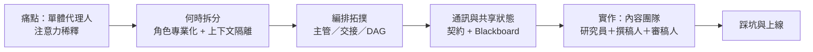
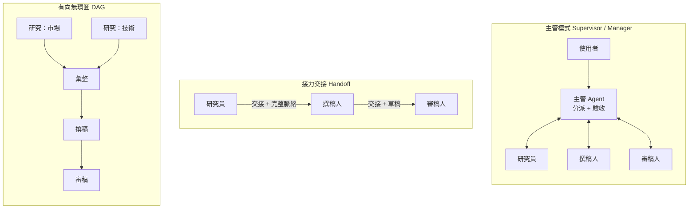
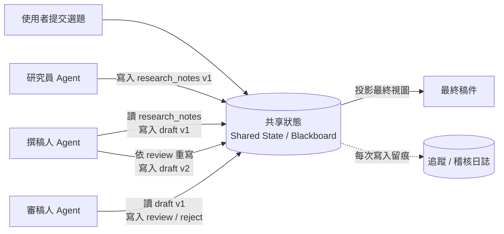
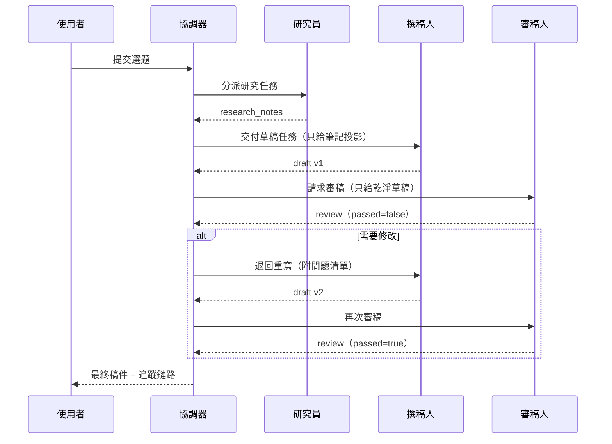

# 第 9 章：Multi-Agent（多代理人）系統架構

> **本章導讀**：單一 Agent（代理人）再聰明，也有注意力稀釋與上下文污染的天花板。本章從「何時該拆」出發，拆解角色專業化與上下文隔離兩大原則，比較主管、交接與 DAG 三種編排拓撲，設計代理人間的通訊協定與共享狀態，最後手刻一支「研究員＋撰稿人＋審稿人」的自動化內容團隊——依舊不用框架。

> **本章你將學到**
> - 判斷何時該把一個 Agent 拆成團隊，而非一味增加提示詞長度
> - 三種編排拓撲（主管／交接／DAG）的適用場景與取捨
> - 用「Shared State（共享狀態）＋結構化訊息」取代混亂的對話轉發
> - 從零實作一個可追蹤、可重試的內容團隊
> - 辨識多代理人系統在生產環境最常踩的五個坑



---

## 問題場景：一個什麼都做、卻什麼都做不好的「超級代理人」

想像你接下一個需求：做一支自動化內容助理，要能「查資料、寫文章、再自己檢查錯誤」。最直覺的做法是寫一個超長提示詞，把三種身分塞進同一個系統提示（system prompt）：

```
你是一位資深研究員，同時也是專業撰稿人與嚴格審稿人。
請先搜尋資料，再寫成文章，最後檢查文章有沒有事實錯誤……
```

上線第一天，它產出一篇 800 字的文章，流暢、結構完整。你很高興。上線第三天，問題來了：文章裡引用了兩個互相矛盾的數字，而「審稿」那一段完全沒有抓出來——因為模型在同一個上下文裡，一邊寫一邊自己審，等於讓它「既當球員又當裁判」。

你直覺的反應是「把提示詞寫得更清楚」：加了一段「請特別注意數字一致性」。結果文章變長了，矛盾還在。於是你又加了一段「你是嚴格的審稿人，請逐句檢查」——上下文視窗（context window）被這些互相打架的指令越擠越滿，模型開始「迷失在中間」，前面的研究筆記被後面幾千字的規則淹沒。

**直覺解法為什麼不夠？** 因為你在試圖用「更多的文字」解決一個「結構性」問題。單一Agent的瓶頸不是智商，而是三個結構缺陷：

1. **注意力稀釋**：一個提示詞裡塞三種角色，模型必須同時遵守三套互斥的評價標準（研究要「廣」，寫作要「順」，審稿要「挑」）。結果是每件事都做到 70 分。
2. **上下文污染**：研究階段的原始資料、寫作階段的草稿、審稿階段的批註全擠在同一個視窗裡。審稿人看到的不是「乾淨的草稿」，而是「草稿＋它自己剛才的思考過程」，很難客觀。
3. **責任無法歸屬**：文章出錯時，你不知道是研究員查錯、撰稿人寫錯，還是審稿人放水。沒有邊界，就沒有可觀測性（observability），也沒有除錯的著力點。

真正的解法不是把大腦變大，而是把大腦**切開**：讓研究員只帶研究資料的上下文、撰稿人只帶草稿所需的上下文、審稿人拿到一份乾淨的草稿。這正是多代理人系統的核心動機——**用架構換取注意力**。

---

## 核心設計模式

### 9.1 何時該拆分多個 Agent？角色專業化與上下文隔離原則

多代理人不是越多越好。每多一個代理人，就多一次 LLM 調用、多一份成本、多一個失敗點，也多一套協調邏輯。在拆之前，先用三個判據檢驗：

| 判據 | 該拆的訊號 | 不該拆的訊號 |
|---|---|---|
| **上下文衝突** | 兩個任務需要的資料彼此干擾（研究要原始雜訊，寫作要乾淨結論） | 任務共享同一份脈絡，拆開反而要重複搬運 |
| **角色對立** | 需要「Generator–Critic」這種互相制衡的關係（寫 vs. 審） | 角色目標一致，只是步驟多 |
| **專業工具／模型差異** | 不同角色需要不同工具、不同模型或不同推理預算 | 所有步驟都只用同一個模型、同一組工具 |

如果三項都不成立，請留在第 5 章的單體 Loop——它更便宜、更好除錯。

拆分的兩個核心原則如下。

**原則一：角色專業化（Role Specialization）。** 每個代理人應該只有**一個可驗證的產出契約**。研究員的產出不是「一段話」，而是一份結構化的 `ResearchNotes`（含來源、關鍵事實、疑問）。撰稿人的產出是一份 `Draft`。審稿人的產出是一份 `Review`（含通過與否、問題清單）。當產出是契約，代理人就能被獨立測試、獨立替換——你甚至可以把研究員從 GPT 換成 Claude，而不影響其餘流程。這是第 2 章「資料契約」觀念的延伸。

**原則二：上下文隔離（Context Isolation）。** 每個代理人只拿到完成自身任務所需的**最小上下文**。這不只是省 token，更是品質手段：審稿人若看到撰稿人的「內心獨白（reasoning）」，會被說服；但只看到乾淨草稿時，才能客觀挑錯。實務上的做法是給每個代理人一份**專用系統提示＋從共享狀態投影出來的視圖（view）**，而不是把整段對話歷史原封不動複製過去。這也正是第 7 章上下文工程在團隊場景的應用。

> **一個簡單的判斷口訣**：如果兩個任務放進同一個腦袋會「互相吵」，就拆；如果拆開後要一直傳話，就別拆。

### 9.2 常見編排拓撲：主管模式、接力交接與有向無環圖

拆成多個代理人後，接著要決定**誰說了算、工作怎麼流**。三種主流拓撲沒有絕對的好壞，只有適不適合。



**主管模式（Supervisor / Manager）。** 一個主管代理人持有全域任務，決定下一步叫誰、何時停止。子代理人完成後把結果回給主管，由主管彙整。優點是控制集中、容易加入人機協作（第 6 章的 interrupt）；缺點是主管本身成為瓶頸與單點故障，且所有訊息都要繞它一圈。適合**任務路徑無法事先預測**的場景——例如客服，你不知道使用者下一句要查訂單還是退貨。

**接力交接（Handoff）。** 代理人像接力賽一樣，把控制權與脈絡交給下一位。交接時通常攜帶一份「交接摘要」，而非完整歷史。優點是延遲低、實作簡單；缺點是容易累積資訊流失（每次交接都掉一點細節），而且一旦往回走（審稿人退回撰稿人）就可能形成迴圈，需要額外的終止條件。適合**線性、階段明確**的流程——正是本章內容團隊的場景。

**有向無環圖（DAG）。** 把任務預先編成一張圖，節點是代理人、邊是資料流。節點可以平行執行（兩個研究員同時查不同主題），最後彙整。優點是可平行、可快取、可預測成本；缺點是缺乏彈性，遇到圖外的突發狀況無法即興處理。適合**可事先規劃、講究吞吐量**的批次作業——例如每晚批量產生 100 篇報告。

| 拓撲 | 控制權 | 平行度 | 彈性 | 典型場景 |
|---|---|---|---|---|
| 主管模式 | 集中於主管 | 低 | 高 | 客服、開放式任務 |
| 接力交接 | 逐一轉移 | 低 | 中 | 內容生產、審核流程 |
| DAG | 分散在圖結構 | 高 | 低 | 批次報告、資料管線 |

實務上常常混用：外層用主管模式決定「做哪個流程」，內層用 DAG 平行執行研究，再用交接完成撰稿到審稿。框架（第 10 章）其實就是把這些拓撲封裝成可複用的元件。

### 9.3 代理人之間的通訊協定與共享狀態設計

最常見的錯誤，是讓代理人彼此「用自然語言聊天」來傳遞工作成果。你很快會得到一段像這樣的話：「我覺得大概可以，資料差不多在那邊。」——不可解析、不可驗證、不可重試。

**通訊協定＝結構化訊息。** 每一則代理人訊息都應該是一份有型別的資料契約，至少包含：

- `sender` / `recipient`：誰發給誰（便於追蹤與權限控管）
- `kind`：訊息種類（`task`／`result`／`review`／`reject`）
- `payload`：符合該契約的結構化內容（用 Pydantic 定義，延續第 2 章）
- `trace_id`：串起整條鏈路的追蹤識別碼（第 12 章會再展開）

**共享狀態（Shared State）＝ Blackboard 模式。** 與其讓 A 直接傳話給 B，不如所有人讀寫一塊共享的「黑板」。黑板保存任務的權威狀態（目前階段、已產出的契約、版本號、錯誤紀錄）。每個代理人被動地從黑板投影出自己需要的視圖，處理完再把結果寫回。好處是：

- **可重試**：代理人崩潰時，狀態還在，重跑即可，不必從頭對話。
- **可稽核**：每一次寫入都能留下時間戳，成為天然的稽核日誌。
- **可隔離**：撰稿人讀不到研究員的推理過程，只讀得到 `ResearchNotes` 契約。



關鍵設計細節是**樂觀鎖（optimistic locking）**：共享狀態帶一個 `version` 號碼，代理人寫回時必須附上它讀到的版本；若版本已被別人改過，寫入失敗並重新讀取。這避免了兩個代理人同時改草稿造成覆蓋。在本章的單線流程裡不會發生，但一旦你上 DAG 平行節點，它就是必需品。

---

## 原生程式碼實作：研究員＋撰稿人＋審稿人內容團隊

我們用接力交接拓撲＋Blackboard 共享狀態，手刻一支內容團隊。全程只用 OpenAI 官方 SDK，不引入任何 Agent 框架。

先定義共享狀態與資料契約（延續第 2 章的 Pydantic 做法）。檔案：`agents/state.py`。

```python
# agents/state.py
from __future__ import annotations

from dataclasses import dataclass, field
from typing import Literal

from pydantic import BaseModel, Field


class ResearchNotes(BaseModel):
    """研究員的結構化產出契約。"""

    topic: str
    key_facts: list[str] = Field(description="3–6 條可查證的關鍵事實")
    sources: list[str] = Field(description="對應的來源網址或出處")
    open_questions: list[str] = Field(default_factory=list)


class Draft(BaseModel):
    """撰稿人的產出契約。"""

    version: int
    title: str
    body: str


class Review(BaseModel):
    """審稿人的產出契約。"""

    passed: bool
    issues: list[str] = Field(default_factory=list)
    suggested_changes: str = ""


Stage = Literal["research", "writing", "review", "done", "failed"]


@dataclass
class SharedState:
    """Blackboard：全域唯一權威狀態，帶版本號做樂觀鎖。"""

    task: str
    stage: Stage = "research"
    version: int = 0
    research_notes: ResearchNotes | None = None
    draft: Draft | None = None
    review: Review | None = None
    revisions: int = 0
    error_log: list[str] = field(default_factory=list)
    trace_id: str = ""

    def commit(self, expected_version: int) -> None:
        """寫入前檢查版本，避免平行代理人互相覆蓋。"""
        if expected_version != self.version:
            raise RuntimeError(
                f"狀態版本衝突：預期 {expected_version}，實際 {self.version}，請重讀後重試"
            )
        self.version += 1
```

接著是三個代理人。每個代理人只拿到自己的系統提示與狀態投影，產出都經過結構化輸出解析。檔案：`agents/content_team.py`。

```python
# agents/content_team.py
from __future__ import annotations

import os
import uuid
from typing import TypeVar

from dotenv import load_dotenv
from openai import OpenAI
from pydantic import BaseModel

from agents.state import (
    Draft,
    ResearchNotes,
    Review,
    SharedState,
)

load_dotenv()
client = OpenAI(api_key=os.environ["OPENAI_API_KEY"])
MODEL = "gpt-4o-mini"  # 版本敏感：以 openai-python v1.x 為例

T = TypeVar("T", bound=BaseModel)


def ask(topic: str, system: str, schema: type[T], retries: int = 2) -> T:
    """呼叫模型並解析成 Pydantic 契約，含重試與逾時。"""
    for attempt in range(retries + 1):
        try:
            resp = client.chat.completions.create(
                model=MODEL,
                temperature=0.2,
                timeout=30.0,
                messages=[
                    {"role": "system", "content": system},
                    {"role": "user", "content": topic},
                ],
                response_format={
                    "type": "json_schema",
                    "json_schema": {
                        "name": schema.__name__,
                        "strict": True,
                        "schema": schema.model_json_schema(),
                    },
                },
            )
            return schema.model_validate_json(resp.choices[0].message.content or "")
        except Exception as exc:  # 解析失敗、逾時、rate limit 都進重試
            if attempt == retries:
                raise RuntimeError(f"模型呼叫失敗（已重試 {retries} 次）") from exc
    raise AssertionError("unreachable")


def researcher(state: SharedState) -> SharedState:
    """角色一：只做研究，只拿到選題，不碰草稿。"""
    v = state.version
    notes = ask(
        state.task,
        "你是嚴謹的研究員。只輸出可查證的事實與來源，不要寫文章。",
        ResearchNotes,
    )
    state.research_notes = notes
    state.stage = "writing"
    state.commit(v)
    return state


def writer(state: SharedState) -> SharedState:
    """角色二：只拿到研究筆記的投影，看不到別的雜訊。"""
    if state.research_notes is None:
        raise ValueError("尚無研究筆記，無法撰稿")
    v = state.version
    facts = "\n".join(f"- {f}" for f in state.research_notes.key_facts)
    notes = ask(
        f"題目：{state.task}\n已查證事實：\n{facts}",
        "你是專業撰稿人。根據提供的事實寫一篇結構清楚的文章，不要新增未查證的數字。",
        Draft,
    )
    notes.version = state.revisions + 1
    state.draft = notes
    state.stage = "review"
    state.commit(v)
    return state


def reviewer(state: SharedState) -> SharedState:
    """角色三：只拿到乾淨草稿，刻意不給研究筆記，避免被說服。"""
    if state.draft is None:
        raise ValueError("尚無草稿，無法審稿")
    v = state.version
    verdict = ask(
        f"標題：{state.draft.title}\n\n{state.draft.body}",
        "你是吹毛求疵的審稿人。逐句檢查事實矛盾、邏輯跳躍與語句冗贅，"
        "有問題就 passed=false 並列出具體問題。",
        Review,
    )
    state.review = verdict
    if verdict.passed:
        state.stage = "done"
    elif state.revisions < 2:  # 最多退回兩次，避免無限修改迴圈
        state.revisions += 1
        state.stage = "writing"
    else:
        state.stage = "failed"
        state.error_log.append("審稿超過兩次仍未通過，轉人工處理")
    state.commit(v)
    return state
```

最後是協調器（接力交接＋時序如圖）。它不自己做決策，只根據 `stage` 路由，並把每一步寫入追蹤。檔案：`agents/orchestrator.py`。



```python
# agents/orchestrator.py
from __future__ import annotations

import time

from agents.content_team import researcher, reviewer, writer
from agents.state import SharedState


def run(task: str) -> SharedState:
    """接力交接：根據 stage 路由，直到 done / failed。"""
    state = SharedState(task=task, trace_id=str(time.time_ns()))
    steps = {
        "research": researcher,
        "writing": writer,
        "review": reviewer,
    }
    for _ in range(12):  # 全域最大步數，防止失控
        if state.stage in ("done", "failed"):
            break
        handler = steps.get(state.stage)
        if handler is None:
            state.error_log.append(f"未知階段：{state.stage}")
            state.stage = "failed"
            break
        try:
            state = handler(state)
        except Exception as exc:  # 單一步失敗就記錄並停止，不留半截狀態
            state.error_log.append(f"{state.stage} 失敗：{exc}")
            state.stage = "failed"
            break
    return state


if __name__ == "__main__":
    result = run("台灣再生能源發展現況與挑戰")
    print(f"階段：{result.stage}　版本：{result.version}　追蹤：{result.trace_id}")
    if result.draft:
        print(f"\n{result.draft.title}\n\n{result.draft.body}")
    if result.error_log:
        print("\n錯誤：", *result.error_log, sep="\n- ")
```

這支約 120 行的團隊已經具備：角色隔離、結構化契約、樂觀鎖、重試、全域步數上限與追蹤 ID。它本質上就是第 5 章那個 `while` 迴圈，只不過「每一步」從工具調用換成了「呼叫另一個代理人」。看懂這層對應，第 10 章的框架對你來說就只是封裝，而不是魔法。

---

## 生產環境踩坑指南

### 坑 1：交接時把整段對話historical照單全收

- **症狀**：審稿人「同意」了撰稿人自己都知道有問題的句子。
- **原因**：你把撰稿人的推理過程一起餵給審稿人，它被自己的思路說服了。
- **解法**：交接只傳契約（`Draft`），不傳 reasoning；對審稿人刻意隱藏研究筆記，維持「新眼光」。

### 坑 2：退回迴圈失控

- **症狀**：審稿人不斷退回，草稿改了十幾版，成本暴衝。
- **原因**：沒有最大修改次數，也沒有「降級」路徑。
- **解法**：像範例中的 `revisions < 2` 硬上限，超標就轉人工（`failed`），並把差異寫入 `error_log`。

### 坑 3：共享狀態被並行節點覆蓋

- **症狀**：DAG 裡兩個研究員同時完成，後寫的把先寫的覆蓋掉。
- **原因**：狀態沒有版本控管，變成 last-write-wins。
- **解法**：導入 `commit(expected_version)` 樂觀鎖，或每個節點只寫自己的 key，由彙整節點統一合併。

### 坑 4：結構化輸出解析失敗就崩潰

- **症狀**：模型偶爾回傳不符合 schema 的 JSON，整條鏈路掛掉。
- **原因**：把結構化輸出當成 100% 可靠。
- **解法**：`model_validate_json` 外包 try/except＋指數退避重試；連續失敗要降級（例如改用較大模型或轉人工），不要無限重試。

### 坑 5：缺乏端到端追蹤，出事找不到是哪一棒掉鏈子

- **症狀**：文章出錯，但没人知道是研究、寫作還是審稿階段的問題。
- **原因**：每次 LLM 調用沒有共用追蹤識別碼。
- **解法**：從 `trace_id` 貫穿所有代理人與工具調用，記錄每次狀態版本變遷（第 12 章會完整展開 Tracing 與 Evals）。

| 坑 | 一句話防呆 |
|---|---|
| 交接污染 | 只傳契約，不傳思考 |
| 退回失控 | 修改次數硬上限 |
| 狀態覆蓋 | 樂觀鎖＋分 key 寫入 |
| 解析失敗 | 重試＋降級路徑 |
| 追蹤斷鏈 | 單一 trace_id 貫穿 |

---

## 小結

- 多代理人的動機是**用架構換注意力**，不是把提示詞寫得更長。
- 拆分的兩個判據是上下文衝突與角色對立；角色專業化與上下文隔離是設計核心。
- 主管模式重控制、交接重簡單、DAG 重吞吐；實務上常混用。
- 通訊要結構化契約，狀態要集中式 Blackboard＋版本控管。
- 手刻的接力團隊已具備框架的核心能力，差別只在封裝程度。

## 練習題

1. **（淺）** 把本章的 `Review` 契約加上一個 `severity: Literal["minor", "major"]` 欄位，並讓協調器只在 `major` 問題時才退回重寫。
2. **（中）** 將內容團隊改為「主管模式」：新增一個 supervisor 代理人，根據 `stage` 與 `review.issues` 決定下一步叫誰，而不是寫死的字典路由。比較兩種寫法的程式碼量。
3. **（深）** 把研究階段改成 DAG：兩個研究員平行查「市場」與「技術」，再由彙整節點合併成 `ResearchNotes`。你必須處理並行寫入的樂觀鎖問題——試著用 `asyncio.gather` 搭配版本號設計。

## 延伸閱讀

- OpenAI, *A practical guide to building agents*（角色、交接與護欄的官方建議）：<https://openai.com/business/guides-and-resources/a-practical-guide-to-building-agents/>
- LangGraph 官方概念文件（Blackboard／State 的框架化實作，對照本章）：<https://langchain-ai.github.io/langgraph/concepts/overview/>
- OpenAI Agents SDK 文件（Handoff 機制的參考設計）：<https://openai.github.io/openai-agents-python/handoffs/>
- Russell & Norvig, *Artificial Intelligence: A Modern Approach*, Ch. 2（Agent 與環境的基礎模型）：<https://aima.cs.berkeley.edu/>
