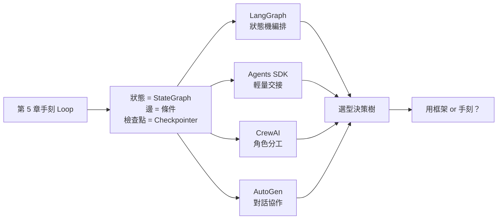
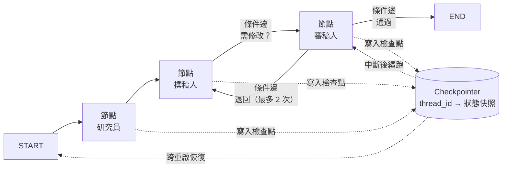
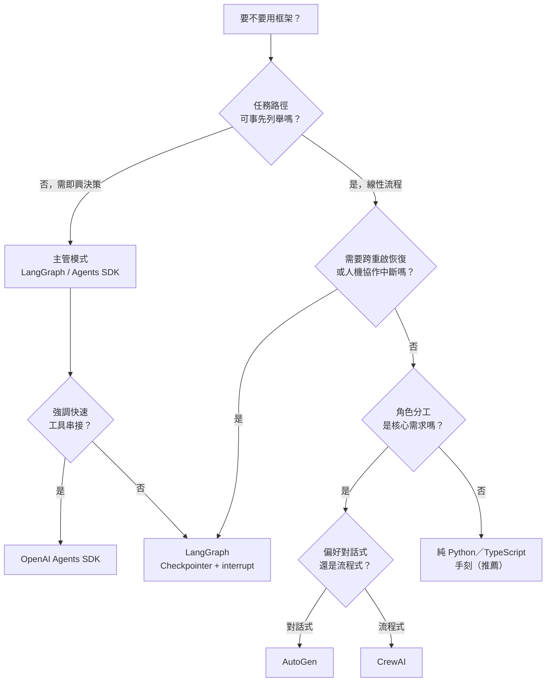

# 第 10 章：主串流開發框架選型與底層對比

> **本章導讀**：到第 9 章為止，你手刻的 Agent 已經能協作、能記住狀態、能重試。但當需求變成「跨重啟恢復、執行到一半暫停等人審批」，手刻成本開始急速上升。本章把第 5 章那個 `while` 迴圈逐項映射到 LangGraph 的狀態圖，再比較 OpenAI Agents SDK、CrewAI、AutoGen 的核心理念，最後給你一棵決策樹——讓你選框架，而不是被框架選。

> **本章你將學到**
> - 把第 5 章手刻迴圈逐項對應到 LangGraph 的 StateGraph、條件邊與 Checkpointer
> - 理解 LangGraph 的節點、邊與持久化檢查點如何運作
> - 比較四大主流框架的核心抽象與適用場景
> - 用一棵決策樹判斷「該用框架」還是「繼續手刻」
> - 避免把框架當黑盒，而能對照底層原理除錯



---

## 問題場景： Demo 很漂亮，但一重啟就全忘了

你的內容團隊上線兩週，老闆很滿意。直到某天凌晨，部署重啟剛好發生在審稿階段——一篇文章改到一半，草稿、研究筆記、修改次數全留在記憶體裡，進程一死，全部蒸發。使用者隔天早上回來，系統問他：「請問您要研究什麼主題？」

更麻煩的需求接著來：法務要求「金額 over 10 萬的稿件必須暫停，等人類主管批准才能繼續」;維運要求「每一步都要能從檢查點重跑，不能整條鏈從頭來」;產品要求「同一個使用者的對話要能接得上上次」。

你的直覺可能是：在 Blackboard 上加個 `save_to_json()`，再寫個 `load_from_json()`。這個補丁短期有效，但你很快會發現自己正在重新實作一套違章的狀態機：什麼時候存？存到哪一版？失敗怎麼回滾？中斷後如何從中間恢復？權限怎麼看？——這正是框架誕生的理由。

但另一個極端同樣危險：直接把整套換成某個框架，三週後 Demo 很漂亮，卻沒有人說得清楚「為什麼 Agent 卡在同一個節點三次」「成本為什麼是昨天的五倍」。如果你沒有先手刻過第 5 章的迴圈，框架對你就是黑盒，出事時連縫隙都找不到。

**問題的本質不是「要不要用框架」，而是「你知不知道框架幫你做了什麼」。** 本章的立場很明確：先有底層心智模型，再把框架當成「把已知概念封裝起來的工具」。當你看到 `StateGraph`，腦中浮現的應該是第 5 章那個 `while` 迴圈，而不是一個全新的名詞。

---

## 核心設計模式

### 10.1 狀態機圖架構：把第 5 章的 Loop 翻譯成 LangGraph

LangGraph 的核心主張只有一句：**把 Agent 的執行流程表示成一個有向圖，讓狀態在節點之間流動**。它沒有發明新东西——它把你已經寫過的東西換了名字。

先看這張對照表，它是本章最重要的一張表：

| 第 5 章／第 9 章手刻元件 | LangGraph 對應 | 背後做的事（你早就寫過） |
|---|---|---|
| `state: dict` 或 `SharedState` dataclass | `StateGraph` 的 state schema（`TypedDict`） | 承載所有代理人共享的資料 |
| `while True:` 迴圈本體 | 圖的「邊」——`add_edge`／`add_conditional_edges` | 決定下一步去哪個節點 |
| 每個 `if stage == ...:` 分支 | 條件函式（router function） | 根據 state 回傳下一節點名稱 |
| `return` / `stage = "done"` 終止 | 特殊節點 `END` | 停止執行 |
| 手寫 `save_json()` / `load_json()` | `Checkpointer`（`MemorySaver`／`PostgresSaver`） | 每次轉換後自動持久化檢查點 |
| 最大步數計數器 | `recursion_limit`（compile / invoke 設定） | 防止無限迴圈 |
| `try/except` 重試 | 節點內重試，或框架的 retry policy | 容錯 |
| 人為中斷 flag | `interrupt()` + checkpointer 恢復 | 暫停等人審批 |

看懂這張表，LangGraph 就不再是魔法。它做的事情，你第 5～9 章全部手寫過，只是框架把它standard化、可視化、可持久化。



**三個核心元件：**

1. **狀態（State）**：通常是一个 `TypedDict`。所有節點讀同一份 state、回傳一個「部分更新（partial update）」，框架負責合併。關鍵設計點是「reducer」——例如 `Annotated[list, add_messages]` 告訴框架「新訊息要追加，不是覆蓋」。這對應你手刻時自己寫的 `state.messages.append(...)`。
2. **節點（Node）**：就是一個函式，输入 state，輸出部分 state。一個節點可以是一次 LLM 調用、一次工具執行，或一整段子流程。第 9 章的 `researcher`／`writer`／`reviewer` 幾乎不用改就能直接當節點。
3. **邊（Edge）**：分固定邊（`add_edge`）與條件邊（`add_conditional_edges`）。條件邊就是路由函式，等同你寫的 `if stage == ...`。它讓圖有了「分支」與「迴圈」能力。
4. **Checkpointer（檢查點持久化）**：每次節點執行後，框架把 state 快照存到一個 `thread_id` 下。隔天用同一個 `thread_id` invoke，就從上次的狀態繼續。這是手刻 Blackboard 最痛的那一塊，框架直接幫你做掉。

> **注意**：`MemorySaver` 只存在記憶體裡，進程重啟就消失，適合開發測試。正式環境要換成資料庫後端（例如 `langgraph-checkpoint-postgres` 的 `PostgresSaver`），才能真正做到「跨重啟恢復」。

### 10.2 輕量化編排與協作：OpenAI Agents SDK / CrewAI / AutoGen 核心理念比較

LangGraph 是「狀態機思維」，其餘三套框架的代表理念各不相同。理解它們差異的關鍵，是看它們**把「協作」抽象成什麼**。

**OpenAI Agents SDK：以「交接（Handoff）」為核心。** 它把agents当成一个个可呼叫的單體，透過 `handoffs` 把控制權從 A 轉給 B，並搭配內建的 tracing 與 guardrail（護欄）。理念是「輕量、貼近官方 SDK、好上手」。你第 9 章寫的接力交接，幾乎就是它的手刻版。適合已經用 OpenAI 生態、想快速把工具與交接串起來的團隊。

**CrewAI：以「角色（Role）與任務（Task）」為核心。** 你先定義 `Agent`（角色、目標、背景故事）與 `Task`（描述、預期產出），再把它們組成 `Crew`，由 `process`（sequential／hierarchical）決定執行順序。理念是「模仿真實團隊組織」。它對「角色分工」的表達最直接，適合內容生產、市場調研這類人類組織語言容易對應的場景；但底層流程控制較不透明，客製化迴圈較麻煩。

**AutoGen：以「對話（Conversation）」為核心。** 代理人透過互相發訊息來推進任務， human 可以作為其中一個 agent 參與。理念是「多代理人對話即計算」。它非常靈活、適合研究與探索性任務，但對話容易失控膨脹，需要額外約束發言次數與終止條件。

| 框架 | 核心抽象 | 編排風格 | 狀態／持久化 | 人機協作 | 學習曲線 | 最適合 | 主要代價 |
|---|---|---|---|---|---|---|---|
| **LangGraph** | 狀態圖（節點／邊） | 顯式流程圖，可分支可迴圈 | Checkpointer 一等公民，支援 DB 後端 | `interrupt()` + 恢復，成熟 | 較陡 | 需要精確控制、可恢復的長流程 | 要自己畫圖、樣板碼較多 |
| **OpenAI Agents SDK** | Agent + Handoff | 交接式，輕量 | 仰賴 session／外部實作 | guardrail + handoff | 低～中 | 快速串接工具與官方模型 | 複雜流程需自己補狀態機 |
| **CrewAI** | Role + Task + Crew | 角色導向，sequential／hierarchical | 框架管理，較不透明 | 有限 | 低 | 內容生產、角色分工明確的任務 | 底層控制較難客製 |
| **AutoGen** | 對話訊息 | 對話驅動，彈性高 | 對話歷史為主 | human 可作為 agent 參與 | 中 | 研究探索、需要多人對話 | 對話易膨脹、終止條件要自己把關 |
| **純手刻（第 5–9 章）** | `while` + dict | 完全自控 | 自己寫 | 自己寫 flag | 低（但工多） | 流程簡單、想完全掌控 | 所有基礎設施都要自己維護 |

選型時別只看「哪个框架功能多」，要看**它強制你思考的抽象，是否吻合你問題的形狀**。問題是流程圖，就選 LangGraph；是交接，就選 Agents SDK；是角色，就選 CrewAI；是開放對話，就選 AutoGen。

### 10.3 建築師的抉擇：何時該用框架，何時該自己寫？

框架不是信仰，是取捨。它的價值在於把「你已經知道怎麼寫、但寫很多次會煩」的基礎設施standard化：檢查點、重試、暫停恢復、可視化、分散式追蹤。它的代價是增加一層抽象，讓除錯多隔一層。

我用一條簡單的法則判斷：**當基礎設施的成本超過理解抽象的成本，就用框架；反之手刻。**

具體來說：

- **該用框架**：需要跨重啟恢復、長時間執行、人機協作中斷、多人協作維護、流程需要可視化與審核——這些正是 LangGraph 的 Checkpointer 與 `interrupt()` 折扣最多的地方。
- **該手刻**：流程是短命的、線性的、單人維護、需要對每一步有百分之百掌控、或只是原型驗證。第 5 章的 `while` 迴圈在這裡比任何框架都清楚。
- **漸進路線（最推薦）**：先手刻到痛點出現，再把那一塊換成框架。例如先用手刻 Loop，等「跨重啟」真的成為問題，才引入 Checkpointer——而不是一開始就全家桶。



還有一个常被忽略的判據：**團隊的除錯能力**。如果團隊裡沒有人讀得懂框架的原始碼，那麼框架出事時只能等升級。這時「slow but clear」的手刻版反而更可靠。框架應該放大你的理解，而不是取代它。

---

## 原生程式碼實作：把第 9 章內容團隊翻譯成 LangGraph

同一支內容團隊，我們用 LangGraph 重寫一次。你會發現節點函式幾乎不用改，差別只在於「圖的組裝」與「Checkpointer」。

> 以下以 `langgraph` v0.x 為例；API 在版號間仍可能變動，上線前請對照官方文件。檔案：`team_graph.py`。

```python
# team_graph.py
from __future__ import annotations

import os
from typing import Literal, TypedDict

from dotenv import load_dotenv
from langgraph.checkpoint.memory import MemorySaver
from langgraph.graph import END, START, StateGraph

from agents.content_team import ask
from agents.state import Draft, ResearchNotes, Review

load_dotenv()


class TeamState(TypedDict):
    """對應第 9 章的 SharedState——只是換成 TypedDict。"""

    task: str
    stage: str
    research_notes: ResearchNotes | None
    draft: Draft | None
    review: Review | None
    revisions: int


def researcher(state: TeamState) -> dict:
    notes = ask(
        state["task"],
        "你是嚴謹的研究員。只輸出可查證的事實與來源。",
        ResearchNotes,
    )
    return {"research_notes": notes, "stage": "writing"}


def writer(state: TeamState) -> dict:
    facts = "\n".join(f"- {f}" for f in state["research_notes"].key_facts)
    draft = ask(
        f"題目：{state['task']}\n已查證事實：\n{facts}",
        "你是專業撰稿人，根據事實寫文章，不要新增未查證數字。",
        Draft,
    )
    draft.version = state["revisions"] + 1
    return {"draft": draft, "stage": "review"}


def reviewer(state: TeamState) -> dict:
    verdict = ask(
        f"{state['draft'].title}\n\n{state['draft'].body}",
        "你是嚴格審稿人，逐句檢查矛盾，有問題就 passed=false。",
        Review,
    )
    if verdict.passed:
        return {"review": verdict, "stage": "done"}
    if state["revisions"] < 2:
        return {"review": verdict, "stage": "writing", "revisions": state["revisions"] + 1}
    return {"review": verdict, "stage": "failed"}


def route(state: TeamState) -> Literal["writer", "reviewer", "__end__"]:
    """條件邊：等同第 5 章的 if stage == ...。"""
    stage = state["stage"]
    if stage == "writing":
        return "writer"
    if stage == "review":
        return "reviewer"
    return "__end__"  # done / failed 都結束


def build_graph():
    builder = StateGraph(TeamState)
    builder.add_node("researcher", researcher)
    builder.add_node("writer", writer)
    builder.add_node("reviewer", reviewer)

    builder.add_edge(START, "researcher")
    builder.add_edge("researcher", "writer")
    builder.add_conditional_edges("writer", route, ["writer", "reviewer", "__end__"])
    builder.add_conditional_edges("reviewer", route, ["writer", "reviewer", "__end__"])

    # 開發用 MemorySaver；正式環境改用 PostgresSaver 才能跨重啟恢復
    checkpointer = MemorySaver()
    return builder.compile(checkpointer=checkpointer)


graph = build_graph()

if __name__ == "__main__":
    config = {"configurable": {"thread_id": "article-2026-001"}}
    result = graph.invoke(
        {
            "task": "台灣再生能源發展現況與挑戰",
            "stage": "research",
            "research_notes": None,
            "draft": None,
            "review": None,
            "revisions": 0,
        },
        config=config,
        recursion_limit=12,  # 等同第 5 章的最大步數
    )
    print(f"階段：{result['stage']}")
    if result["draft"]:
        print(result["draft"].title, "\n", result["draft"].body)

    # 中斷後用同一個 thread_id 再 invoke，即從上次檢查點續跑
    snapshot = graph.get_state(config)
    print("目前檢查點版本：", snapshot.metadata.get("step") if snapshot.metadata else "N/A")
```

對照看看：三個節點函式與第 9 章的 `researcher`／`writer`／`reviewer` 逻辑幾乎一样；真正的差異是——`StateGraph` 取代了你手寫的路由字典，`add_conditional_edges` 取代了 `if stage == ...`，而 `MemorySaver` 取代了你自己寫的 `save_json()`。這就是「框架沒有魔法，只是封裝」最好的證明。

> **TypeScript 讀者**：LangGraph 也有 `@langchain/langgraph` 套件，概念完全對應——`StateGraph`、`.addNode()`、`.addConditionalEdges()`、`MemorySaver` 一應俱全。若你的團隊是 TS 技術棧，可直接沿用本章的心智模型。

---

## 生產環境踩坑指南

### 坑 1：誤用 MemorySaver 當正式持久化

- **症狀**：開發環境正常，一上Production重啟就忘記所有狀態。
- **原因**：`MemorySaver` 只存在進程記憶體，重啟即消失。
- **解法**：正式環境換資料庫後端 checkpointer（如 `PostgresSaver`），並確保 `thread_id` 穩定且唯一。

### 坑 2：條件邊忘了列入 path_map

- **症狀**：router 回傳 `"writer"`，但圖抱怨找不到節點或 silently 走到 END。
- **原因**：`add_conditional_edges` 的回傳值必須明确對應到已註冊的節點名稱。
- **解法**：用 `Literal[...]` 限制 router 回傳型別，並把可能值全部放進 `path_map`，讓型別檢查幫你抓漏。

### 坑 3：把框架當黑盒，不懂狀態合併

- **症狀**：節點明明回傳了新欄位，下一次節點卻讀到舊值。
- **原因**：不了解框架如何合併 partial update——list 預設是覆蓋而非追加。
- **解法**：需要累積的欄位用 reducer（如 `Annotated[list, add_messages]`），並在腦中對照你手刻時的 `append` 邏輯。

### 坑 4：人機協作中斷沒有搭配 checkpointer

- **症狀**：呼叫 `interrupt()` 後進程結束，再也無法恢復。
- **原因**：中斷狀態必須靠 checkpointer 保存，才能用同一 `thread_id` 續跑。
- **解法**：`interrupt()` 與資料庫 checkpointer 一起用；批准後以 `Command(resume=...)` 續跑，並把審批結果寫入稽核日誌。

### 坑 5：框架升級打破樣板碼

- **症狀**：升級小版本後，`invoke` 參數或 `interrupt` API 行為改變，流程出錯。
- **原因**：框架仍快速迭代，API 不保證穩定。
- **解法**：鎖定確切版本號、把圖組裝集中在一處、寫整合測試驗證狀態流轉；這也是「先理解底層」的回報——升級時你知道該去哪裡改。

| 坑 | 一句話防呆 |
|---|---|
| 假持久化 | 上線換 DB checkpointer |
| 路由斷鏈 | `Literal` + `path_map` |
| 狀態被覆蓋 | 用 reducer 對照 append |
| 中斷難恢復 | interrupt 配 checkpointer |
| 升級炸掉 | 鎖版本＋整合測試 |

---

## 小結

- 框架沒有新魔法：`while`＝邊、`state dict`＝StateGraph、手寫存檔＝Checkpointer。
- LangGraph 用狀態圖表達流程，檢查點持久化與 `interrupt()` 是其最強的差異化能力。
- Agents SDK 重交接、CrewAI 重角色、AutoGen 重對話；選抽象要吻合問題形狀。
- 選型法則：基礎設施成本高過理解抽象的成本時，才用框架。
- 最穩的路線是漸進式——先手刻到痛，再把那一塊換成框架。

## 練習題

1. **（淺）** 把本章範例的 `route` 函式改寫成使用 `Literal` 型別註記，並故意回傳一個錯誤字串，觀察框架的錯誤訊息如何幫你定位問題。
2. **（中）** 將 `MemorySaver` 換成你選擇的資料庫 checkpointer，執行到一半就停止程式，再用同一個 `thread_id` 重新 invoke，驗證它從檢查點續跑。
3. **（深）** 同時用 LangGraph 與 OpenAI Agents SDK 實作第 9 章的內容團隊。比較兩者的程式碼行數、除錯難易度，以及「加入人類審批」這一需求的實作成本，寫下你會在什麼條件下選哪一個。

## 延伸閱讀

- LangGraph 官方概念與教學文件（State、Nodes、Edges、Checkpointer）：<https://langchain-ai.github.io/langgraph/concepts/overview/>
- OpenAI Agents SDK 官方文件（Handoffs、Guardrails、Tracing）：<https://openai.github.io/openai-agents-python/>
- CrewAI 官方文件（Roles、Tasks、Crews）：<https://docs.crewai.com/>
- AutoGen 官方文件（多代理人對話與 human-in-the-loop）：<https://microsoft.github.io/autogen/stable/>
