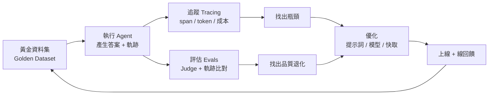
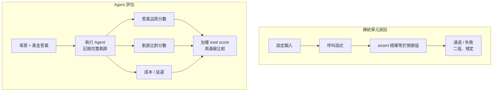
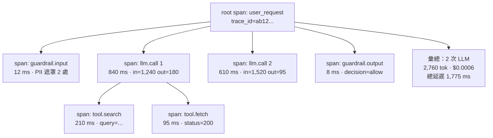

# 第 12 章：評估（Evals）、可觀測性與持續優化

走到這裡，你的 Agent（代理人）已經會規劃、會用工具、有記憶、有護欄。但「它看起來很棒」不是工程結論。這一章談怎麼把直覺變成數字：用追蹤看懂每一次 LLM 呼叫，用評估取代注定崩潰的單元測試，再用 LLM-as-a-Judge 與軌跡比對建立可回歸的品質關卡。最後，我們把整趟從 API 到代理人的旅程，收束成一條持續優化的循環。

> 本章你將學到
>
> - 為什麼斷言式的單元測試無法驗證「機率性」的 Agent 行為
> - 用 span 記錄 LLM 呼叫、工具耗時與 token 消耗，建立全鏈路追蹤
> - 設計 LLM-as-a-Judge 與軌跡評估，把主觀品質變成可回歸的分數
> - 用模型蒸餾、快取與分層路由把成本曲線壓下來
> - 把評估、上線、回饋串成持續優化的閉環



---

## 問題場景：CI 全綠，使用者卻在抱怨

某個週二，團隊為客服 Agent 加了一批單元測試，CI 全綠，大家放心地部署。隔天早上，客服主管傳來訊息：「它開始亂回答退款問題了。」

工程師打開測試，第一條寫的是：

```python
assert agent.answer("退款期限多久？") == "退款期限為 7 天"
```

而 Agent 實際回的是：「下單後一週內都可以申請退款喔！」——語意完全正確，字串完全不同。測試掛了，但產品是好的。更尷尬的是另一個案例：Agent 選錯了工具，查詢了「舊版定價表」，但因為新版定價恰好相同，最終答案「碰巧正確」。測試過了，過程卻是錯的。

直覺解法是「多寫幾個 assert」或「把模型 mock 掉」。但這兩條路都走不通：

- **不 mock**：模型輸出隨 temperature、模型版本、提示詞微調而漂移，今天通過的精確字串比對，明天就可能失敗。你不是在測行為，而是在測隨機種子。
- **mock 模型**：你把所有不確定性都 mock 掉了，等於完全沒測到 Agent 真正的決策邏輯——而那正是最容易出錯的地方。

另一個晚上，雲端帳單突然是昨天的五倍。工程師翻遍日誌，只看到一行又一行的 `INFO: LLM call done`，沒有 token 數、沒有模型名稱、沒有耗時。他根本無法回答「是哪個功能、哪個提示詞、哪個客戶把成本吃掉的」。

問題的根在於：**傳統單元測試的前提是「相同輸入 → 相同輸出」，而 Agent 打破了這個前提。** 它不只輸出機率性，還有多步驟的「軌跡」、外部 tool 的副作用、以及隨時間變化的狀態。當輸出不再是單值，而是一段過程，測量單位就必須跟著改變。我們要量的不是「字串一不一樣」，而是四件事：**答案對不對、路徑對不對、花了多少錢、花了多少時間**。

---

## 核心設計模式

### 12.1 為什麼傳統單元測試在 Agent 時代失效了？

測試失效不是因為工程師偷懶，而是因為被測對象變了。兩者差異可以從五個維度看清：

| 維度 | 傳統軟體 | Agent 系統 |
|---|---|---|
| 輸入 → 輸出 | 確定性，可精確比對 | 機率性，同輸入不同輸出 |
| 關注單位 | 單一函式回傳值 | 答案 + 工具調用序列（軌跡） |
| 狀態 | 多為無狀態 | 有記憶、有上下文、有外部副作用 |
| 成本與時間 | 近乎忽略 | 每次呼叫都要錢，延遲可達數秒 |
| 失敗型態 | 崩潰或 assert 失敗 | 答案「看起來對」但其實錯了 |



新的評估單位是「**結果 + 軌跡 + 成本 + 延遲**」的組合。實務上分成三層，各有不同的成本與穩定性：

1. **元件層（Component）**：測工具 Schema、提示詞模板、Pydantic 契約。這裡依然可以用傳統測試——因為程式碼是確定性的。第 2 章的資料萃取器就屬於這一層。
2. **任務層（Task）**：單輪問答，用黃金資料集比對答案與工具選擇。這是評估和回歸的主力。
3. **端到端層（End-to-End）**：多輪對話或多代理人協作，評的是整體目標是否達成。成本高、雜訊大，通常只跑 nightly。

關鍵心法：**把「主觀品質」轉成「有 rubric 的分數」，再把「分數」轉成「可回歸的門檻」。** 門檻不是要求滿分，而是「不能比上週差超過 3%」。

### 12.2 全鏈路追蹤（Tracing）：看懂每一次呼叫

追蹤（Trace）是一棵由 span 組成的樹。一個 root span 代表一次使用者請求，底下掛起 LLM 呼叫、工具執行、RAG 檢索、護欄掃描等 child span。每個 span 至少記錄：名稱、開始與結束時間、父 span id、模型名稱、輸入與輸出 token、工具參數（已遮罩）、錯誤訊息，以及推算出的成本。



有了這棵樹，你能回答原本無解的問題：「為什麼這個請求要 1.8 秒？」——看一眼就知道是 `llm.call #1` 加兩次工具，而不是模型慢。「成本暴衝是誰造成的？」——按 span 聚合 token，立刻找到某個提示詞在迴圈裡被呼叫了 40 次。

成本公式很直觀：`input_tokens / 1e6 × 輸入單價 + output_tokens / 1e6 × 輸出單價`。但有三個坑：快取讀取的 token 單價通常只有十分之一；不同模型單價不同；定價會改。所以定價表要外部化、標註版本，而不是寫死在程式裡。

採樣策略也要設計。全量追蹤在高流量下本身就是成本，常見做法是：錯誤請求 100% 保留、超過延遲閾值的 100% 保留、其餘用頭部採樣 5–10%。若你用了 OpenTelemetry，span 的命名與屬性應遵循 GenAI semantic conventions，方便日後接到 Jaeger、Datadog 或 LangSmith。

### 12.3 自動化評估體系：Judge、軌跡與降本

**LLM-as-a-Judge** 是用一個較強的模型（例如 GPT-4o）當評審，依據 rubric 對答案打分。它解決了「精確字串比對」的窘境：標準答案是「一週內」，Agent 回「七天內」，judge 能判斷語意相同。但 judge 本身也有偏見——位置偏見（偏好第一個選項）、長度偏見（偏好長回答）、自我偏好（偏好自己模型寫的東西）。解法是：匿名化答案順序、隨機交換位置、多次投票取中位數，並定期用人工標註校準 judge 的準確率。

**軌跡評估（Trajectory Eval）** 比對的是工具調用的序列，而不是最終答案。它回答「Agent 是不是用對方法到達對的結果」。比對方式從嚴格到寬鬆：精確比對（工具名 + 參數完全一致）、序列比對（用 LCS 允許插入多餘但無害的步驟）、或讓 judge 判斷路徑是否合理。軌跡分數能抓出「答案碰巧對、過程全錯」的隱形缺陷。

**模型蒸餾降本路線** 則是把高品質變成低成本：

1. 用最強模型 + judge 過濾，產出一批高品質黃金軌跡。
2. 把這些軌跡轉成 few-shot 範例，餵給便宜模型；或直接用來微調小模型。
3. 在上線路由做分層：簡單問題走小模型，複雜問題才升級大模型——而「複雜度」本身可以由一個便宜的分類器判斷。
4. 搭配第 7 章的 Prompt Caching，把重複的系統提示詞成本壓低 80%。

這條路線的信心，來自評估體系：沒有 judge 與軌跡分數，你根本不知道蒸餾後的小模型在哪一步開始變笨。

---

## 原生程式碼實作

以下三個檔案分別是「追蹤器」「Judge」「軌跡比對」，最後用一個 runner 把它們串起來。

> 以 Python 3.11+、openai-python v1.x 為例。定價表僅為示意，請以官方定價頁為準。

### `obs/tracing.py`：手刻一個 span 追蹤器

```python
from __future__ import annotations

import json
import time
import uuid
from contextlib import contextmanager
from dataclasses import dataclass, field
from typing import Any, Iterator

# 範例定價（USD / 1M tokens）；上線前請改為設定檔並標註版本。
PRICING: dict[str, dict[str, float]] = {
    "gpt-4o-mini": {"in": 0.15, "out": 0.60},
    "gpt-4o": {"in": 2.50, "out": 10.00},
}


@dataclass
class Span:
    trace_id: str
    span_id: str
    parent_id: str | None
    name: str
    start_ms: int
    end_ms: int | None = None
    attributes: dict[str, Any] = field(default_factory=dict)
    tokens_in: int = 0
    tokens_out: int = 0
    error: str | None = None

    @property
    def duration_ms(self) -> int:
        return (self.end_ms or 0) - self.start_ms

    @property
    def cost_usd(self) -> float:
        price = PRICING.get(str(self.attributes.get("model")), {"in": 0.0, "out": 0.0})
        return self.tokens_in / 1_000_000 * price["in"] + self.tokens_out / 1_000_000 * price["out"]


class Tracer:
    """最小可用的巢狀追蹤器；概念與 OpenTelemetry 一致。"""

    def __init__(self) -> None:
        self.trace_id = uuid.uuid4().hex
        self.spans: list[Span] = []
        self._stack: list[str] = []

    @contextmanager
    def span(self, name: str, **attrs: Any) -> Iterator[Span]:
        item = Span(
            trace_id=self.trace_id,
            span_id=uuid.uuid4().hex[:16],
            parent_id=self._stack[-1] if self._stack else None,
            name=name,
            start_ms=int(time.time() * 1000),
            attributes=attrs,
        )
        self.spans.append(item)
        self._stack.append(item.span_id)
        try:
            yield item
        except Exception as exc:
            item.error = f"{type(exc).__name__}: {exc}"
            raise
        finally:
            item.end_ms = int(time.time() * 1000)
            self._stack.pop()

    def export(self, path: str) -> dict[str, Any]:
        summary = {
            "trace_id": self.trace_id,
            "span_count": len(self.spans),
            "tokens_in": sum(s.tokens_in for s in self.spans),
            "tokens_out": sum(s.tokens_out for s in self.spans),
            "cost_usd": round(sum(s.cost_usd for s in self.spans), 6),
            "duration_ms": max((s.end_ms or s.start_ms) for s in self.spans)
            - min(s.start_ms for s in self.spans),
        }
        with open(path, "w", encoding="utf-8") as fh:
            json.dump(
                {"summary": summary, "spans": [s.__dict__ for s in self.spans]},
                fh, ensure_ascii=False, indent=2,
            )
        return summary
```

### `eval/judge.py`：LLM-as-a-Judge

```python
from __future__ import annotations

import os

from dotenv import load_dotenv
from openai import OpenAI
from pydantic import BaseModel, Field

load_dotenv()
client = OpenAI(api_key=os.environ["OPENAI_API_KEY"])

RUBRIC = """你是一位嚴格但公平的評審。請依下列面向給 1–5 分：
1. 正確性：答案是否符合事實與標準答案？
2. 完整性：是否遺漏使用者要求的重要資訊？
3. 簡潔性：是否避免不必要的贅詞？
請只看語義，不要因用字不同而扣分。不要因為答案較長就給高分。"""


class Judgment(BaseModel):
    score: int = Field(ge=1, le=5, description="依評分標準給 1–5 分")
    rationale: str = Field(description="簡要說明扣分原因")


def judge_answer(question: str, reference: str, answer: str, *, votes: int = 3) -> Judgment:
    results: list[Judgment] = []
    candidates = [answer] * votes
    # 參考答案以中性標題呈現；同一候選重複評分以降低單次隨機性
    for candidate in candidates:
        try:
            response = client.beta.chat.completions.parse(
                model="gpt-4o",
                messages=[
                    {"role": "system", "content": RUBRIC},
                    {
                        "role": "user",
                        "content": (
                            f"問題：{question}\n"
                            f"參考資訊：{reference}\n"
                            f"待評答案：{candidate}\n"
                            "請給分並說明理由。"
                        ),
                    },
                ],
                response_format=Judgment,
                temperature=0,
                timeout=30,
            )
            parsed = response.choices[0].message.parsed
            if parsed is not None:
                results.append(parsed)
        except Exception:
            # 單次失敗不應讓整個評估崩掉；全部失敗才在下方拋出
            continue

    if not results:
        raise RuntimeError("所有 judge 呼叫都失敗，請檢查 API 金鑰與網路")

    results.sort(key=lambda item: item.score)
    return results[len(results) // 2]  # 中位數投票，降低單次評審的隨機性
```

### `eval/trajectory.py`：軌跡比對

```python
from __future__ import annotations

from dataclasses import dataclass


@dataclass(frozen=True)
class Step:
    tool: str
    # args 轉成排序後的 (key, value) tuple，避免字典順序造成假失敗
    args: tuple[tuple[str, str], ...] = ()


def lcs_length(actual: list[Step], expected: list[Step]) -> int:
    """最長共同子序列長度：容忍多餘但無害的步驟，同時保留順序。"""
    n, m = len(actual), len(expected)
    dp = [[0] * (m + 1) for _ in range(n + 1)]
    for i in range(1, n + 1):
        for j in range(1, m + 1):
            if actual[i - 1] == expected[j - 1]:
                dp[i][j] = dp[i - 1][j - 1] + 1
            else:
                dp[i][j] = max(dp[i - 1][j], dp[i][j - 1])
    return dp[n][m]


def trajectory_score(actual: list[Step], expected: list[Step]) -> float:
    """回傳 0–1 的 F1 分數，同時懲罰多餘的步驟與漏掉的步驟。"""
    if not expected:
        return 1.0 if not actual else 0.0
    matched = lcs_length(actual, expected)
    precision = matched / len(actual) if actual else 0.0
    recall = matched / len(expected)
    return 0.0 if precision + recall == 0 else 2 * precision * recall / (precision + recall)
```

### `eval/run_eval.py`：把所有東西串成一條回歸管線

```python
from __future__ import annotations

import os
from dataclasses import dataclass

from dotenv import load_dotenv
from openai import OpenAI

from eval.judge import judge_answer
from eval.trajectory import Step, trajectory_score
from obs.tracing import Tracer

load_dotenv()
client = OpenAI(api_key=os.environ["OPENAI_API_KEY"])


@dataclass(frozen=True)
class Case:
    question: str
    reference: str
    expected_tools: list[Step]


def my_agent(question: str, tracer: Tracer) -> tuple[str, list[Step]]:
    """示範 Agent：把你的實作換進來即可，重點是 token 要寫回 span。"""
    answer = ""
    steps: list[Step] = []
    with tracer.span("llm.call", model="gpt-4o-mini") as sp:
        response = client.chat.completions.create(
            model="gpt-4o-mini",
            messages=[{"role": "user", "content": question}],
            timeout=30,
        )
        if response.usage:
            sp.tokens_in = response.usage.prompt_tokens
            sp.tokens_out = response.usage.completion_tokens
        answer = response.choices[0].message.content or ""
    return answer, steps


def run_case(case: Case) -> dict[str, object]:
    tracer = Tracer()
    with tracer.span("user_request") as root:
        answer, actual_tools = my_agent(case.question, tracer)
        root.attributes["question"] = case.question[:200]

    summary = tracer.export(f"traces/{tracer.trace_id}.json")
    judged = judge_answer(case.question, case.reference, answer)
    path_score = trajectory_score(actual_tools, case.expected_tools)
    return {
        "judge_score": judged.score,
        "trajectory_score": round(path_score, 3),
        "cost_usd": summary["cost_usd"],
        "duration_ms": summary["duration_ms"],
        "trace_id": tracer.trace_id,
        "rationale": judged.rationale,
    }


def main() -> None:
    cases = [
        Case(
            question="退款期限多久？",
            reference="下單後七天內可申請退款。",
            expected_tools=[Step(tool="search_policy", args=(("topic", "refund"),))],
        ),
        Case(
            question="我的訂單 A123 到哪了？",
            reference="訂單 A123 已出貨，預計明天送達。",
            expected_tools=[Step(tool="get_order", args=(("order_id", "A123"),))],
        ),
    ]
    results = [run_case(case) for case in cases]
    for row in results:
        print(row)
    avg_judge = sum(int(r["judge_score"]) for r in results) / len(results)
    if avg_judge < 4.0:
        raise SystemExit(f"[eval] 品質退化：平均 judge 分數 {avg_judge:.2f} < 4.0")


if __name__ == "__main__":
    main()
```

> **何時用 `asyncio`？** 上面的案例是依序執行的。Golden dataset 有幾百筆時，改用 `AsyncOpenAI` + `asyncio.gather`，並以 `asyncio.Semaphore(5)` 限制並行，避免把 judge 自己的速率限制打爆；每個 `await` 都包上 `asyncio.wait_for` 逾時。

---

## 生產環境踩坑指南

### 坑 1：拿精確字串比對當評估

- **症狀**：模型回了語意相同的句子，CI 卻失敗；工程师開始「調 prompt 遷就測試」。
- **原因**：把隨機輸出當成确定性函式。
- **解法**：答案層用 judge 或語意相似度；只有工具參數、枚舉值這類契約才用精確比對。

### 坑 2：Judge 有自己的偏好

- **症狀**：換了 judge 模型，分數整體上升 0.5，但品質沒變。
- **原因**：位置偏見、長度偏見、自我偏好（見 12.3 節）。
- **解法**：匿名化、隨機順序、三次投票取中位數；每季用 100 筆人工標註校準 judge 與人的一致率，低於 80% 就換 rubric 或換模型。

### 坑 3：追蹤資料本身變成外洩點

- **症狀**：Trace 平台裡可以直接搜到使用者的身分證號。
- **原因**：工具參數被原封不動寫進 span attributes。
- **解法**：沿用第 11 章的 `PIIRedactor`，在寫入 span 前先遮罩；設定採樣率與保留期限；Trace 平台納入存取權限控管。

### 坑 4：只看最終答案，不看軌跡

- **症狀**：使用者客訴「它查錯資料」，但評估分數全部合格。
- **原因**：Agent 碰巧用錯誤資料得到正確答案，答案層看不出來。
- **解法**：把 `trajectory_score` 加入門檻，且對「高風險工具」（付款、寄信）要求精確比對，不允許用 LCS 寬容。

### 坑 5：成本算不準

- **症狀**：追蹤顯示 $0.12，帳單卻是 $0.30。
- **原因**：忽略快取讀取折扣、模型更名、或系統提示詞被重複計費。
- **解法**：定價表外部化並標註生效日期；另外記錄 cache read tokens；每月用帳單總額反校正追蹤數字。

### 坑 6：門檻太嚴，團隊不敢改東西

- **症狀**：每次改 prompt 都可能讓 CI 紅燈，最後大家乾脆跳過評估。
- **原因**：把「平均分」當成唯一門檻，沒有區分核心與邊緣案例。
- **解法**：分層門檻——核心 20 題必須全過，其餘只警告；門檻用「相較上週退化不超過 3%」而非絕對滿分；黃金資料集每季更新一次，避免過擬合舊案例。

---

## 小結

回頭看這趟旅程：第 1 章，我們盯著一個無狀態的 API，發現它只是「文字進、文字出」；第 2 章讓它的話能被程式讀懂；第 3、4 章給了它雙手與標準協定；第 5、6 章用一個 `while` 迴圈與四種模式讓它自主運轉；第 7、8 章替它裝上記憶；第 9、10 章讓它學會與同伴協作；第 11 章，我們給它套上護欄與剎車；而這一章，我們終於學會**量測它**。

- 傳統單元測試假設確定性，Agent 卻是機率性、有軌跡、有副作用的系統；量的單位必須從「字串」變成「答案 + 軌跡 + 成本 + 延遲」。
- 追蹤把黑盒拆成一棵 span 樹，讓「為什麼慢」「誰把錢花掉」從猜測變成讀圖。
- LLM-as-a-Judge 與軌跡比對，把主觀品質轉成可回歸的分數；但要校正 judge 的偏見，不能盲信。
- 模型蒸餾、分層路由與 Prompt Caching 是降本三件套，而它們的信心都來自評估體系。
- 安全（第 11 章）與評估（第 12 章）是一體兩面：護欄防止災難，評估確保進步；沒有評估，你連「更安全了」都無法證明。
- **評估不是畢業典禮，而是每日例行。** 從 API 到代理人的路沒有終點，只有一再重複的「觀察 → 評估 → 改進 → 上線」循環。

恭喜你走到全書最後一章。現在你手裡不再只是一個會聊天的模型，而是一個可拆解、可觀測、可信賴的系統——這正是「工程」與「Demo」的分界線。

## 練習題

1. **入門**：拿第 12.1 節的「退款期限」案例，把 `assert` 精確比對改成 `judge_answer()`，觀察它如何接受語意相同但字串不同的回答。
2. **中等**：在 `my_agent()` 裡加入一次假的 `tool.search` span（可用 `time.sleep(0.1)` 模擬耗時），執行 `run_eval()` 後開啟產生的 `traces/*.json`，畫出類似 12.2 節的 span 樹並算出總成本。
3. **進階**：設計一個蒸餾實驗：用 `judge_answer()` 過濾出高分軌跡，把其中 5 條轉成 few-shot 範例，比較「小模型 + few-shot」與「大模型」在平均分與成本上的差異，寫出你的降本結論。

## 延伸閱讀

- [OpenAI Evals（官方評估框架原始碼）](https://github.com/openai/evals)——可直接執行的 eval 範例與自建 eval 教學。
- [Judging LLM-as-a-Judge with MT-Bench and Chatbot Arena](https://arxiv.org/abs/2306.05685)——系統性分析 judge 的位置、長度與自我偏好偏見。
- [OpenTelemetry GenAI Semantic Conventions](https://opentelemetry.io/docs/specs/semconv/gen-ai/)——LLM 追蹤屬性的業界標準，方便串接既有 observability 平台。
- [LangSmith Observability 文件](https://docs.langchain.com/langsmith/observability)——追蹤與線上班級評估的實作參考。
